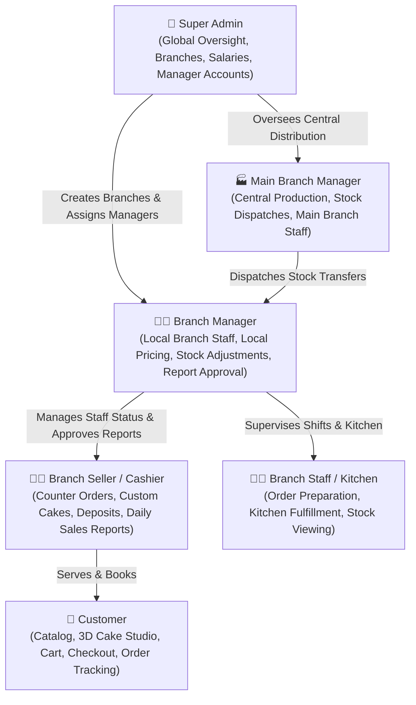
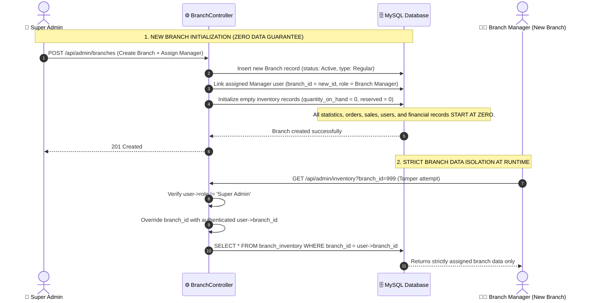
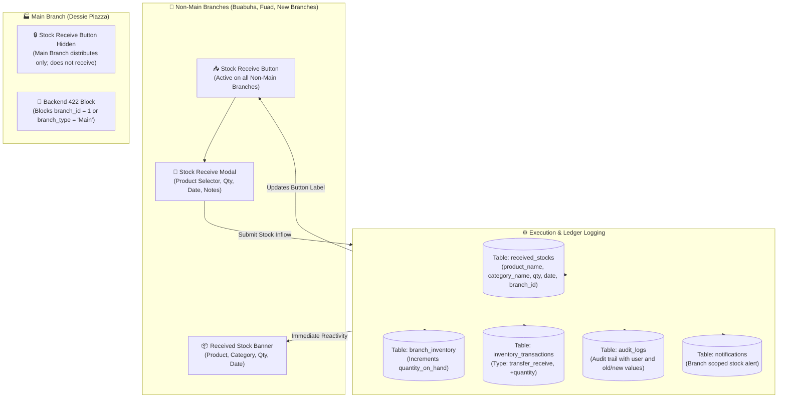
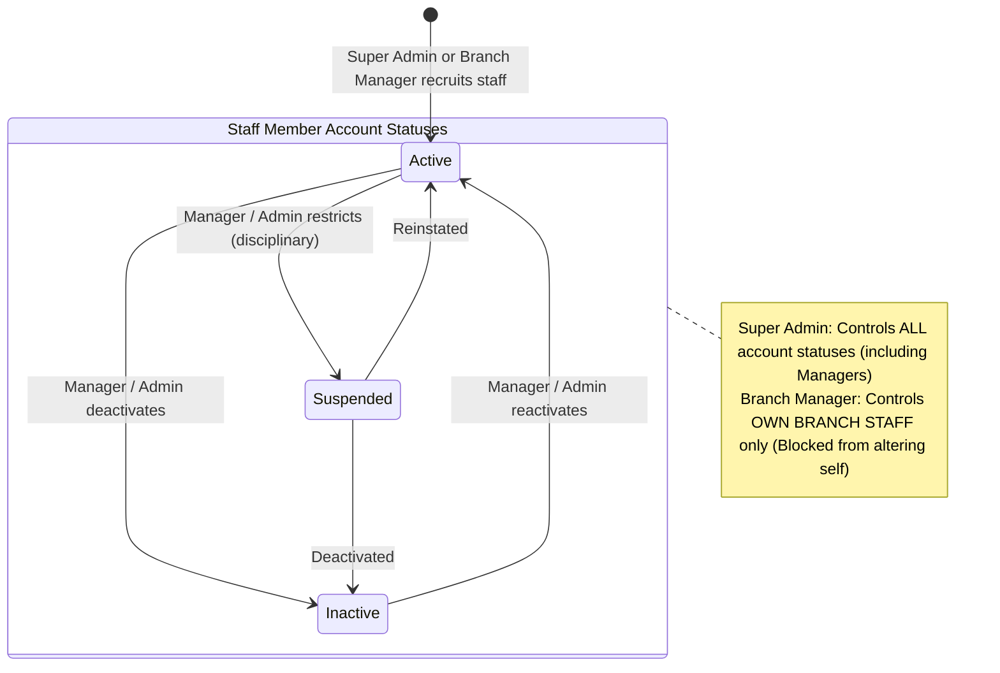
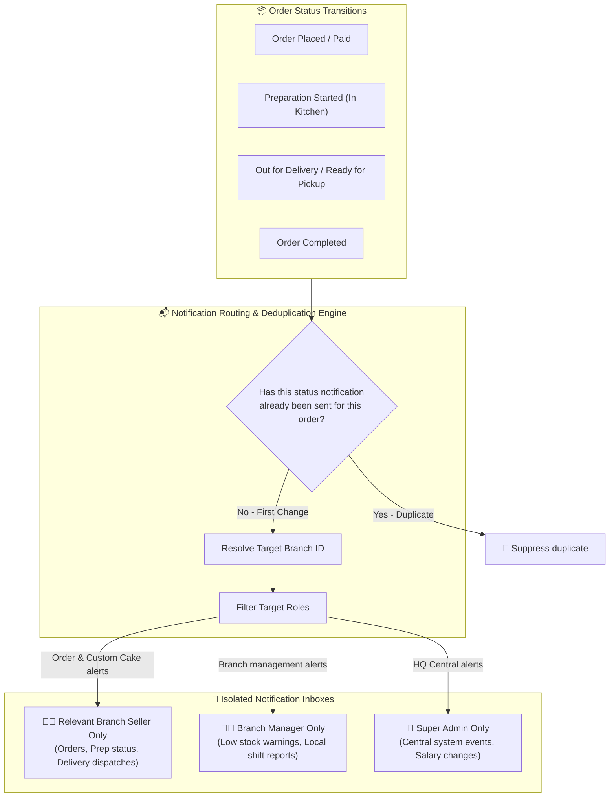
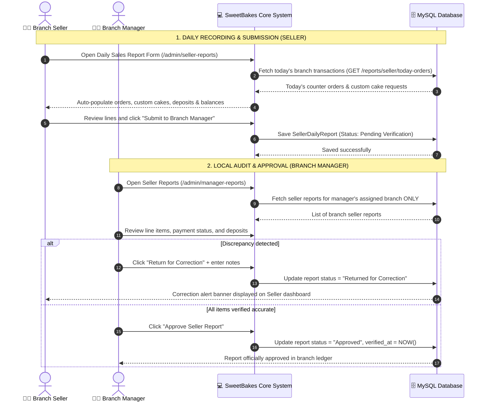
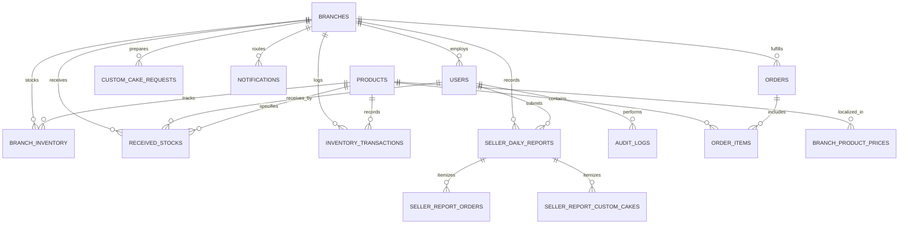

# 🧁 SweetBakes Bakery Management & E-Commerce Platform
## Comprehensive Technical, Architectural & Functional Documentation

> **Platform Version:** 4.0 Enterprise (Release 2026.11.10)  
> **Backend Architecture:** Laravel 11 / PHP 8.2+ / REST API / Eloquent ORM  
> **Frontend Architecture:** Vue.js 3 (Composition API) / Vite / Tailwind CSS / Pinia  
> **Database:** MySQL / MariaDB (InnoDB, Strict Relational Constraints, 33+ Tables)  
> **Design Standard:** Warm Luxury Bakery Visual System (Chocolate `#3D251E`, Terracotta `#BA5420`, Blush `#FAF7F2`, `#FFF5F2` gradients)

---

## 1. Executive Overview & System Purpose

The **SweetBakes Bakery Management & E-Commerce Platform** is an enterprise multi-branch bakery ecosystem engineered to unify digital storefront sales, branch-level retail operations, independent branch governance, centralized corporate oversight, and automated inventory logistics:

1. **Customer E-Commerce Storefront:** Enables customers to select their nearest branch, explore real-time inventory, place bakery retail orders, design bespoke celebration cakes in an interactive 3D studio, track delivery progress with live milestone steppers, and enjoy a refined homepage with smooth typing and scroll animations.
2. **Branch Retail & Seller Operations:** Equips Branch Sellers and Cashiers with tools to record in-store counter orders, custom cake bookings, customer advance deposits, and submit structured Daily Sales Reports with auto-calculation safeguards.
3. **Autonomous Branch Management:** Empowers Branch Managers with isolated branch-level oversight: independent branch product pricing, staff account lifecycle management (`Active`, `Inactive`, `Suspended`), physical stock adjustments, seller report approval/rejection, and local shift reporting.
4. **Stock Receive Logistics Engine:** Provides dedicated stock inflow processing for all regional branches (excluding the Main Production Branch) with real-time on-button and banner status tracking (Product Name, Category, Received Quantity, Date Received).
5. **Headquarters Centralized Governance:** Empowers the Super Admin to oversee multi-branch revenue, initialize new branches with zero-data isolation guarantees, manage manager accounts, configure employee salaries, and monitor business-wide audit and inventory transaction ledgers.

---

## 2. System Architecture & Technology Stack

```mermaid
flowchart TD
    subgraph ClientLayer["🖥️ Frontend Client Layer (Vue.js 3 + Vite)"]
        CustomerUI["Customer Storefront\n(Animated Home, Shop, 3D Cake Builder, Cart, Checkout)"]
        SellerUI["Branch Seller Portal\n(Orders, Custom Cakes, Daily Sales Report, Local Notifications)"]
        ManagerUI["Branch Manager Portal\n(Staff Status, Branch Pricing, Inventory, Stock Receive, Report Approval)"]
        AdminUI["Super Admin Portal\n(Central KPIs, Branch Management, Salaries, System Logs)"]
    end

    subgraph SecurityLayer["🛡️ Security, RBAC & Isolation Layer"]
        SanctumAuth["Sanctum Bearer Token Authentication"]
        RBACMiddleware["RoleAuthorizationMiddleware\n(Super Admin, Managers, Sellers, Staff)"]
        BranchIsolation["Strict Branch Data Isolation Guard\n(Cryptographic Session & DB Scoping)"]
        StatusGuard["Account Status Protection Guard\n(Anti-Tamper & Hierarchy Enforcement)"]
    end

    subgraph BackendLayer["⚙️ Backend REST API Controllers (Laravel 11)"]
        OrderCtrl["Order & Custom Cake Controllers"]
        ReportCtrl["OrderReportController (Branch Review & Approval)"]
        StockRcvCtrl["ReceivedStockController (Branch Inflow Engine)"]
        CatalogCtrl["Catalog & Branch Pricing Controller"]
        InventoryCtrl["Inventory & Stock Ledger Controller"]
        BranchCtrl["Branch Management Controller (Fresh Init)"]
        UserCtrl["User, Staff & Salary Controller"]
        NotifyCtrl["NotificationController (Role & Branch Router)"]
    end

    subgraph DatabaseLayer["🗄️ Relational Database (MySQL InnoDB)"]
        CoreDB[("kenan_cake_db\n(33+ Relational Tables,\nStrict Foreign Keys, Row-Level Locking)")]
    end

    ClientLayer --> SecurityLayer
    SecurityLayer --> BackendLayer
    BackendLayer --> DatabaseLayer
```



### Core Technologies:
- **Backend Framework:** Laravel 11 running on PHP 8.2+.
- **Authentication:** Laravel Sanctum issuing stateless Bearer tokens with token expiration and multi-role authorization middleware (`RoleAuthorizationMiddleware`).
- **Database Engine:** MySQL InnoDB with strict foreign key constraints, atomic transactions (`DB::transaction()`, `lockForUpdate()`), and soft deletes on critical entities.
- **Frontend Framework:** Vue 3 using the Composition API (`<script setup>`), Vue Router 4 with strict role navigation guards, Pinia for reactive store management, and Vite for lightning-fast bundling.
- **Styling & Design System:** Tailwind CSS with warm luxury bakery design tokens:
  - **Dark Chocolate Primary:** `#3D251E` (Headers, Primary Buttons, Sidebar Background)
  - **Warm Terracotta Accent:** `#BA5420` (CTA buttons, highlight badges, interactive controls)
  - **Forest Emerald Action:** `#047857` / `#059669` (Stock Receive features, approved badges)
  - **Cream Canvas:** `#FAF7F2` (Warm background canvas)
  - **Soft Blush Header:** Gradient `from-[#FFF5F2] via-[#FFF0EC] to-[#FCE7E1]` with border `#F7E1D7`
  - **Headings Font:** `font-serif` (Playfair Display)
  - **Body & Numeric Font:** `font-poppins` (Poppins)

---

## 3. User Roles, Permissions & Scoping Hierarchy (RBAC)

The platform enforces strict, multi-tiered Role-Based Access Control (RBAC) across frontend navigation, API routes, controller logic, and database query builders:



### Role Matrix & Authority Boundaries:

| Role | Operational Scope | Storefront / Admin | Orders & Custom Cakes | Stock Receive | Staff Status Governance | Daily Sales Report Responsibility |
|---|---|---|:---:|:---:|---|---|
| **Super Admin** | Whole Business (All Branches) | Admin Portal | ❌ *Removed for Clean Governance* | ❌ *(Central Distribution)* | Full control over all Manager, Seller, and Staff account statuses (`Active`, `Inactive`, `Suspended`). | Central multi-branch overview & audit logs. |
| **Main Branch Manager** | Main Branch Only | Admin Portal | ❌ *(Retail handled by Sellers)* | ❌ *(Main Branch Dispatches)* | Manages staff within Main Branch only. Cannot alter own status. | Reviews Main Branch counter reports. |
| **Branch Manager** | Assigned Branch Only | Admin Portal | ❌ *Omitted from dashboard to focus on leadership* | ✅ **Full Access** *(Receive Inflow)* | Can activate, deactivate, or suspend staff in **own branch only**. **Cannot change own status**. | **Exclusively reviews, approves, or rejects** local seller reports. |
| **Branch Seller / Cashier** | Assigned Branch Only | Admin Portal | ✅ **Full Daily Recording** | ❌ *(Managed by Manager/Supervisor)* | No staff status permissions. | Records sales, books cakes, and **submits Daily Sales Reports** to Manager. |
| **Branch Staff / Servant** | Assigned Branch Only | Admin Portal | Order prep only | View only | No staff status permissions. | Kitchen prep and shift logs. |
| **Customer** | Public Storefront | Storefront | View own placed orders | ❌ | Self profile only. | None. |

> [!IMPORTANT]
> **Core Role Governance Updates (Release 4.0):**
> 1. **Super Admin Dashboard:** Order and Custom Order management queues are completely removed from the Super Admin dashboard. These features belong exclusively to Branch Sellers and Branch Managers.
> 2. **Branch Sales Reports:** Branch sales reports are no longer submitted to the Super Admin. The Branch Manager is responsible for reviewing, auditing, and approving/rejecting all sales reports within their branch.
> 3. **Manager Account Status Self-Protection:** Branch Managers cannot modify their own status (`Active`, `Inactive`, `Suspended`). Only the Super Admin can modify a Branch Manager's status.
> 4. **Branch Staff Isolation:** Branch Managers can only alter the status of staff members belonging to their own branch. Attempts to alter cross-branch staff accounts return HTTP 403.

---

## 4. Branch Management & Data Isolation Architecture

To ensure multi-tenant security and operational autonomy across expanding branch networks, the platform enforces strict branch data isolation:



### Key Isolation Guarantees:
1. **Fresh & Empty Initialization:**
   - Whenever the Super Admin creates a new branch, it starts with **completely fresh and empty data**.
   - All statistics, sales, counter orders, custom cakes, staff lists, and financial ledgers start at exactly **zero**.
   - Never copies or inherits data from existing branches. Data accumulates only as new transactions are performed at that specific branch.
2. **Backend Controller Enforcement:**
   - Non-Super Admin requests automatically have their target `branch_id` overridden by `$request->user()->branch_id`.
   - Modifying query strings (`?branch_id=X`) or payload attributes in API calls cannot bypass branch isolation.
3. **Database Query Scoping:**
   - Every operational model (`Order`, `CustomCakeRequest`, `SellerDailyReport`, `BranchInventory`, `ReceivedStock`, `InventoryTransaction`, `Notification`) has strict `where('branch_id', $branchId)` scoping.

---

## 5. Stock Receive Feature (Branch Inflow Engine)

The **Stock Receive** feature allows non-Main branch locations to receive incoming stock deliveries (from the central bakery, production hubs, or external suppliers) and immediately update their local on-hand inventory and audit ledgers.



### Functional Requirements & Implementation:

1. **Stock Receive Button (Requirement 1 & 3):**
   - Displayed in **every non-Main branch**, including all existing branches (e.g. Buabuha, Fuad) and any newly created branches.
   - **Main Branch Exclusion:** Hidden in the Main Branch. The Main Branch is the production and distribution center; it bakes and dispatches stock to other branches rather than receiving transfers.
2. **Received Stock Details Display (Requirement 2):**
   - When a branch receives stock, both the **Stock Receive button** and the **Received Stock Banner** prominently display the latest received stock details:
     - **Product Name** (e.g., Strawberry Shortcake)
     - **Product Category** (e.g., Cakes, Pastries, Bread)
     - **Received Quantity** (e.g., `+25 pcs`)
     - **Date Received** (e.g., `Nov 10, 2026`)
3. **Branch Compatibility (Requirement 4):**
   - Fully automated and dynamic. Any newly created branch (`branch_type = 'Regular'`) created by the Super Admin automatically inherits Stock Receive capabilities without manual code updates or ID hardcoding.
4. **Data Management & Ledger Integration (Requirement 5):**
   - Stored in the dedicated `received_stocks` table with foreign key `branch_id`.
   - Each branch only accesses its own received stock history via `GET /api/admin/received-stocks`.
   - **Atomic Inflow Processing:** Executed inside a database transaction:
     - Increments `branch_inventory.quantity_on_hand`.
     - Logs an immutable `inventory_transactions` row with `transaction_type = 'transfer_receive'`.
     - Records an entry in `audit_logs`.
     - Emits a branch-scoped notification for branch staff.

---

## 6. Staff Account Status & Governance Hierarchy

To maintain staff discipline and organizational integrity, employee account status management is regulated by strict hierarchical controls:



### Account Status Lifecycle:
- `Active`: Employee has full portal access according to their assigned role.
- `Inactive`: Account is disabled; employee cannot log in or record transactions.
- `Suspended`: Account is temporarily restricted pending operational or audit review.

### Strict Governance Rules:
1. **Branch Manager Account Protection:**
   - Branch Managers **must not be able to change their own account status**.
   - Only the **Super Admin** can manage, activate, deactivate, or suspend a Branch Manager's account.
   - Controller validation strictly rejects any manager self-modification requests.
2. **Branch Staff Management:**
   - Branch Managers have full authority to activate, deactivate, or restrict staff members (`Branch Seller`, `Cashier`, `Servant`, `Branch Staff`) belonging to **their own branch only**.
3. **Branch Isolation:**
   - Branch Managers cannot view, edit, or modify staff accounts belonging to any other branch.
   - Any attempt to target a staff member from another branch returns HTTP 403 Forbidden.

---

## 7. Branch Seller Notification System

The notification engine has been updated with a minimal, modern, and noise-free design, preventing duplicate alerts and routing events strictly by role and branch ID:



### Key Safeguards:
1. **Zero Duplicates:** Notifications are triggered only once per status transition (`pending` $\rightarrow$ `preparing` $\rightarrow$ `out_for_delivery` $\rightarrow$ `completed`).
2. **Super Admin Relief:** All Order and Custom Order notifications are removed from the Super Admin dashboard, eliminating noise.
3. **Branch Seller Focus:** Branch Sellers receive alerts only for orders originating at their assigned branch.
4. **Modern Minimalist UI:** Rendered with clean icons, status badges, contextual time indicators, and direct action links.

---

## 8. Customer Storefront & Homepage Animation Engine

The customer storefront combines high-performance e-commerce browsing with a warm, luxury bakery aesthetic:

### 8.1. Homepage Visual System & Interactive Typography
- **Removal of 3D Canvas:** The homepage features a clean, fast-loading, responsive luxury bakery presentation without distracting 3D elements.
- **Interactive Typing Headline:** Features a typewriter animation engine for hero headlines and slogans:
  - Dynamically types and backspaces evocative taglines (*"Handcrafted with Love"*, *"Artisan Sourdough & Custom Celebration Cakes"*, *"Freshly Baked Every Morning"*).
  - Smooth blinking cursor, realistic typing cadence, and pauses before backspacing.
- **Subtle Scroll Reveals:** Clean fade-in and smooth slide-up reveal animations applied to headings, feature cards, product grids, and action buttons.
- **Full Responsiveness:** Lightweight CSS/JS transitions designed for fast mobile loading and touch-friendly navigation.

### 8.2. Interactive 3D Custom Cake Studio ([`/custom-cake`](file:///c:/Kenan%20Cake/Client/src/views/customer/CustomCakeBuilderView.vue))
- Customers design bespoke celebratory cakes in a dedicated 3D WebGL studio:
  - **Tier Geometries:** 1 kg, 2 kg, 3 kg, or Tiered arrangements with realistic cream frosting textures and pearl border piping.
  - **3D Orbit & Turntable:** Full 360° mouse drag, touch rotation, zoom, and auto-spin turntable mode.
  - **Occasion Toppers & Ribbons:** 3D Birthday Candles with glowing flame, Wedding Interlocking Rings, Celebration Crests, and custom piped inscription ribbons.
  - **3D Snapshot Capture:** Exports high-resolution WebGL snapshot data attached to customer order requests for kitchen fulfillment and seller quotation.

### 8.3. Live Order Tracking Milestone Stepper ([`/track-order`](file:///c:/Kenan%20Cake/Client/src/views/customer/OrderTrackingView.vue))
- Customers enter order reference numbers (`ORD-xxxx` or `CCR-xxxx`) to monitor real-time fulfillment milestones:
  $$\text{Order Placed} \longrightarrow \text{Confirmed} \longrightarrow \text{In Kitchen / Preparing} \longrightarrow \text{Out for Delivery} \longrightarrow \text{Delivered}$$

### 8.4. Branch Discovery & GPS Synchronization ([`/contact`](file:///c:/Kenan%20Cake/Client/src/views/customer/ContactView.vue))
- Synchronized with the `branches` database table. Displays actual branch addresses, operating hours, phone numbers, and clickable Google Maps navigation links.

---

## 9. Branch Seller & Manager Sales Reporting Architecture



### Key Principles of Reporting:
1. **Local Approval Authority:** The Branch Manager has complete authority to review, audit, approve, or reject seller reports. Reports are no longer sent to the Super Admin.
2. **Auto-Fill Speed:** 1-click import of today's branch orders (`GET /api/admin/reports/seller/today-orders`) avoids manual re-entry errors.
3. **Protected Formulas:**
   $$\text{Total Order Amount} = \text{Quantity} \times \text{Unit Price}$$
   $$\text{Remaining Balance} = (\text{Quantity} \times \text{Unit Price}) - \text{Advance Payment}$$
   $$\text{Total Daily Sales} = \text{Regular Orders Revenue} + \text{Custom Cake Revenue}$$

---

## 10. Database Schema & Migration Architecture



### Key Relational Tables:

#### 1. `received_stocks` (Branch Stock Inflow)
| Column | Type | Description |
|---|---|---|
| `received_stock_id` | BIGINT UNSIGNED (PK) | Unique primary key for the received stock record |
| `branch_id` | BIGINT UNSIGNED (FK) | Target destination branch receiving the stock |
| `product_id` | BIGINT UNSIGNED (FK) | Bakery product received |
| `product_name` | VARCHAR(255) | Name of the received product |
| `category_name` | VARCHAR(255) | Category name (e.g., Cakes, Pastries, Bread) |
| `quantity_received`| INT UNSIGNED | Positive integer representing units received |
| `date_received` | DATE | Date the shipment was received at the branch |
| `received_by` | BIGINT UNSIGNED (FK) | User ID of staff/manager accepting delivery |
| `receiver_name` | VARCHAR(255) | Full name of receiving personnel |
| `reference_number` | VARCHAR(100) | Delivery manifest or shipment reference code |
| `notes` | TEXT (Nullable) | Delivery observations or batch notes |
| `created_at` / `updated_at` | TIMESTAMP | Audit timestamps |

#### 2. `users` (Account Status Enhanced)
| Column | Type | Description |
|---|---|---|
| `user_id` | BIGINT UNSIGNED (PK) | Unique user identification |
| `branch_id` | BIGINT UNSIGNED (FK, Nullable) | Assigned branch location (NULL for Super Admin) |
| `full_name` | VARCHAR(255) | User's full name |
| `email` | VARCHAR(255) (Unique) | Login credential |
| `role` | VARCHAR(100) | `Super Admin`, `Main Branch Manager`, `Branch Manager`, `Branch Seller`, `Cashier`, `Servant`, `Branch Staff`, `Customer` |
| `status` | ENUM('Active', 'Inactive', 'Suspended') | Account operating state |
| `salary` | DECIMAL(10,2) | Monthly remuneration managed by Super Admin |

#### 3. `branches`
| Column | Type | Description |
|---|---|---|
| `branch_id` | BIGINT UNSIGNED (PK) | Unique branch identification |
| `branch_name` | VARCHAR(255) | Name of bakery branch |
| `branch_code` | VARCHAR(50) (Unique) | Unique branch identifier (e.g. `BR-BUA`) |
| `branch_type` | ENUM('Main', 'Regular') | Main production center vs regional retail branch |
| `city` / `address` | VARCHAR(255) | Physical geographic location |
| `latitude` / `longitude` | DECIMAL(10,8) | GPS coordinates for live maps & distance calculation |
| `manager_id` | BIGINT UNSIGNED (FK) | Assigned Branch Manager |
| `status` | ENUM('Active', 'Inactive') | Branch operating status |

#### 4. `branch_inventory` & `inventory_transactions`
- `branch_inventory`: Tracks `quantity_on_hand`, `reserved_quantity`, `available_quantity` (virtual), and `reorder_level` per `(branch_id, product_id)`.
- `inventory_transactions`: Immutable log storing signed `quantity`, `transaction_type` (`production`, `transfer_dispatch`, `transfer_receive`, `order_placed`, `order_completed`, `order_cancelled`, `damaged`, `expired`, `manual_adjustment`), `reason`, and `created_by`.

---

## 11. API Route Reference

### Authentication & Public Storefront:
| Method | Endpoint | Description |
|---|---|---|
| `POST` | `/api/auth/login` | Sanctum Bearer token login (rate-limited 60/min) |
| `POST` | `/api/auth/register` | Customer account registration |
| `GET` | `/api/branches` | List active branches with GPS coordinates |
| `GET` | `/api/products` | Browse product catalog with localized branch prices |
| `POST` | `/api/orders` | Place online retail order |
| `GET` | `/api/orders/track/{number}` | Real-time milestone order tracker |
| `POST` | `/api/custom-cakes` | Submit 3D bespoke cake request with WebGL snapshot |

### Stock Receive & Inventory API:
| Method | Endpoint | Allowed Roles | Description |
|---|---|---|---|
| `GET` | `/api/admin/received-stocks` | Super Admin, Managers, Sellers, Staff | List received stocks for branch (Strictly scoped) |
| `POST` | `/api/admin/received-stocks` | Super Admin, Branch Manager, Staff | Receive stock delivery at branch (Blocked for Main Branch) |
| `GET` | `/api/admin/inventory` | Admin, Managers, Sellers, Staff | View on-hand inventory levels |
| `POST` | `/api/admin/inventory/adjust` | Super Admin, Branch Managers | Adjust physical stock counts with reason code |
| `GET` | `/api/admin/inventory/transactions` | Admin, Managers, Staff | View immutable transaction ledger |
| `GET` | `/api/admin/inventory/reconcile` | Admin, Managers | Verify inventory on-hand balance against transaction ledger |

### Branch & Staff Governance API:
| Method | Endpoint | Allowed Roles | Description |
|---|---|---|---|
| `GET` | `/api/admin/branches` | Super Admin, Managers | List branches |
| `POST` | `/api/admin/branches` | Super Admin | Create new branch with fresh zero-data initialization |
| `PATCH` | `/api/admin/branches/{id}` | Super Admin | Update branch details, manager assignment, or GPS coordinates |
| `GET` | `/api/admin/users` | Super Admin, Branch Managers | View staff members (Manager restricted to own branch) |
| `PATCH` | `/api/admin/users/{id}/status` | Super Admin, Branch Managers | Update account status (`Active`, `Inactive`, `Suspended`). Manager self-modification blocked. |
| `POST` | `/api/admin/users` | Super Admin, Branch Managers | Recruit new staff member |

### Sales Reporting API:
| Method | Endpoint | Allowed Roles | Description |
|---|---|---|---|
| `GET` | `/api/admin/reports/seller/today-orders` | Branch Sellers, Cashiers | Auto-fill today's branch transactions |
| `GET` | `/api/admin/reports/seller/my-reports` | Branch Sellers, Cashiers | View history of submitted daily reports |
| `POST` | `/api/admin/reports/seller/daily` | Branch Sellers, Cashiers | Save draft or submit Daily Sales Report |
| `GET` | `/api/admin/reports/manager/seller-reports`| Branch Managers | View seller reports for assigned branch |
| `POST` | `/api/admin/reports/manager/seller-reports/{id}/verify` | Branch Managers | Approve or return seller report with notes |

---

## 12. Verification & Quality Assurance Summary

The platform undergoes automated end-to-end testing to verify functional compliance:

1. **Stock Receive Verification:**
   - Attempting stock receive for Main Branch (`branch_id = 1` or `branch_type = 'Main'`) returns HTTP `422 Unprocessable Entity`.
   - Receiving stock for non-Main branch increments `branch_inventory.quantity_on_hand` and logs `transfer_receive` in `inventory_transactions`.
   - Data isolation verified: Branch A queries received stock and receives 0 records belonging to Branch B.
   - Newly created branches immediately support receiving stock without additional configuration.
2. **Staff Status Governance Verification:**
   - Super Admin can modify status for any user, including Branch Managers.
   - Branch Managers attempting to alter their own status are rejected with HTTP `403/422`.
   - Branch Managers attempting to alter staff belonging to another branch are rejected with HTTP `403`.
3. **Notification Routing Verification:**
   - Order notifications route exclusively to the relevant branch sellers. Super Admin receives zero order alerts.
   - Duplicate notifications are suppressed across all status changes.
4. **Build & Asset Integrity:**
   - Frontend production build compiles with Vite in under 2 seconds with zero syntax or compilation errors.
   - All 23 database migrations are active, clean, and consistent.

---

## 13. System Maintenance & Quick Start Commands

### Local Development Environment:
```bash
# 1. Start MySQL database service on port 3306 (database: kenan_cake_db)

# 2. Run database migrations
php Backend/artisan migrate

# 3. Start Laravel Backend API server
php Backend/artisan serve --port=8000

# 4. Start Vue 3 Frontend Client (Vite Dev Server)
npm --prefix Client run dev
# Running at: http://localhost:5173
```

### Production Build:
```bash
npm --prefix Client run build
```

### Default System Accounts:
- **Super Admin:** `admin@goldencrust.com` / `Password123!`
- **Main Branch Manager:** `amirhassen2027@gmail.com` / `Password123!`
- **Branch Seller / Cashier:** `amirhassen2026@gmail.com` / `Password123!`
