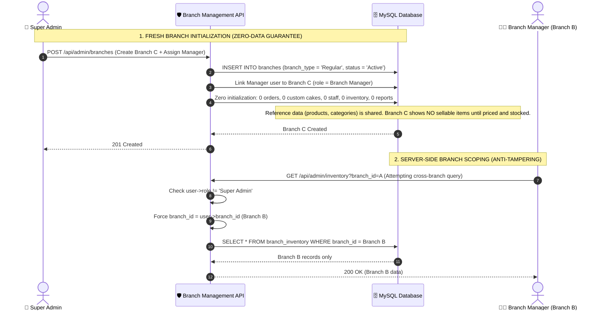
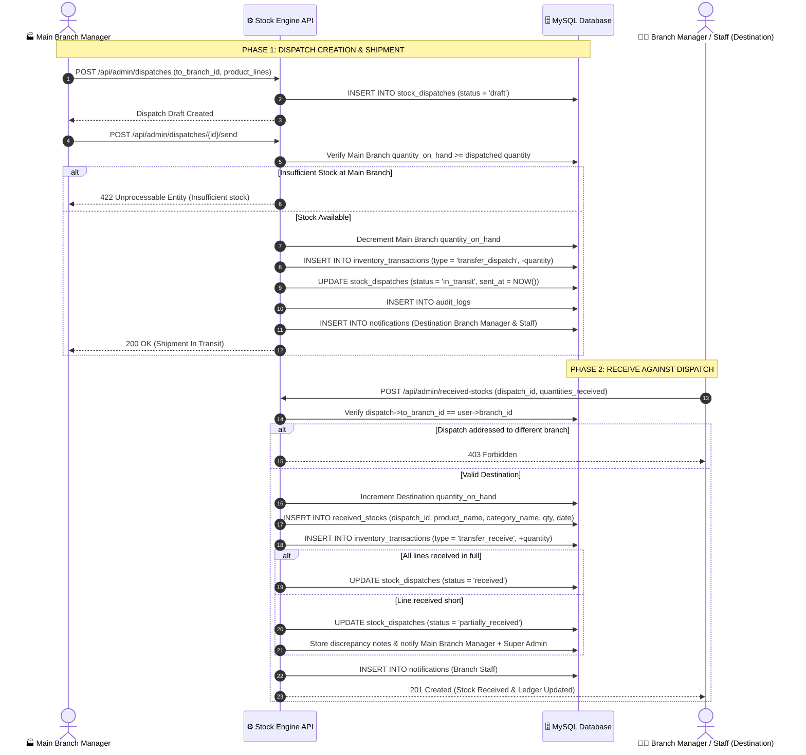
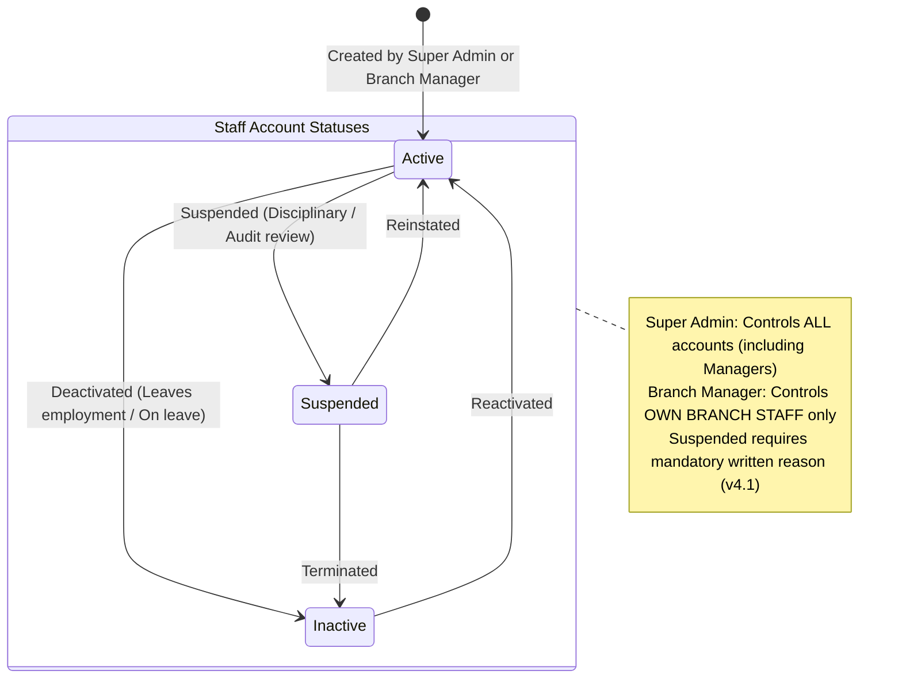
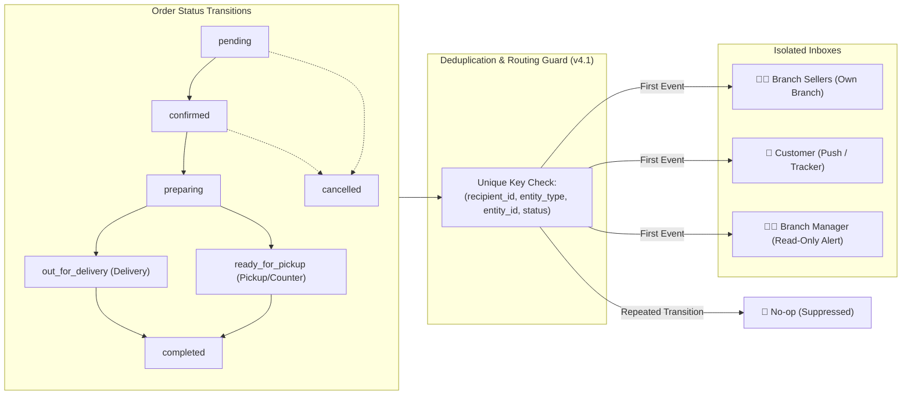
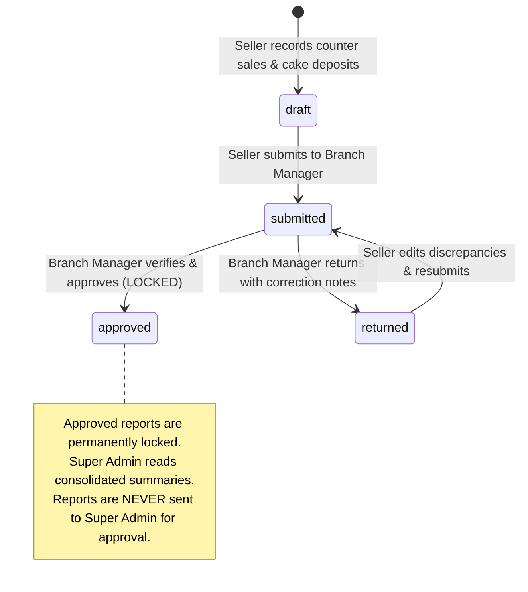
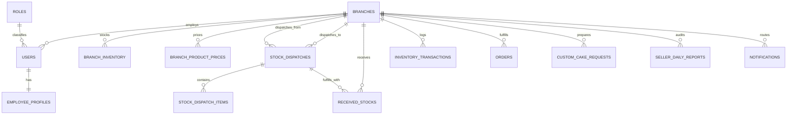

# 🧁 SweetBakes Bakery Management & E-Commerce Platform
## Comprehensive Technical, Architectural & Functional Documentation

> **Platform Version:** 4.1 Enterprise (Revision of 4.0, Release 2026.11.10)  
> **Backend Architecture:** Laravel 11 / PHP 8.2+ / REST API / Eloquent ORM  
> **Frontend Architecture:** Vue.js 3 (Composition API) / Vite / Tailwind CSS / Pinia  
> **Database:** MySQL / MariaDB (InnoDB, Strict Relational Constraints)  
> **Design Standard:** Warm Luxury Bakery Visual System (Dark Chocolate `#3D251E`, Warm Terracotta `#BA5420`, Forest Emerald `#047857`, Cream Canvas `#FAF7F2`, Soft Blush `#FFF5F2`)

---

## What Changed in v4.1

Version 4.1 fixes 14 critical defects and contradictions identified during the v4.0 review: conflicting role rules, a missing stock-dispatch workflow, schema precision errors, and unsafe defaults. Changed rules are marked **(v4.1)** throughout this document.

| # | Area | Defect in v4.0 | Resolution in v4.1 |
|---|---|---|---|
| **1** | **Role Matrix** | Contradicted between "omitted from manager dashboard" and "belongs to Branch Managers". | Single source of truth matrix: Branch Managers have **read-only order visibility** for supervisory oversight; Main Branch Manager explicitly covered across all domains. |
| **2** | **Stock Receive Roles** | Matrix said "view only" for staff, while API allowed staff. Super Admin had receive rights without a branch. | Harmonized: **Branch Manager and Branch Staff receive**; Super Admin and Sellers view only. Super Admin cannot receive stock. |
| **3** | **Dispatch & Receive Flow** | Receipts occurred without verifying stock was ever sent or available. | Linked two-step flow: Main Branch dispatches (`stock_dispatches`, `stock_dispatch_items`), and the destination branch receives against that dispatch. |
| **4** | **Main Branch Detection** | Code mixed `branch_type = 'Main'` and hardcoded `branch_id = 1`. | Main Branch is identified **exclusively by `branch_type = 'Main'`**. Hardcoded IDs such as `branch_id = 1` are strictly forbidden. |
| **5** | **HTTP Status Codes** | Mixed 403 and 422 for authorization and input failures. | Consistent standard: **HTTP 403 Forbidden** for permission/role violations; **HTTP 422 Unprocessable Entity** for validation/state errors. |
| **6** | **Staff Account Creation** | Managers could potentially create elevated roles. | Managers create **only staff roles** (`Branch Seller`, `Cashier`, `Servant`, `Branch Staff`) in their **own branch only**. Elevated requests return 403. |
| **7** | **Order Status Flow** | Tracker labels and notification statuses were misaligned. | Unified status machine shared across DB, notifications, and customer stepper: `pending`, `confirmed`, `preparing`, `out_for_delivery`, `ready_for_pickup`, `completed`, `cancelled`. |
| **8** | **Sales Reports Lifecycle** | Mixed terms ("reject" vs "return") and blurred cash vs sales. | Defined lifecycle: `draft` $\rightarrow$ `submitted` $\rightarrow$ `approved` (locked) or `returned` (with notes). Explicit separation of **Booked Sales** vs **Cash Collected**. |
| **9** | **Database Schema** | Longitude truncated values $> 99^\circ$; salary exposed in users; missing dispatch tables. | Fixed `longitude` to `DECIMAL(11,8)`; created `roles`, `employee_profiles` (salaries), `branch_product_prices`, and `stock_dispatches` tables; `users.status_reason` required when Suspended. |
| **10** | **Security & Auth** | Permissive 60/min login throttle; order tracking open to enumeration; hardcoded passwords. | Login throttle tightened to **5/min**; order tracking requires **2 factors** (`order_number` + phone/email); passwords loaded from `SEED_DEFAULT_PASSWORD`. |
| **11** | **API Completeness** | Missing dispatch, salary, quotation, and branch summary endpoints. | Added full endpoints for stock dispatches, custom-cake quotes, branch pricing, salaries, audit logs, and Super Admin consolidated read-only report summaries. |
| **12** | **Naming & Seed Data** | Legacy database name (`kenan_cake_db`) and real personal seed emails. | Standardized product name to **SweetBakes**, database `sweetbakes_db`, and development seed emails to `@sweetbakes.test`. |
| **13** | **Notifications** | Missing customer & manager notification mappings; duplicate alerts. | Complete recipient event mapping; duplicate notifications suppressed via unique composite constraint `(recipient, entity, event_or_status)`. |
| **14** | **Formatting & Math** | Broken LaTeX expressions and unescaped currency symbols. | Clean GFM KaTeX math formatting and strict currency notations. |

---

## 1. Executive Overview & System Purpose

The **SweetBakes Bakery Management & E-Commerce Platform** is an enterprise multi-branch bakery platform unifying digital customer sales, retail counter transactions, autonomous branch administration, central production distribution, and headquarters oversight:

1. **Customers (Storefront):** Choose their nearest branch, browse real-time localized stock and prices, order bakery items online, design bespoke cakes in an interactive 3D WebGL studio, and track orders with a two-factor milestone stepper.
2. **Branch Sellers and Cashiers:** Record counter orders, custom cake requests, and customer advance deposits with real-time balance calculations, and submit structured Daily Sales Reports.
3. **Branch Managers:** Supervise branch operations with read-only order queues, configure branch-specific product selling prices, manage staff account lifecycles (`Active`, `Inactive`, `Suspended`), adjust physical inventory with mandatory reason codes, receive stock dispatches, and approve or return seller reports.
4. **Main Branch Manager:** Manages the Main Branch with all manager authorities, plus creating and dispatching stock shipments to regular branches **(v4.1)**.
5. **Super Admin:** Global oversight across all branches, creates new branches with zero data guarantees, manages manager accounts and employee salaries, and reviews immutable business-wide audit and inventory ledgers.

> [!NOTE]
> **Storefront Clarification (v4.1):** The homepage features an elegant, fast-loading 2D luxury presentation with an interactive typewriter headline and smooth scroll reveals. The 3D WebGL studio is dedicated exclusively to the [`/custom-cake`](file:///c:/Kenan%20Cake/Client/src/views/customer/CustomCakeBuilderView.vue) studio page.

---

## 2. Architecture & Technology Stack

The platform operates as a stateless REST API (Laravel 11) consumed by a modern single-page client (Vue 3 / Vite), with all data isolation and authorization enforced on the server.

```mermaid
flowchart TD
    subgraph ClientLayer["🖥️ Frontend Client Layer (Vue.js 3 + Vite)"]
        CustomerUI["Customer Storefront\n(Animated Home, Shop, 3D Cake Studio, Cart, 2-Factor Tracker)"]
        SellerUI["Branch Seller Portal\n(Orders, Custom Cakes, Daily Sales Report, Local Notifications)"]
        ManagerUI["Branch Manager Portal\n(Read-Only Orders, Staff Status, Branch Pricing, Stock Receive, Report Review)"]
        MainManagerUI["Main Branch Manager Portal\n(Main Operations, Stock Dispatch Engine)"]
        AdminUI["Super Admin Portal\n(Central KPIs, Branch Management, Salaries, Audit Ledgers)"]
    end

    subgraph SecurityLayer["🛡️ Security, RBAC & Isolation Layer"]
        SanctumAuth["Sanctum Bearer Token Auth\n(Revoked immediately on Inactive/Suspended)"]
        RBACMiddleware["RoleAuthorizationMiddleware\n(Role & Scope Enforcement)"]
        BranchIsolation["Strict Server-Side Branch Isolation\n(Forces branch_id from authenticated session)"]
        RateLimiter["Security Rate Limiters\n(Login: 5/min, Tracking: 15/min)"]
    end

    subgraph BackendLayer["⚙️ Backend REST API Controllers (Laravel 11)"]
        OrderCtrl["OrderController & CustomCakeController"]
        DispatchCtrl["StockDispatchController (v4.1 Dispatch Engine)"]
        StockRcvCtrl["ReceivedStockController (v4.1 Linked Inflow Engine)"]
        ReportCtrl["OrderReportController (v4.1 Lifecycle: draft/submitted/approved/returned)"]
        CatalogCtrl["CatalogController & BranchPriceController (v4.1)"]
        InventoryCtrl["InventoryController (Ledger & Reconciliation)"]
        UserCtrl["UserController & SalaryController (v4.1)"]
        NotifyCtrl["NotificationController (v4.1 Unique Constraint Deduplication)"]
    end

    subgraph DatabaseLayer["🗄️ Relational Database (MySQL InnoDB)"]
        CoreDB[("sweetbakes_db\n(Strict Foreign Keys, Row-Level Locking,\nDecimal 11,8 GPS, Immutable Ledgers)")]
    end

    ClientLayer --> SecurityLayer
    SecurityLayer --> BackendLayer
    BackendLayer --> DatabaseLayer
```



### Core Technologies:
- **Backend:** Laravel 11 running on PHP 8.2+.
- **Authentication & Sessions:** Laravel Sanctum issuing stateless Bearer tokens. Existing tokens are **revoked immediately** when an account status changes to `Inactive` or `Suspended` **(v4.1)**.
- **Authorization:** `RoleAuthorizationMiddleware` applied to every administrative and branch route.
- **Database:** MySQL InnoDB with strict foreign key constraints, atomic transactions (`DB::transaction()`, `lockForUpdate()`), and soft deletes on critical entities. Primary keys strictly follow `<table_singular>_id`.
- **Frontend:** Vue 3 using `<script setup>` Composition API, Vue Router 4 with role navigation guards, Pinia reactive stores, and Vite bundling.
- **Design Tokens:**
  - **Dark Chocolate:** `#3D251E` (Headers, Primary Buttons, Sidebar Background)
  - **Warm Terracotta:** `#BA5420` (CTA buttons, highlight badges, interactive controls)
  - **Forest Emerald:** `#047857` / `#059669` (Stock Receive, approved badges)
  - **Cream Canvas:** `#FAF7F2` (Warm background canvas)
  - **Soft Blush Header:** Gradient `from-[#FFF5F2] via-[#FFF0EC] to-[#FCE7E1]` with border `#F7E1D7`
  - **Headings Font:** `font-serif` (Playfair Display)
  - **Body & Numeric Font:** `font-poppins` (Poppins)

---

## 3. Roles, Permissions & Scoping (RBAC)

Access is enforced across four defensive tiers: frontend navigation guards, API route middleware, controller authorization, and database query scopes. 

### Authoritative Role Permission Matrix (v4.1):
This matrix is the **single source of truth** across the entire platform:

| Role | Operational Scope | Orders & Custom Cakes | Stock Dispatch | Stock Receive | Staff Account Status | Daily Sales Reports |
|---|---|:---:|:---:|:---:|---|---|
| **Super Admin** | All branches | None *(Queues removed)* | View only *(Audit)* | View only *(Audit)* | Any user, including managers | Read-only consolidated summary of approved reports |
| **Main Branch Manager** | Main Branch | **Read-only** *(v4.1)* | **Create & Send** *(v4.1)* | Hidden *(Main never receives)* | Main Branch staff only; not own status | Reviews, approves, or returns Main Branch seller reports |
| **Branch Manager** | Own branch | **Read-only** *(v4.1)* | None | **Receive & View** | Own-branch staff only; not own status | Reviews, approves, or returns own-branch seller reports |
| **Branch Seller / Cashier** | Own branch | **Full Daily Recording** | None | View only | None | Records sales, books cakes, submits daily reports |
| **Branch Staff / Servant** | Own branch | Order prep only | None | **Receive & View** *(v4.1)* | None | Kitchen preparation and shift logs |
| **Customer** | Public Storefront | Own orders only | None | None | Own profile only | None |

### Key Governance Rules:
1. **Manager Read-Only Order Supervision (v4.1):** Branch Managers have read-only visibility into branch orders and custom cakes. They supervise kitchen preparation and fulfillment milestones without recording retail orders.
2. **Stock Receive Authority (v4.1):** Branch Managers and Branch Staff at destination branches can receive stock. Super Admin has no assigned branch and cannot receive stock.
3. **Manager Account Status Protection:** Only the Super Admin can alter a Branch Manager's or Main Branch Manager's account status. Managers attempting self-modification receive **HTTP 403 Forbidden**.
4. **Cross-Branch Isolation:** Managers attempting to alter staff, modify prices, or view transactions belonging to another branch receive **HTTP 403 Forbidden**.

---

## 4. Branch Management & Data Isolation

Every branch operates in strict isolation. The server determines the branch identity from the authenticated session, never from client input.



### Isolation Guarantees (v4.1):
1. **Fresh Start Guarantee:** A new branch created by the Super Admin starts with zero orders, custom cakes, staff members, reports, inventory records, branch prices, and ledger entries. Nothing is copied from existing branches.
2. **Product Catalog & Availability (v4.1):** Products and categories are shared reference data. A newly created branch displays **no products as available for retail purchase** until the branch receives stock and sets a local selling price in `branch_product_prices`.
3. **Server-Side Override:** For every authenticated user except Super Admin, `branch_id` is locked to `$request->user()->branch_id`. Query parameters (`?branch_id=X`) and payload values are discarded.
4. **Customer Storefront Exception (v4.1):** Customers select a branch from active branches (`status = 'Active'`). Customer requests pass the selected `branch_id`, and customers access only their own order records.

---

## 5. Stock Dispatch & Receive Engine (v4.1)

Stock distribution operates as a linked, two-phase supply chain workflow: the Main Branch dispatches, and the regular destination branch receives against that dispatch.



### Stock Receive Display Rules:
1. **Dynamic Button Visibility:** The **Stock Receive** button displays only when the active branch has `branch_type = 'Regular'` (not Main) and the logged-in role has receive authority (`Branch Manager`, `Branch Staff`).
2. **Main Branch Identification (v4.1):** Evaluated strictly by `branch_type = 'Main'`. Hardcoded IDs such as `branch_id = 1` are strictly prohibited.
3. **On-Button & Banner Information:** When stock is received, the button and top banner dynamically display:
   - **Product Name** (e.g. Strawberry Shortcake)
   - **Product Category** (e.g. Cakes)
   - **Received Quantity** (e.g. `+25 pcs`)
   - **Date Received** (e.g. `Nov 10, 2026`)
4. **Validation Standards:**
   - Destination branch is derived from the authenticated user.
   - Receiving stock for the Main Branch returns **HTTP 422**.
   - Receiving against a dispatch addressed to another branch returns **HTTP 403**.
   - Received quantity must be positive and cannot exceed dispatched quantity.

---

## 6. Staff Account Status & Governance Hierarchy

Employee account status is managed strictly from above, and self-modification is impossible:



### Status Lifecycle & Token Invalidation (v4.1):
| Status | Meaning | Login Allowed | Existing Bearer Tokens |
|---|---|:---:|---|
| `Active` | Full access according to role permissions | Yes | Valid |
| `Inactive` | Account disabled | No | **Revoked immediately** *(v4.1)* |
| `Suspended` | Restricted pending operational/audit review | No | **Revoked immediately** *(v4.1)* (Written reason mandatory) |

### Who May Change Whose Status (v4.1):
| Actor | May Change | May NOT Change |
|---|---|---|
| **Super Admin** | Any user, including Branch Managers and Main Branch Manager | Own status *(Prevents system lockout)* |
| **Main Branch Manager** | Staff of Main Branch only | Own status; other managers; staff of other branches |
| **Branch Manager** | Staff of own branch (`Branch Seller`, `Cashier`, `Servant`, `Branch Staff`) | Own status; other managers; staff of other branches |
| **Everyone Else** | None | Anything |

### Account Creation Restrictions (v4.1):
When a Branch Manager creates a user (`POST /api/admin/users`), the system forces the new account into the manager's own branch and permits only staff roles (`Branch Seller`, `Cashier`, `Servant`, `Branch Staff`). Attempts to create `Branch Manager`, `Main Branch Manager`, or `Super Admin` accounts return **HTTP 403 Forbidden**.

---

## 7. Unified Notification Engine

Notifications are dispatched once per event, routed to the correct role in the correct branch, and synchronized with the customer milestone tracker:



### Authoritative Order Status & Milestone Mapping (v4.1):
| Internal Status | Customer Tracker Label | Customer Notified | Delivery Orders | Pickup / Counter Orders |
|---|---|:---:|:---:|:---:|
| `pending` | Order Placed | Yes *(Receipt)* | Step 1 | Step 1 |
| `confirmed` | Confirmed | Yes | Step 2 | Step 2 |
| `preparing` | In Kitchen / Preparing | No *(Kitchen step)* | Step 3 | Step 3 |
| `out_for_delivery` | Out for Delivery | Yes | Step 4 | Skipped |
| `ready_for_pickup` | Ready for Pickup | Yes | Skipped | Step 4 |
| `completed` | Delivered / Collected | Yes | Step 5 | Step 5 |
| `cancelled` | Cancelled | Yes | Aborted | Aborted |

### Recipients by System Event:
| Event | Target Recipients |
|---|---|
| New Order / Custom Cake Request | Sellers of that specific branch |
| Order Status Change or Cancellation | Customer + Branch Manager (Read-only alert) |
| Stock Dispatched to Branch | Destination Branch Manager + Branch Staff |
| Stock Received | Main Branch Manager; Super Admin on discrepancy only |
| Seller Daily Report Submitted | Manager of that branch |
| Seller Daily Report Approved / Returned | The submitting seller |
| Inventory at or below Reorder Level | Branch Manager of that branch |
| Account Suspended | Super Admin (for managers); audit log otherwise |

---

## 8. Customer Storefront & Homepage

### 8.1. Homepage Visual System
- Clean, fast-loading 2D luxury presentation with zero 3D canvas overhead on mobile.
- Typewriter animation headline cycling through curated slogans with natural typing speed, blinking cursor, and pause-before-backspace.
- Smooth scroll reveals (fade-in, slide-up) for product categories, feature highlights, and baker story.
- Users with `prefers-reduced-motion` enabled receive clean static typography without animation **(v4.1)**.

### 8.2. Interactive 3D Custom Cake Studio ([`/custom-cake`](file:///c:/Kenan%20Cake/Client/src/views/customer/CustomCakeBuilderView.vue))
- Dedicated 3D WebGL studio with 1 kg, 2 kg, 3 kg, and multi-tiered cylinder cake geometries.
- Full orbit rotation, touch pinch-zoom, and turntable auto-spin.
- 3D occasion toppers (birthday candle with flame, wedding rings, celebration crest, piped inscription ribbon).
- WebGL high-resolution snapshot generation attached to customer requests for seller quotation.

### 8.3. Two-Factor Order Tracker ([`/track-order`](file:///c:/Kenan%20Cake/Client/src/views/customer/OrderTrackingView.vue)) (v4.1)
- Requires **two factors** to view order status: `order_number` (`ORD-xxxx` or `CCR-xxxx`) PLUS customer phone number or email.
- Entering order number alone returns a generic not-found message, preventing order enumeration.
- Rate-limited to 15 lookups per minute per IP.
- Displays fulfillment milestone stepper matching Section 7.

---

## 9. Sales Reporting Architecture

Sellers record daily counter transactions and submit one Daily Sales Report per branch per day. The Branch Manager audits and approves the report or returns it for correction.



### Financial Definitions & Protected Formulas (v4.1):
- **Booked Sales:** Total agreed value of orders and custom cakes booked that day.
- **Cash Collected:** Actual currency collected that day (counter sales + advance deposits + balance payments).
- **Outstanding Balance:** Booked value awaiting payment upon collection or delivery.

$$\text{Line Total} = (\text{Quantity} \times \text{Unit Price}) - \text{Discount}$$
$$\text{Remaining Balance} = \text{Line Total} - \text{Advance Payment}$$
$$\text{Total Daily Booked Sales} = \text{Regular Orders Revenue} + \text{Custom Cake Revenue}$$

> [!IMPORTANT]
> The server recalculates every figure upon submission; client-submitted totals are ignored. Advance payments cannot exceed line totals, and remaining balances cannot be negative.

---

## 10. Database Schema & Migration Architecture

### Key Relational Tables (v4.1):



#### 1. `branches`
| Column | Type | Constraints / Description |
|---|---|---|
| `branch_id` | BIGINT UNSIGNED (PK) | Unique branch ID |
| `branch_name` | VARCHAR(255) | Name of bakery location |
| `branch_code` | VARCHAR(50) (Unique) | Unique identifier (e.g. `BR-BUA`) |
| `branch_type` | ENUM('Main', 'Regular') | Exactly one 'Main' branch; all others 'Regular' |
| `city` / `address` | VARCHAR(255) | Physical geographic location |
| `latitude` | DECIMAL(10,8) | Range $\pm 90^\circ$ |
| `longitude` | DECIMAL(11,8) | **Fixed in v4.1:** Range $\pm 180^\circ$ requires 3 integer digits |
| `manager_id` | BIGINT UNSIGNED (FK) | Assigned Branch Manager |
| `status` | ENUM('Active', 'Inactive') | Branch operating status |

#### 2. `users`, `roles` & `employee_profiles` (v4.1)
- `roles`: `role_id` (PK), `role_name`, `slug` (`super_admin`, `main_branch_manager`, `branch_manager`, `branch_seller`, `cashier`, `servant`, `branch_staff`, `customer`).
- `users`: `user_id` (PK), `role_id` (FK), `branch_id` (FK, nullable), `full_name`, `email` (Unique), `status` (`Active`, `Inactive`, `Suspended`), `status_reason` (TEXT, nullable, **required when Suspended**).
- `employee_profiles` **(v4.1)**: `user_id` (PK/FK), `salary` (`DECIMAL(10,2)`). Segregates compensation data away from the customer-facing user entity; managed exclusively by Super Admin.

#### 3. `stock_dispatches` & `stock_dispatch_items` (v4.1)
- `stock_dispatches`: `dispatch_id` (PK), `from_branch_id` (FK, Main Branch), `to_branch_id` (FK, Destination), `status` (`draft`, `in_transit`, `partially_received`, `received`, `cancelled`), `reference_number` (Unique), `created_by` (FK), `sent_at` (TIMESTAMP).
- `stock_dispatch_items`: `dispatch_id` (FK), `product_id` (FK), `quantity_dispatched` (INT UNSIGNED), `quantity_received` (INT UNSIGNED).

#### 4. `received_stocks` (v4.1)
- `received_stock_id` (PK), `branch_id` (FK), `product_id` (FK), `dispatch_id` (FK, nullable in v4.0, **mandatory in v4.1**), `product_name`, `category_name`, `receiver_name`, `quantity_received` (INT UNSIGNED), `date_received` (DATE), `received_by` (FK), `notes` (TEXT).

#### 5. `branch_product_prices` (v4.1)
- `branch_id` (FK), `product_id` (FK), `price` (`DECIMAL(10,2)`), `updated_by` (FK). Unique composite key `(branch_id, product_id)`.

---

## 11. Complete RESTful API Route Reference

All `/api/admin/*` endpoints require a Sanctum Bearer token and pass through `RoleAuthorizationMiddleware`.

### Public Storefront & Authentication:
| Method | Endpoint | Rate Limit | Description |
|---|---|:---:|---|
| `POST` | `/api/auth/login` | **5 / min** *(v4.1)* | Bearer token authentication with IP/email throttling |
| `POST` | `/api/auth/register` | 10 / min | Customer account registration |
| `GET` | `/api/branches` | 60 / min | Active branches with GPS coordinates |
| `GET` | `/api/products` | 60 / min | Catalog listing with localized branch pricing |
| `POST` | `/api/orders` | 15 / min | Place online retail order |
| `POST` | `/api/orders/track` | **15 / min** *(v4.1)* | **Two-factor tracking** (`order_number` + phone/email) |
| `POST` | `/api/custom-cakes` | 15 / min | Submit 3D cake design brief with WebGL snapshot |

### Orders & Custom Cakes:
| Method | Endpoint | Allowed Roles | Description |
|---|---|---|---|
| `GET` | `/api/admin/orders` | Sellers, Staff, **Managers (Read-only)** | List branch orders *(v4.1)* |
| `PATCH` | `/api/admin/orders/{id}/status` | Sellers, Staff (Preparation) | Update order milestone along Section 7 flow |
| `POST` | `/api/admin/orders` | Sellers, Cashiers | Record in-store counter order |
| `GET` | `/api/admin/custom-cakes` | Sellers, Staff, **Managers (Read-only)** | List branch custom-cake requests *(v4.1)* |
| `POST` | `/api/admin/custom-cakes/{id}/quote` | Sellers | Set final price quotation and deposit *(v4.1)* |

### Stock Dispatch & Inflow Engine:
| Method | Endpoint | Allowed Roles | Description |
|---|---|---|---|
| `POST` | `/api/admin/dispatches` | Main Branch Manager | Create draft dispatch manifest *(v4.1)* |
| `POST` | `/api/admin/dispatches/{id}/send` | Main Branch Manager | Confirm shipment; lowers Main stock *(v4.1)* |
| `GET` | `/api/admin/dispatches` | Super Admin, Managers, Staff | List own-branch dispatches *(v4.1)* |
| `GET` | `/api/admin/received-stocks` | Super Admin, Managers, Sellers, Staff | List received stocks scoped to branch |
| `POST` | `/api/admin/received-stocks` | **Branch Manager, Branch Staff** | Receive stock against dispatch *(v4.1)* |
| `GET` | `/api/admin/inventory` | Admin, Managers, Sellers, Staff | View on-hand inventory levels |
| `POST` | `/api/admin/inventory/adjust` | Managers | Physical count adjustments with mandatory reason |
| `GET` | `/api/admin/inventory/transactions` | Admin, Managers, Staff | View immutable transaction ledger |
| `GET` | `/api/admin/inventory/reconcile` | Admin, Managers | Verify stock balance against transaction history |

### Branch Governance & Personnel:
| Method | Endpoint | Allowed Roles | Description |
|---|---|---|---|
| `GET` | `/api/admin/branches` | Super Admin, Managers | List branches |
| `POST` | `/api/admin/branches` | Super Admin | Create branch with fresh zero-data initialization |
| `PATCH` | `/api/admin/branches/{id}` | Super Admin | Update branch name, manager, or GPS coordinates |
| `GET / PUT` | `/api/admin/branch-prices` | Managers | Read and set branch-specific selling prices *(v4.1)* |
| `GET` | `/api/admin/users` | Super Admin, Managers | Staff directory (Managers see own branch only) |
| `POST` | `/api/admin/users` | Super Admin, Managers | Recruit staff (Managers restricted to staff roles in own branch) |
| `PATCH` | `/api/admin/users/{id}/status` | Super Admin, Managers | Update account status (`Active`, `Inactive`, `Suspended`) |
| `PUT` | `/api/admin/users/{id}/salary` | Super Admin | Manage employee salary in `employee_profiles` *(v4.1)* |
| `GET` | `/api/admin/audit-logs` | Super Admin | Business-wide audit trail *(v4.1)* |

### Sales Reporting:
| Method | Endpoint | Allowed Roles | Description |
|---|---|---|---|
| `GET` | `/api/admin/reports/seller/today-orders` | Sellers, Cashiers | 1-click import of today's branch transactions |
| `GET` | `/api/admin/reports/seller/my-reports` | Sellers, Cashiers | Historical submitted daily reports |
| `POST` | `/api/admin/reports/seller/daily` | Sellers, Cashiers | Save draft or submit Daily Sales Report |
| `GET` | `/api/admin/reports/manager/seller-reports`| Managers | View seller reports for assigned branch |
| `POST` | `/api/admin/reports/manager/seller-reports/{id}/verify` | Managers | Approve or return seller report with notes |
| `GET` | `/api/admin/reports/admin/branch-summary` | Super Admin | Read-only summary of approved branch reports *(v4.1)* |

---

## 12. Verification & Quality Assurance Suite

Every rule in this specification is verified through automated test suites:

| Area | Test Scenario | Expected Outcome |
|---|---|---|
| **Stock Receive** | Receive for Main Branch (`branch_type = 'Main'`) | HTTP 422 Unprocessable Entity |
| **Stock Receive** | Receive with no dispatch or dispatch for another branch | HTTP 422 (no dispatch) or HTTP 403 (wrong branch) |
| **Stock Receive** | Valid receive against dispatch at regular branch | `quantity_on_hand` increments; `transfer_receive` transaction; audit log; notification |
| **Stock Receive** | Receive quantity exceeding dispatched quantity | HTTP 422 Unprocessable Entity |
| **Stock Dispatch** | Dispatch quantity exceeding Main Branch on-hand | HTTP 422 Unprocessable Entity |
| **Stock Dispatch** | Valid dispatch confirmed | Main stock decrements; `transfer_dispatch` transaction; status `in_transit` |
| **Data Isolation** | Branch A queries received stocks, orders, or staff | Exactly 0 records belonging to Branch B, even with query tampering |
| **Data Isolation** | New branch initialized by Super Admin | All counters, sales, orders, and financial records start at 0 |
| **Status Governance** | Super Admin changes any user status | 200 OK |
| **Status Governance** | Any user attempts self-status modification | HTTP 403 Forbidden |
| **Status Governance** | Manager attempts altering staff of another branch | HTTP 403 Forbidden |
| **Status Governance** | Account set to `Suspended` without reason | HTTP 422 Unprocessable Entity |
| **Status Governance** | Manager attempts creating Branch Manager or Admin | HTTP 403 Forbidden |
| **Session Invalidation**| Account changed to `Inactive` or `Suspended` | Existing Sanctum tokens revoked immediately |
| **Notifications** | Order milestone updated | Only relevant branch sellers, branch manager, and customer notified |
| **Notifications** | Identical milestone triggered twice | Duplicate suppressed via unique composite constraint |
| **Security** | 6th login attempt within 1 minute from same IP/email | HTTP 429 Too Many Requests |
| **Security** | Order tracking queried with order number alone | Generic not-found response (Requires phone/email factor) |
| **Build & Assets** | Production frontend build (`npm run build`) | Zero errors and zero warnings |

---

## 13. System Maintenance & Quick Start

### Local Development Environment:
```bash
# 1. Start MySQL on port 3306 (database: sweetbakes_db)

# 2. Run database migrations
php Backend/artisan migrate

# 3. Start Laravel REST API server
php Backend/artisan serve --port=8000

# 4. Start Vue 3 Vite Client
npm --prefix Client run dev
# Running at: http://localhost:5173
```

### Production Build:
```bash
npm --prefix Client run build
```

### Development Seed Accounts (v4.1):
| Role | Email |
|---|---|
| **Super Admin** | `admin@sweetbakes.test` |
| **Main Branch Manager** | `main.manager@sweetbakes.test` |
| **Branch Seller / Cashier** | `seller@sweetbakes.test` |

> [!CAUTION]
> Seed credentials are for local development and testing only. Passwords are set from the `SEED_DEFAULT_PASSWORD` environment variable and must be changed upon first login.
