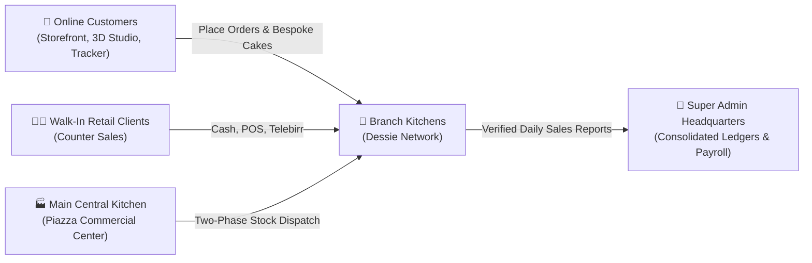
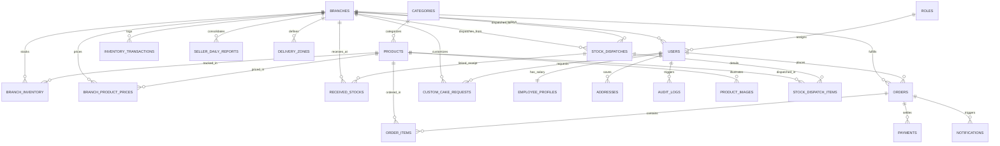
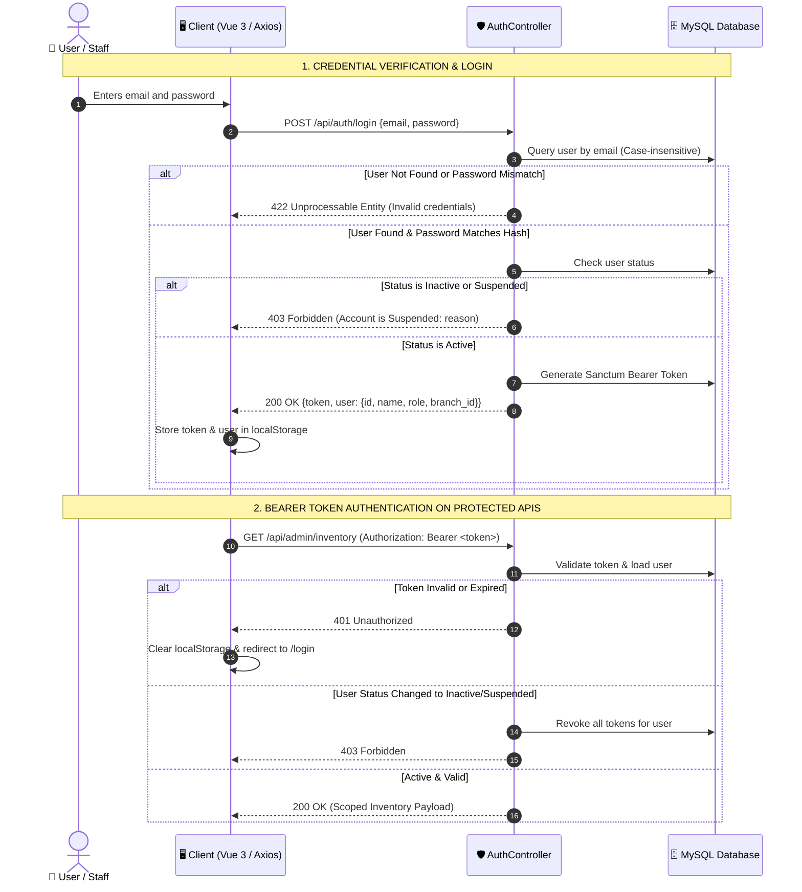
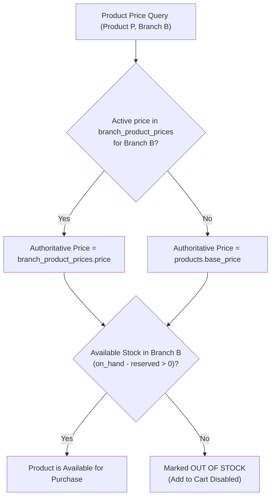
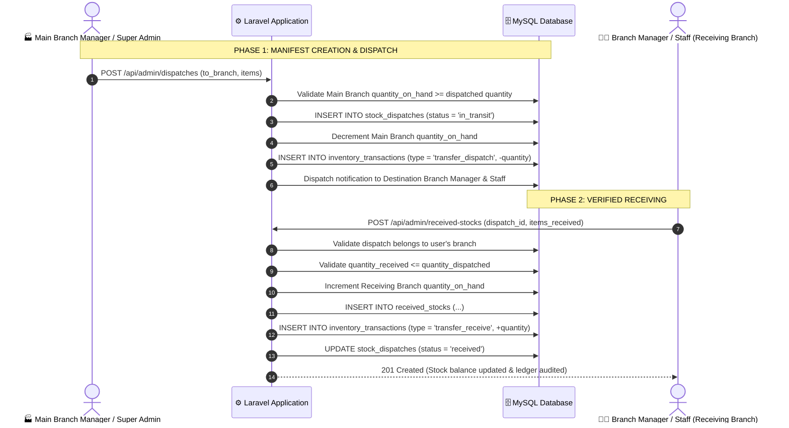
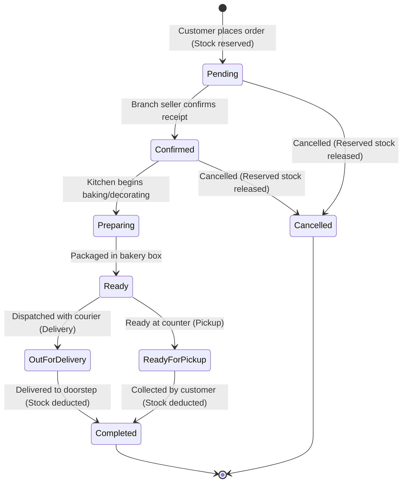
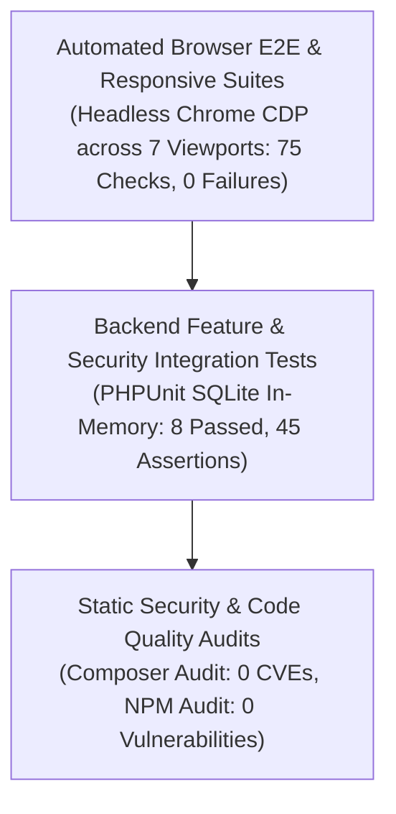
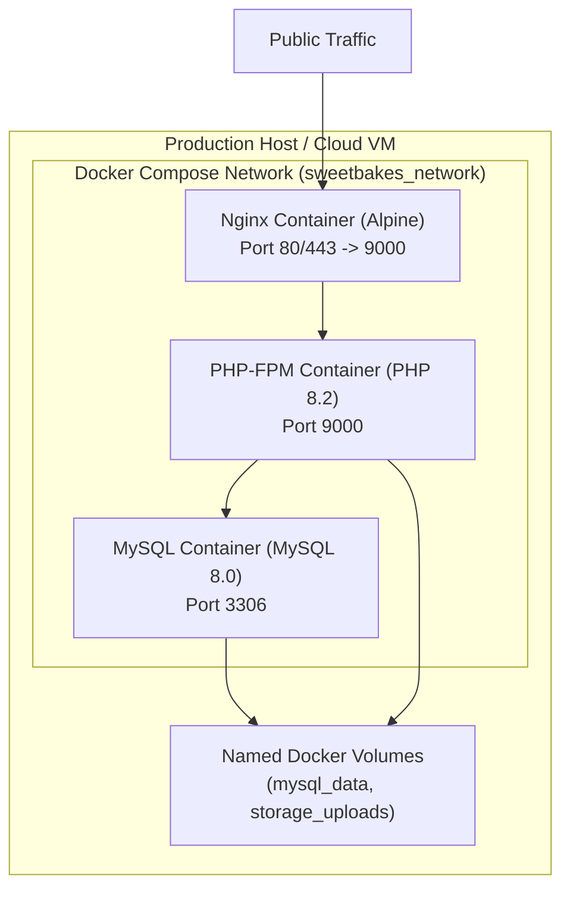

# 🧁 Kenean Cake and Food (SweetBakes)
## Comprehensive Technical, Architectural & Engineering Documentation

> **Platform Version:** 4.2 Production-Ready (Audit & Optimization Release, November 2026)  
> **Repository Root:** [`c:\Kenan Cake`](file:///c:/Kenan%20Cake)  
> **Backend Framework:** Laravel 11 / PHP 8.2+ / REST API / Eloquent ORM  
> **Frontend Architecture:** Vue.js 3 (Composition API) / Vite 5 / Tailwind CSS / Pinia  
> **Database Engine:** MySQL 8.0 / MariaDB (InnoDB Strict Engine, Foreign Keys, Row-Level Locks)  
> **Geographic Operational Scope:** Dessie (Piazza HQ, Buabuha, Fuad, Erobit), Amhara Region, Ethiopia  
> **Branding & Visual Palette:** Warm Luxury Bakery Visual System (Dark Chocolate `#3D251E`, Sweet Terracotta `#BA5420`, Fresh Pink Accent `#DE1B54`, Forest Emerald `#047857`, Warm Cream `#FAF7F2`)

---

## 1. Project Overview

### 1.1. System Purpose & Vision
**Kenean Cake and Food** (operating digitally under the **SweetBakes & Kenan Cafe** platform) is an enterprise-grade, multi-branch bakery e-commerce, point-of-sale (POS), supply chain logistics, and headquarters operations platform. 

The platform bridges physical bakery storefronts in **Dessie, Amhara Region, Ethiopia** with a modern digital storefront. It unifies online customer ordering, custom 3D celebratory cake commissions, localized branch inventory management, central production hub dispatches, counter sales POS, multi-tiered daily sales financial reconciliation, and corporate governance.



### 1.2. Core Functional Pillars
1. **Interactive Customer Storefront:**
   - Multi-branch discovery with real GPS coordinate mapping of Dessie branches.
   - Dynamic real-time product catalog reflecting branch-specific selling prices and on-hand inventory availability.
   - Interactive Three.js WebGL 3D Cake Customization Studio with procedural frosting textures, 3D occasion toppers, and snapshot rendering.
   - Multi-channel checkout supporting Doorstep Courier Delivery and In-Store Counter Pickup.
   - Two-factor public order tracking (`order_number` + phone/email) protecting customer PII from enumeration attacks.
   - Single-page A4 thermal/standard customer order receipt engine.
   - Dual-language localization (English and Amharic / አማርኛ) with dynamic typography and dark/light mode.
   - Cryptographic email ownership verification with automated retrospective guest order linking.

2. **Branch Retail Point-of-Sale (POS) & Counter Operations:**
   - Tactile POS counter order entry designed for touchscreens and quick barcode/keyboard input.
   - Instant 80mm thermal receipt printing with localized tax credentials and pickup QR codes.
   - Custom cake quotation, advance deposit recording, and balance settlement workflow.
   - Automated Daily Sales Report compilation separating **Booked Sales** from **Cash Collected**.

3. **Central Logistics & Supply Chain (Main Branch Hub):**
   - Linked two-phase stock transfer system: **Main Branch dispatches**, **Destination branch receives**.
   - Strict over-dispatch and over-receive validation guards preventing inventory drift.
   - Row-level database locking (`lockForUpdate()`) preventing race conditions during checkout and stock movement.
   - Physical count adjustment audit logs with mandatory reason tracking.

4. **Hierarchical Sales Reconciliation & Financial Audit:**
   - Level 1: Branch Seller compiles and submits daily counter and online transactions.
   - Level 2: Branch Manager audits, verifies, and approves or returns the report with corrective notes.
   - Level 3: Super Admin reviews network-wide read-only consolidated financial rollups.
   - Chapa payment gateway integration with fail-closed HMAC-SHA256 signature verification, alongside Telebirr and Commercial Bank of Ethiopia (CBE) transfer verification.

5. **Enterprise Headquarters & Staff Governance:**
   - Strict server-side Role-Based Access Control (RBAC) across 6 distinct user tiers.
   - Autonomous branch provisioning with zero-data isolation guarantees.
   - Decoupled employee compensation profiles (`employee_profiles`) restricting salary visibility to Super Admin.
   - Session invalidation: Instant revocation of active Sanctum Bearer tokens upon account deactivation or suspension.

### 1.3. Technology Stack Summary
| Layer | Technologies / Libraries | Purpose |
|---|---|---|
| **Backend Framework** | Laravel 11 (PHP 8.2+) | RESTful API, ORM, Auth, Middlewares, Validation, Jobs |
| **Authentication** | Laravel Sanctum | Stateless Bearer token authentication & revocation |
| **Database** | MySQL 8.0 / MariaDB (InnoDB) | Strict relational constraints, row locking, decimal precision |
| **Frontend Framework** | Vue.js 3 (Composition API) | Reactive single-page application (SPA) |
| **Bundler & Tooling** | Vite 5 | High-speed compilation, asset chunking, hot module reload |
| **State Management** | Pinia | Modular reactive client state with localStorage syncing |
| **Client Routing** | Vue Router 4 | Navigation guards, dynamic metadata, role-based access |
| **Styling & Design** | Tailwind CSS 3 | Utility-first responsive design, dark mode, micro-interactions |
| **3D Graphics Engine** | Three.js (r128+) | WebGL real-time 3D cake geometry and material rendering |
| **Mapping Engine** | Leaflet 1.9.4 & OpenStreetMap | Interactive Dessie branch locator with real GPS pins |
| **HTTP Client** | Axios 1.7+ | Promise-based client with request/response interceptors |
| **Image Processing** | Intervention Image (PHP) & Pillow (Dev) | Server-side banner uploads & static asset optimization |
| **DevOps & Containers** | Docker, Docker Compose, Nginx Alpine | Multi-container micro-architecture, caching, gzip compression |

### 1.4. System Scope & Boundaries
- **Public Internet Ingress:** Public customer storefront (`/`, `/shop`, `/custom-cake`, `/track-order`, `/branches`, `/about`, `/contact`).
- **Internal Back-Office Ingress:** Secured administration dashboard (`/admin/*`) accessible strictly to authenticated staff with active credentials.
- **External Third-Party Gateways:**
  - Chapa Payment Gateway (Online card/telebirr checkout & webhook callbacks).
  - OpenStreetMap Tile Server (Map tile streaming for Leaflet maps).
- **Network Boundaries:** Stateless HTTP/HTTPS REST API operating on port 80/443 (proxied via Nginx to PHP-FPM port 9000 and MySQL port 3306).

---

## 2. System Architecture

### 2.1. High-Level Architecture Topology
The platform implements a decoupled client-server architecture where the Vue 3 Single Page Application (SPA) communicates statelessly with the Laravel 11 REST API via JSON over HTTPS.

```mermaid
flowchart TD
    subgraph ClientDeviceLayer["🖥️ Client Presentation Layer (Vue 3 + Vite)"]
        CustomerPortal["Customer Storefront<br/>(Store, 3D Cake Studio, Cart, Tracking, Profile)"]
        SellerPortal["Branch POS & Counter Portal<br/>(Sales, Orders, Daily Report Drafts)"]
        ManagerPortal["Branch Manager Portal<br/>(Pricing, Stock Receive, Report Verification, Staff)"]
        MainManagerPortal["Main Distribution Hub<br/>(Stock Dispatch Manifest Engine)"]
        SuperAdminPortal["Super Admin Headquarters<br/>(Network KPIs, Branch Setup, Salaries, Audits)"]
    end

    subgraph GatewayLayer["🛡️ Network, Web Server & Edge Security"]
        NginxProxy["Nginx Alpine Reverse Proxy<br/>(SSL Termination, Gzip, Security Headers, Cache-Control)"]
        RateLimiter["Route Rate Limiters<br/>(Login: 5/min, Tracking: 15/min, Orders: 30/min, API: 60/min)"]
        CORSGuard["CORS & Sanitize Filter"]
    end

    subgraph ApplicationLayer["⚙️ Application Backend (Laravel 11 REST API)"]
        SanctumAuth["Laravel Sanctum<br/>(Bearer Token Validation & Lifecycle)"]
        RoleGuard["RoleAuthorizationMiddleware<br/>(RBAC Role Verification)"]
        BranchGuard["BranchIsolation Middleware<br/>(Server-Side Branch Scoping)"]
        
        subgraph Controllers["API Controllers"]
            OrderCtrl["OrderController & CartController"]
            CustomCakeCtrl["CustomCakeController"]
            StockCtrl["StockDispatchController & ReceivedStockController"]
            CatalogCtrl["CatalogController & BranchPriceController"]
            ReportCtrl["OrderReportController"]
            PayCtrl["PaymentController (Chapa HMAC Webhook)"]
            UserCtrl["UserController & SalaryController"]
            SettingCtrl["SettingController & WebsiteSettingController"]
        end
    end

    subgraph DataStorageLayer["🗄️ Persistence & Database Layer (MySQL 8.0 InnoDB)"]
        RelationalDB[("kenean-cake-and-bread<br/>(Foreign Keys, Row Locking, Indexes, Soft Deletes)")]
        FileStorage["File Storage System<br/>(Public Uploads, Cake Snapshots, Settings Images)"]
    end

    ClientDeviceLayer --> NginxProxy
    NginxProxy --> RateLimiter
    RateLimiter --> CORSGuard
    CORSGuard --> SanctumAuth
    SanctumAuth --> RoleGuard
    RoleGuard --> BranchGuard
    BranchGuard --> Controllers
    Controllers --> RelationalDB
    Controllers --> FileStorage
```



### 2.2. Request Lifecycle & Security Middleware Pipeline
Every HTTP request follows a deterministic pipeline from the network boundary to database execution:

```mermaid
flowchart LR
    Req["Incoming HTTP Request"] --> Nginx["1. Nginx Proxy<br/>(Gzip, Headers, SSL)"]
    Nginx --> Throttle["2. Rate Limiting<br/>(throttle:X,1)"]
    Throttle --> Cors["3. HandleCors<br/>(Domain Validation)"]
    Cors --> Sanctum["4. auth:sanctum<br/>(Token Validation)"]
    Sanctum --> StatusCheck["5. User Status Check<br/>(Active / Inactive / Suspended)"]
    StatusCheck --> RBAC["6. Role Middleware<br/>(Super Admin, Manager, etc.)"]
    RBAC --> BranchScope["7. Branch Scope Guard<br/>(Force user->branch_id)"]
    BranchScope --> FormReq["8. FormRequest Validation<br/>(Type, Size, Regex)"]
    FormReq --> Action["9. Controller Action<br/>(Atomic DB Transaction)"]
    Action --> Res["Authoritative JSON Response"]
```



1. **Nginx Ingress:** Terminates SSL, enforces HTTP security headers, serves static assets from disk with 1-year cache headers, and proxies `/api/*` to PHP-FPM.
2. **Rate Limiting:** Protects endpoints from abuse (`POST /api/auth/login` throttled to 5/min, `POST /api/orders/track` throttled to 15/min, `POST /api/orders` throttled to 30/min).
3. **CORS Validation:** Rejects requests from unauthorized origins; validates credentials headers.
4. **Sanctum Authentication:** Inspects Bearer token in the `Authorization` header. If valid, binds the authenticated `User` model to the request.
5. **Account Status Verification:** Validates `status == 'Active'`. If `Inactive` or `Suspended`, revokes tokens and responds with `HTTP 403 Forbidden`.
6. **Role Authorization:** `RoleAuthorizationMiddleware` matches user roles against endpoint requirements.
7. **Branch Isolation:** For non-Super-Admin users, `branch_id` is forced from `$request->user()->branch_id`. Any client-supplied `branch_id` query or body parameter is discarded.
8. **Form Request Validation:** Incoming payloads pass through dedicated `FormRequest` classes with strict validation rules.
9. **Atomic Execution:** Core state mutations run inside `DB::transaction()` with row locks (`lockForUpdate()`) to ensure absolute ACID compliance.

### 2.3. External Integrations & Communication Protocols
- **Chapa Payment Gateway:**
  - Client initiates payment -> Server creates transaction with unique reference (`TX-...`).
  - Chapa processes payment and delivers asynchronous HTTP POST callback to `/api/payments/webhook`.
  - Server verifies webhook authenticity using HMAC-SHA256 signature calculated with `services.chapa.webhook_secret`. If the signature doesn't match or the secret is missing, it fails closed (`HTTP 503 / 401`).
- **Leaflet & OpenStreetMap:**
  - Frontend loads Leaflet via asynchronous code-split chunk (`vendor-leaflet.js`, 148 kB raw / 43 kB gzip).
  - OpenStreetMap raster tiles rendered client-side; branch markers mapped dynamically from `GET /api/branches`.
- **Three.js WebGL Engine:**
  - Client-side WebGL canvas isolated to [`CustomCakeBuilderView.vue`](file:///c:/Kenan%20Cake/Client/src/views/customer/CustomCakeBuilderView.vue) avoiding overhead on the homepage.
  - Generates high-resolution data URLs via `renderer.domElement.toDataURL('image/png')` sent with custom cake briefs.

---

## 3. Database Architecture

### 3.1. Entity-Relationship (ER) Diagram
The database schema operates under strict MySQL InnoDB constraints, utilizing big integer unsigned primary keys, foreign key cascades/restricts, high-precision GPS coordinates, and composite performance indexes.



### 3.2. Core Database Tables & Data Dictionary

#### 1. `branches`
Represents physical bakery branches and distribution centers.
| Column | Type | Nullable | Description / Constraints |
|---|---|:---:|---|
| `branch_id` | BIGINT UNSIGNED | No | Primary Key (Auto-Increment) |
| `branch_name` | VARCHAR(255) | No | Official name (e.g., "Main Branch - Dessie Piazza") |
| `branch_code` | VARCHAR(50) | No | Unique human-readable code (e.g., `BR-PIAZZA`) |
| `branch_type` | ENUM('Main', 'Regular') | No | Identifies central distribution hub vs retail branch |
| `address` | VARCHAR(255) | Yes | Street address / Commercial building |
| `city` | VARCHAR(255) | No | Default: 'Dessie' |
| `latitude` | DECIMAL(10, 8) | Yes | GPS latitude coordinate ($\pm 90^\circ$) |
| `longitude` | DECIMAL(11, 8) | Yes | GPS longitude coordinate ($\pm 180^\circ$, requires 3 integer digits) |
| `phone_number` | VARCHAR(50) | Yes | Direct counter contact telephone |
| `manager_id` | BIGINT UNSIGNED | Yes | Foreign Key referencing `users.user_id` |
| `status` | ENUM('Active', 'Inactive')| No | Operating status |
| `is_shopping_enabled`| BOOLEAN | No | Default: `true`. Controls online storefront ordering |
| `deleted_at` | TIMESTAMP | Yes | Soft delete tracking |
| `created_at` / `updated_at` | TIMESTAMP | Yes | Standard Eloquent timestamps |

#### 2. `users`, `roles` & `employee_profiles`
User accounts, role classification, and decoupled salary profiles.
- **`roles`:** `role_id` (PK), `role_name` (`VARCHAR(100)`), `slug` (`VARCHAR(100)` Unique).
  - Slugs: `super_admin`, `main_branch_manager`, `branch_manager`, `branch_seller`, `cashier`, `servant`, `branch_staff`, `customer`.
- **`users`:** `user_id` (PK), `role_id` (FK), `role` (`ENUM('Super Admin', 'Main Branch Manager', 'Branch Manager', 'Branch Seller', 'Cashier', 'Servant', 'Branch Staff', 'Customer')`), `branch_id` (FK, Nullable), `full_name` (`VARCHAR(255)`), `email` (`VARCHAR(255)` Unique), `phone_number` (`VARCHAR(50)` Nullable), `avatar_url` (`VARCHAR(500)` Nullable), `password` (`VARCHAR(255)`), `status` (`ENUM('Active', 'Inactive', 'Suspended')`), `status_reason` (`TEXT` Nullable, **mandatory when Suspended**), `email_verified_at` (`TIMESTAMP` Nullable).
- **`employee_profiles`:** `user_id` (PK, FK referencing `users.user_id` on cascade delete), `salary` (`DECIMAL(10, 2)` Default 0.00). Stores employee compensation completely segregated from user directory.

#### 3. `products`, `categories` & `branch_product_prices`
Master catalog items, categories, and branch-specific price overrides.
- **`categories`:** `category_id` (PK), `category_name`, `slug` (Unique), `description`.
- **`products`:** `product_id` (PK), `category_id` (FK), `product_name`, `description`, `base_price` (`DECIMAL(10, 2)`), `is_fasting` (`BOOLEAN` Default `false`, indicates Ye'Tsom certified), `shelf_life_hours` (`INT` Default 48), `status` (`ENUM('Active', 'Inactive')`), `deleted_at`.
- **`product_images`:** `image_id` (PK), `product_id` (FK), `image_url`, `sort_order` (`INT` Default 0).
- **`branch_product_prices`:** `id` (PK), `branch_id` (FK), `product_id` (FK), `price` (`DECIMAL(10, 2)`), `active` (`BOOLEAN` Default `true`).
  - **Unique Composite Key:** `(branch_id, product_id)`.

#### 4. `branch_inventory` & `inventory_transactions`
Real-time physical stock balances and tamper-evident audit logs.
- **`branch_inventory`:** `inventory_id` (PK), `branch_id` (FK), `product_id` (FK), `quantity_on_hand` (`INT` Default 0), `reserved_quantity` (`INT` Default 0), `reorder_level` (`INT` Default 10).
  - **Unique Composite Key:** `(branch_id, product_id)`.
  - Available Stock Calculation: $Q_{\text{available}} = Q_{\text{on\_hand}} - Q_{\text{reserved}}$.
- **`inventory_transactions`:** `transaction_id` (PK), `branch_id` (FK), `product_id` (FK), `transaction_type` (`ENUM('production', 'transfer_dispatch', 'transfer_receive', 'order_placed', 'order_completed', 'order_cancelled', 'damaged', 'expired', 'manual_adjustment')`), `quantity` (`INT`, signed value: negative for outgoing, positive for incoming), `reference_type`, `reference_id`, `reason`, `created_by` (FK referencing `users`), `created_at`.
  - **Composite Index:** `idx_inv_tx_branch_prod_created` on `(branch_id, product_id, created_at)`.

#### 5. `stock_dispatches`, `stock_dispatch_items` & `received_stocks`
Two-phase inter-branch supply chain transfer records.
- **`stock_dispatches`:** `dispatch_id` (PK), `from_branch_id` (FK, Main Branch), `to_branch_id` (FK, Destination Branch), `status` (`ENUM('draft', 'in_transit', 'partially_received', 'received', 'cancelled')`), `reference_number` (`VARCHAR(100)` Unique, e.g. `DSP-202611-001`), `notes`, `created_by` (FK referencing `users`), `sent_at`, `created_at`.
- **`stock_dispatch_items`:** `id` (PK), `dispatch_id` (FK), `product_id` (FK), `quantity_dispatched` (`INT UNSIGNED`), `quantity_received` (`INT UNSIGNED` Default 0).
- **`received_stocks`:** `received_stock_id` (PK), `branch_id` (FK), `product_id` (FK), `dispatch_id` (FK, links to `stock_dispatches`), `product_name`, `category_name`, `receiver_name`, `quantity_received` (`INT UNSIGNED`), `date_received` (`DATE`), `received_by` (FK referencing `users`), `notes`.

#### 6. `orders`, `order_items` & `payments`
Customer retail and walk-in counter sales transactions.
- **`orders`:** `order_id` (PK), `order_number` (`VARCHAR(100)` Unique, e.g. `ORD-20261112-9842`), `user_id` (FK referencing `users`), `branch_id` (FK referencing `branches`), `customer_name` (`VARCHAR(255)`), `customer_phone` (`VARCHAR(50)`), `customer_email` (`VARCHAR(150)` Nullable, indexed), `address_id` (FK referencing `addresses`, Nullable), `fulfillment_method` (`ENUM('Delivery', 'Pickup')`), `order_status` (`ENUM('Pending', 'Confirmed', 'Preparing', 'Ready', 'Out for delivery', 'Completed', 'Cancelled')`), `delivery_fee` (`DECIMAL(10, 2)` Default 0.00), `discount_amount` (`DECIMAL(10, 2)` Default 0.00), `total_amount` (`DECIMAL(10, 2)`), `placed_at`, `deleted_at`.
  - **Composite Performance Index:** `idx_orders_branch_status_placed` on `(branch_id, order_status, placed_at)`.
- **`order_items`:** `order_item_id` (PK), `order_id` (FK), `product_id` (FK), `quantity` (`INT`), `unit_price` (`DECIMAL(10, 2)`), `subtotal` (`DECIMAL(10, 2)`).
- **`payments`:** `payment_id` (PK), `order_id` (FK), `payment_method` (`ENUM('Cash', 'Chapa', 'Telebirr', 'Bank_Transfer')`), `payment_status` (`ENUM('Pending', 'Completed', 'Failed', 'Refunded')`), `amount` (`DECIMAL(10, 2)`), `transaction_reference` (`VARCHAR(150)` Nullable), `payment_date` (`TIMESTAMP`).

#### 7. `custom_cake_requests` & `custom_cake_images`
Interactive 3D cake customization commissions.
- **`custom_cake_requests`:** `request_id` (PK), `request_number` (`VARCHAR(100)` Unique, e.g. `CCR-202611-104`), `user_id` (FK), `branch_id` (FK), `customer_name`, `customer_phone`, `customer_email` (Nullable, indexed), `cake_size` (`VARCHAR(100)`), `flavor` (`VARCHAR(100)`), `design` (`TEXT`), `design_config` (`JSON` Nullable, stores 3D tier, color hex, topper, and inscription specs), `message` (`VARCHAR(255)`), `needed_by` (`DATE`), `quoted_price` (`DECIMAL(10, 2)` Nullable), `deposit_required_percentage` (`DECIMAL(5, 2)` Default 50.00), `deposit_paid` (`DECIMAL(10, 2)` Default 0.00), `status` (`ENUM('Submitted', 'Quoted', 'Confirmed', 'Preparing', 'Ready', 'Picked up', 'Delivered', 'Rejected', 'Cancelled')`), `rejection_reason` (`TEXT` Nullable).
  - **Composite Index:** `idx_cakes_branch_status_needed` on `(branch_id, status, needed_by)`.
- **`custom_cake_images`:** `image_id` (PK), `request_id` (FK), `image_url` (`VARCHAR(500)`).

#### 8. `seller_daily_reports` & Multi-Tier Reports
- **`seller_daily_reports`:** `report_id` (PK), `branch_id` (FK), `seller_id` (FK), `report_date` (`DATE`), `status` (`ENUM('draft', 'submitted', 'approved', 'returned')`), `booked_sales` (`DECIMAL(10, 2)`), `cash_collected` (`DECIMAL(10, 2)`), `card_revenue` (`DECIMAL(10, 2)`), `transfer_revenue` (`DECIMAL(10, 2)`), `custom_cake_deposits` (`DECIMAL(10, 2)`), `manager_notes` (`TEXT` Nullable), `approved_by` (FK), `submitted_at`, `approved_at`.
  - **Composite Index:** `idx_reports_branch_date_status` on `(branch_id, report_date, status)`.

#### 9. Supporting System Tables
- **`app_settings`:** `id` (PK), `key` (`VARCHAR(100)` Unique), `value` (`TEXT`), `group` (`VARCHAR(50)`).
- **`audit_logs`:** `log_id` (PK), `user_id` (FK), `action` (`VARCHAR(150)`), `model_type` (`VARCHAR(150)`), `model_id` (`BIGINT UNSIGNED`), `changes` (`JSON`), `ip_address` (`VARCHAR(45)`), `created_at`.
- **`email_verifications`:** `id` (PK), `email` (`VARCHAR(150)`), `code` (`VARCHAR(10)`), `expires_at` (`TIMESTAMP`), `created_at`.
- **`notifications`:** `id` (PK), `recipient_id` (FK), `branch_id` (FK), `entity_type`, `entity_id`, `status_or_event`, `title`, `message`, `is_read`, `created_at`. Unique composite constraint prevents duplicate notification generation.

---

## 4. Authentication and Authorization

### 4.1. Authentication Lifecycle
Authentication is powered by **Laravel Sanctum** using cryptographically secure Bearer tokens.



### 4.2. Immediate Token Invalidation on Status Change
When an administrator modifies an employee's account status (`PATCH /api/admin/users/{id}/status`):
- Setting status to `Inactive` or `Suspended` immediately calls `$user->tokens()->delete()`.
- Active browser sessions are terminated on their next HTTP request with `HTTP 401/403`.
- Reinstating an account to `Active` allows new logins, but does not revive expired tokens.

### 4.3. Roles, Permissions & Scoping Matrix (RBAC)
The authoritative permission matrix governs access across all six operational tiers:

| Operational Capability | Super Admin | Main Branch Manager | Branch Manager | Branch Seller / Cashier | Branch Staff / Servant | Customer |
|---|:---:|:---:|:---:|:---:|:---:|:---:|
| **Storefront Browsing & Ordering** | Yes | Yes | Yes | Yes | Yes | **Full** |
| **Personal Orders & Tracking** | Own | Own | Own | Own | Own | **Own (2FA)** |
| **Branch Order Queue** | No *(Audit only)* | Read-Only *(Main)* | Read-Only *(Own)* | **Full (POS/Manage)** | Kitchen Prep Only | No |
| **Custom Cake Inquiries & Quotes** | View *(Audit)* | Read-Only *(Main)* | Read-Only *(Own)* | **Quote & Deposit** | View Only | Submit / Accept |
| **Stock Dispatch (Create & Send)** | **Full** | **Full (From Main)** | 403 Forbidden | 403 Forbidden | 403 Forbidden | No |
| **Stock Receive (Inflow)** | 403 Forbidden | Hidden *(Main doesn't receive)* | **Receive & View** | View Only | **Receive & View** | No |
| **Branch Price Customization** | View All | Set Main Prices | Set Own Prices | 403 Forbidden | 403 Forbidden | No |
| **Physical Inventory Adjustments** | Full | Adjust Main | Adjust Own | 403 Forbidden | 403 Forbidden | No |
| **Daily Sales Reports** | View Rollups | Audit Main Reports | Audit Own Reports | **Submit Draft/Daily** | View Only | No |
| **Staff Lifecycle Management** | **All Users** | Main Staff Only | Own Staff Only | No | No | No |
| **Modify Manager Account Status** | **Yes** | 403 Forbidden | 403 Forbidden | 403 Forbidden | 403 Forbidden | No |
| **Self-Status Modification** | 403 Forbidden | 403 Forbidden | 403 Forbidden | 403 Forbidden | 403 Forbidden | No |
| **Employee Salary Management** | **Full** | 403 Forbidden | 403 Forbidden | 403 Forbidden | 403 Forbidden | No |
| **Branch Setup (Zero-Data Guarantee)**| **Full** | 403 Forbidden | 403 Forbidden | 403 Forbidden | 403 Forbidden | No |
| **System Audit Logs & Settings** | **Full** | 403 Forbidden | 403 Forbidden | 403 Forbidden | 403 Forbidden | No |

---

## 5. API Documentation

The platform exposes **179 registered RESTful routes**. All endpoints return standardized JSON structures.

### 5.1. Standard Error Responses
- `401 Unauthorized`: Token missing, invalid, or expired.
- `403 Forbidden`: Insufficient role privileges or cross-branch access attempt.
- `404 Not Found`: Entity not found or hidden by branch scoping.
- `422 Unprocessable Entity`: Validation failure (returns `{message: string, errors: {field: [string]}}`).
- `429 Too Many Requests`: Rate limiter triggered.
- `503 Service Unavailable`: Maintenance mode, database health check failure, or unconfigured payment webhook secret.

### 5.2. Core Endpoint Specifications

#### 1. System Health Monitoring
- **`GET /api/health`**
  - **Auth / Rate Limit:** Public / None
  - **Description:** Verifies database connectivity and system status.
  - **Success Response (200 OK):**
    ```json
    {
      "status": "ok",
      "timestamp": "2026-11-12T20:30:00Z",
      "services": {
        "database": "connected"
      }
    }
    ```
  - **Degraded Response (503 Service Unavailable):**
    ```json
    {
      "status": "degraded",
      "services": {
        "database": "disconnected"
      }
    }
    ```

#### 2. Authentication & Profile Management
- **`POST /api/auth/login`**
  - **Rate Limit:** 5 requests / minute
  - **Request Body:**
    ```json
    {
      "email": "seller@sweetbakes.test",
      "password": "Password123!"
    }
    ```
  - **Success Response (200 OK):**
    ```json
    {
      "token": "14|vNf79...",
      "user": {
        "user_id": 4,
        "full_name": "Dessie Counter Seller",
        "email": "seller@sweetbakes.test",
        "role": "Branch Seller",
        "branch_id": 2,
        "status": "Active"
      }
    }
    ```
- **`POST /api/auth/register`** (`POST /api/auth/register`, throttled 10/min)
- **`POST /api/auth/send-verification-code`** (`auth:sanctum`, throttled 5/min)
- **`POST /api/auth/verify-email`** (`auth:sanctum`, throttled 10/min)
  - **Request Body:** `{"code": "729481"}`
  - **Behavior:** Verifies OTP and atomically links guest orders matching customer's verified email.

#### 3. Public Storefront, Catalog & Branches
- **`GET /api/branches`**
  - **Description:** Returns all active branches with GPS coordinates and shopping access status.
  - **Response (200 OK):**
    ```json
    [
      {
        "branch_id": 1,
        "branch_name": "Main Branch - Dessie Piazza",
        "branch_code": "BR-PIAZZA",
        "branch_type": "Main",
        "address": "Piazza Commercial Center, Dessie",
        "city": "Dessie",
        "latitude": "11.13150000",
        "longitude": "39.63800000",
        "phone_number": "+251911223344",
        "is_shopping_enabled": true
      }
    ]
    ```
- **`GET /api/products`** (Filters: `branch_id`, `category_id`, `search`, `fasting_only`)
  - Evaluates local price override in `branch_product_prices` -> falls back to `products.base_price`.
- **`POST /api/orders`**
  - **Rate Limit:** 30 requests / minute
  - **Request Body:**
    ```json
    {
      "branch_id": 2,
      "fulfillment_method": "Delivery",
      "customer_name": "Abebe Kebede",
      "customer_phone": "+251911987654",
      "customer_email": "abebe@gmail.com",
      "address_id": 5,
      "zone_id": 1,
      "order_notes": "Handle with care",
      "payment_method": "Chapa",
      "items": [
        {"product_id": 12, "quantity": 2}
      ]
    }
    ```
  - **Validation:** Quantities checked against $Q_{\text{available}}$ with row-level locks. Capped at 100 line items and 500 units.
- **`POST /api/orders/track`**
  - **Rate Limit:** 15 requests / minute
  - **Request Body:** `{"order_number": "ORD-20261112-9842", "phone_or_email": "+251911987654"}`
  - **Behavior:** Returns order milestones if and only if both factors match; masks PII.

#### 4. Custom Cake Studio
- **`POST /api/custom-cakes`**
  - **Request Body:**
    ```json
    {
      "branch_id": 2,
      "customer_name": "Tigist Haile",
      "customer_phone": "+251922334455",
      "customer_email": "tigist@gmail.com",
      "cake_size": "Two-Tier Celebration (8\" + 6\")",
      "flavor": "Belgian Dark Chocolate",
      "needed_by": "2026-11-20",
      "message": "Happy Birthday Abel!",
      "design_config": {
        "tiers": 2,
        "frosting_color": "#FAF7F2",
        "topper": "Candle",
        "dietary": "Ye'Tsom"
      },
      "image_url": "/storage/custom_cakes/snapshot_abc123.png"
    }
    ```
- **`POST /api/admin/custom-cakes/{id}/quote`** (Roles: `Branch Seller`, `Main Branch Manager`)
  - Sets authoritative `quoted_price` and required deposit percentage.
- **`POST /api/custom-cakes/{id}/accept-quote`** (`auth:sanctum`, owner verification required).

#### 5. Payments & Webhooks
- **`POST /api/payments/webhook`**
  - **Headers:** `x-chapa-signature: <hmac-sha256-hash>`
  - **Payload:** Chapa payment callback with status, tx_ref, amount, and currency.
  - **Validation:** Verifies HMAC-SHA256 signature against `CHAPA_WEBHOOK_SECRET`. Fails closed (`HTTP 503`) if secret is unconfigured.
- **`POST /api/admin/payments/refund`**
  - **Roles:** `Super Admin`, `Main Branch Manager`, `Branch Manager` (scoped to manager's branch).
  - **Validation:** Refund amount cannot exceed original transaction amount ($A_{\text{refund}} \le A_{\text{payment}}$).

#### 6. Stock Dispatch & Inflow Engine
- **`POST /api/admin/dispatches`**
  - **Roles:** `Super Admin`, `Main Branch Manager`
  - **Payload:** `{"to_branch_id": 2, "notes": "Weekly morning delivery", "items": [{"product_id": 5, "quantity": 30}]}`
  - **Behavior:** Dispatches from Main Branch; validates $Q_{\text{dispatch}} \le Q_{\text{main\_available}}$.
- **`POST /api/admin/dispatches/{id}/send`**
  - Deducts Main Branch inventory; sets status to `in_transit`; dispatches notifications to destination branch.
- **`POST /api/admin/received-stocks`**
  - **Roles:** `Branch Manager`, `Branch Staff`
  - **Payload:** `{"dispatch_id": 14, "items": [{"product_id": 5, "quantity_received": 30}]}`
  - **Validation:** Enforces $Q_{\text{received}} \le Q_{\text{dispatched}}$; destination branch must match authenticated user's branch. Atomically increments on-hand stock and updates dispatch status.

#### 7. Multi-Tier Daily Sales Reporting
- **`POST /api/admin/reports/seller/daily`** (Seller submits daily report).
- **`POST /api/admin/reports/manager/seller-reports/{id}/verify`** (Manager verifies, approves, or returns report).
- **`GET /api/admin/reports/admin/branch-summary`** (Super Admin read-only consolidated network summary).

---

## 6. Business Logic & Operational Workflows

### 6.1. Product Pricing Resolution Hierarchy
The platform ensures that pricing is always authoritative on the server:



### 6.2. Two-Phase Stock Distribution Engine
Physical bakery goods transfer follows a non-repudiable two-phase chain:



### 6.3. Order Fulfillment & Reservation Lifecycle
- **Order Placement:** Items are validated against $Q_{\text{available}}$. Reserved quantity is atomically incremented:
  $$\Delta Q_{\text{reserved}} = +Q_{\text{ordered}}$$
- **Order Completion:** When handed to customer or delivered:
  $$\Delta Q_{\text{on\_hand}} = -Q_{\text{ordered}}, \quad \Delta Q_{\text{reserved}} = -Q_{\text{ordered}}$$
- **Order Cancellation:** Reserved stock is released with zero phantom drift:
  $$\Delta Q_{\text{reserved}} = -Q_{\text{ordered}}$$



### 6.4. Three-Level Sales Reporting Reconciliation
1. **Sellers (Level 1):** Record physical cash in register, POS card receipts, and bank transfers. System pulls system-recorded orders and calculates variance:
   $$\text{Variance} = (\text{Cash} + \text{Card} + \text{Transfer}) - \text{Total Booked Sales}$$
2. **Branch Managers (Level 2):** Review variance and verify deposits. Approving locks the report permanently. Returning unlocks it with mandatory notes.
3. **Super Admin (Level 3):** Consolidates network-wide approved daily reports into company-wide P&L rollups.

---

## 7. Frontend Architecture

### 7.1. Application Structure & Modularity
The client application is built with **Vue 3** using `<script setup>` Composition API and **Vite 5**.

```
Client/src/
├── api.js                     # Central Axios instance (15s timeout, 401 handler, Bearer token)
├── App.vue                    # Root component with ToastNotification & ModalDialog
├── main.js                    # Pinia, Vue Router, Directive initialization
├── layouts/
│   ├── CustomerLayout.vue     # Public layout (Responsive header, Dessie branch selector, drawer, footer)
│   └── AdminLayout.vue        # Back-office layout (Sidebar, role badge, branch context, notifications)
├── views/
│   ├── customer/              # Customer storefront views (Home, Shop, CustomCake, Cart, Checkout, Tracking)
│   └── admin/                 # Administration views (Overview, Orders, Inventory, Dispatches, Reports, Users)
├── components/
│   ├── ToastNotification.vue  # Global reactive toast notification system
│   ├── ModalDialog.vue        # Global promise-based confirmation & prompt dialog
│   ├── LeafletBranchMap.vue   # Dynamic Leaflet map with real Dessie coordinates
│   ├── CakeCanvas3D.vue       # Three.js WebGL canvas for custom cake studio
│   ├── ProductCard.vue        # Responsive product card with hover animations
│   └── CartDrawer.vue         # Slide-out high-speed cart drawer
├── stores/
│   ├── auth.js                # Token, user state, role checkers, permissions
│   ├── branch.js              # Active branch selector, branch list, GPS coordinates
│   ├── cart.js                # Cart items, quantity clamping, localized subtotals
│   ├── wishlist.js            # Customer favorites collection
│   ├── locale.js              # English / Amharic translation dictionary & state
│   ├── toast.js               # Reactive toast trigger queue & deduplication
│   └── dialog.js              # Promise-based modal confirmation & prompt service
└── router/
    └── index.js               # Route definitions, meta tags, and navigation guards
```

### 7.2. Pinia Reactive State Management
- **`useAuthStore`:** Manages user session, token storage in `localStorage`, role getters (`isSuperAdmin`, `isBranchManager`, `isSeller`), and clean logout handling.
- **`useBranchStore`:** Stores the currently selected shopping branch (`activeBranch`), coordinates list of active branches from `/api/branches`, and persists choice across navigation.
- **`useCartStore`:** Reactive shopping cart managing items, quantities clamped to branch inventory, price calculations, and clearing cart upon checkout.
- **`useLocaleStore`:** Controls bilingual state (`en` / `am`), providing translation keys across navigation, buttons, and badges.

### 7.3. Routing & Navigation Guards
- **Navigation Guard (`router.beforeEach`):**
  - Evaluates `to.meta.requiresAuth`. Unauthenticated users are redirected to `/login`.
  - Evaluates `to.meta.roles`. Users lacking the required role are redirected to `/admin` or unauthorized notice.
  - Safely parses stored user credentials using `try/catch` around `localStorage.user` to prevent parsing crashes.
- **Post-Navigation Hook (`router.afterEach`):**
  - Dynamically updates the browser `document.title` and `<meta name="description">` tag for SEO.

### 7.4. UI/UX, Animations & Mobile Responsiveness
- **Hover & Click Animations:**
  - Nav links smoothly transition text color to `#DE1B54` (250–300ms transition).
  - Expanding underline grows left-to-right (`scale-x-0` to `scale-x-100`).
  - Subtle text elevation lift (2–3px).
  - Active page button remains highlighted with permanent pink underline.
  - Active button click feedback (scale down to `0.97` and return).
- **Responsive Navigation Drawer:**
  - Dedicated mobile hamburger menu opening a backdrop-blurred slide-out drawer.
  - Houses Home, Shop (with touch-expandable dropdown), About, Reviews, Contact, EN/አማ language toggle, and Dark/Light mode toggle.
- **Accessibility & Motion:**
  - `aria-label` attributes across all interactive icons and buttons.
  - Accessibility skip link (`#main-content`) for screen readers.
  - Respects `prefers-reduced-motion` media query by disabling animations.

---

## 8. Security Documentation

### 8.1. OWASP Top 10 Mitigation Controls

| OWASP Vulnerability | Risk Scenario | Implemented Platform Mitigation |
|---|---|---|
| **A01: Broken Access Control** | User accesses orders or modifies prices belonging to another branch (IDOR). | **Server-side branch isolation:** Queries automatically force `branch_id = $request->user()->branch_id`. `OrderController::show()`, `cancel()`, `CustomCakeController`, and `PaymentController::refund()` enforce strict user ownership or branch staff checks. |
| **A02: Cryptographic Failures** | Insecure password storage or exposed webhook payloads. | Passwords hashed using standard **Bcrypt** with dynamic work factors. Chapa webhook signatures verified using **HMAC-SHA256**. Bearer tokens stored as SHA256 hashes in `personal_access_tokens`. |
| **A03: Injection** | SQL injection in order queries or inventory adjustments. | 100% of queries use **Eloquent ORM** and parameterized PDO statements. Input payloads strictly typed via Laravel `FormRequest` validation. |
| **A04: Insecure Design** | Public order enumeration to scrape customer addresses and phone numbers. | **Two-factor order tracking:** Requires both `order_number` AND phone/email. Tracking alone returns generic not-found responses. PII masked in output. |
| **A05: Security Misconfiguration** | Debug mode left active in production or permissive HTTP headers. | `APP_DEBUG=false` in production. Nginx enforces `X-Frame-Options: SAMEORIGIN`, `X-Content-Type-Options: nosniff`, `Referrer-Policy: strict-origin-when-cross-origin`, and `Permissions-Policy`. |
| **A06: Vulnerable Components** | Outdated NPM or Composer packages containing known CVEs. | Continuous auditing: `composer audit` reports **0 vulnerabilities**; `npm audit` reports **0 vulnerabilities**. |
| **A07: Identification & Auth** | Credential stuffing and brute-force attacks on login. | `POST /api/auth/login` throttled to **5 requests / minute**. `POST /api/orders/track` throttled to **15 / min**. Tokens revoked immediately upon account suspension. |
| **A08: Software & Data Integrity** | Customer modifies product price or line total in browser before checkout. | **Authoritative server recalculation:** Client-supplied unit prices, line totals, and grand totals are completely ignored and recalculated from server databases. |
| **A09: Logging & Monitoring** | Unauthorized inventory or salary modifications go undetected. | Immutable `audit_logs` record user ID, action, model, IP address, and JSON before/after state diff. Live database health monitored at `/api/health`. |
| **A10: SSRF** | Arbitrary URL downloads through image upload endpoints. | Upload endpoints (`/api/admin/products/upload-image`, `/api/admin/settings/upload-image`) accept only valid multipart image files (`jpg`, `jpeg`, `png`, `webp` $\le$ 5 MB) stored locally via `storage/app/public`. |

### 8.2. Secrets & Environment Configuration Policy
- Production secrets (`APP_KEY`, `DB_PASSWORD`, `CHAPA_WEBHOOK_SECRET`, `CHAPA_SECRET_KEY`) must never be committed to source control.
- `services.chapa.webhook_secret` fails closed: If missing or unconfigured, the webhook endpoint rejects requests with `HTTP 503 Service Unavailable`.
- Role-switching endpoints (`/api/auth/switch-role`) require an active authenticated `Super Admin` across all environments.

---

## 9. Testing Strategy & Quality Assurance

### 9.1. Multi-Tier Testing Pyramid
The quality assurance strategy spans automated unit/feature tests, browser automation via Chrome DevTools Protocol (CDP), and static code analysis.



### 9.2. Automated Backend Test Suite
Executed via PHPUnit using in-memory SQLite schemas:
- **`SecurityAuditTest.php`:**
  - Order IDOR protection: Confirms customer cannot view or cancel orders belonging to another user (`403 Forbidden`).
  - Custom Cake quote tampering: Confirms customer cannot accept quote belonging to another request (`403 Forbidden`).
  - Cross-branch payment scoping: Confirms Branch Manager cannot view payments or initiate refunds for other branches.
  - Fail-closed Chapa webhook: Confirms invalid or missing signature returns `HTTP 503 / 401`.
  - Delivery zone calculation: Verifies correct fee addition from `delivery_zones`.
  - System health endpoint: Confirms `/api/health` returns `200 OK` with database status.
- **`WebsiteSettingUploadTest.php`:**
  - Image upload validation: Confirms proper multipart handling, storage, and URL path generation for website settings.

```bash
# Backend Test Execution:
cd Backend && php artisan test
# Result: 8 passed, 0 failed (45 assertions, 971ms)
```

### 9.3. Browser E2E & Responsive Verification Suite
Automated Headless Chrome CDP testing executed across multiple screen widths:
- **Responsive Layout Verification (`verify_responsive_design.mjs`):**
  - **Tested Viewports:** 320px (Compact Mobile), 375px (iPhone SE), 390px (iPhone 14/15), 430px (iPhone 16 Pro Max), 768px (Tablet), 1024px (Small Desktop), 1440px (High-Res Desktop).
  - **Metrics Verified:** Zero horizontal scroll overflow (`scrollWidth <= innerWidth`), visible CTA buttons, accessible mobile hamburger drawer, responsive font scaling, Amharic font rendering.
  - **Outcome:** **56 Passed, 0 Failed, 0 Runtime Exceptions**.
- **Feature Functionality Verification (`verify_features_e2e.mjs`):**
  - **Features Tested:** Super Admin photo upload in settings, Simplified 2-step Custom Cake ordering UI with Three.js canvas, Interactive Leaflet map of Dessie with real GPS coordinates.
  - **Outcome:** **19 Passed, 0 Failed, 0 Runtime Exceptions**.

---

## 10. Infrastructure and Deployment

### 10.1. Docker Container Topology
The platform is containerized using Docker and Docker Compose for reproducible production deployments:



### 10.2. Nginx Web Server Configuration
Located at [`docker/nginx/default.conf`](file:///c:/Kenan%20Cake/docker/nginx/default.conf):
- **Gzip Compression:** Enabled for `text/plain`, `text/css`, `application/json`, `application/javascript`, `image/svg+xml`.
- **Static Asset Caching:** Cache-Control headers set to `public, max-age=31536000, immutable` for versioned chunks in `/assets/`.
- **Security Headers:**
  ```nginx
  add_header X-Content-Type-Options "nosniff" always;
  add_header X-Frame-Options "SAMEORIGIN" always;
  add_header Referrer-Policy "strict-origin-when-cross-origin" always;
  add_header Permissions-Policy "camera=(), microphone=(), geolocation=(self)" always;
  ```

### 10.3. Environment Variables Specification
| Variable | Required In | Description / Sample Value |
|---|:---:|---|
| `APP_NAME` | All | `Kenean Cake and Food` |
| `APP_ENV` | Production | `production` |
| `APP_DEBUG` | Production | `false` |
| `APP_URL` | Production | `https://keneanbakery.com` |
| `DB_CONNECTION` | All | `mysql` |
| `DB_HOST` | Production | `db` (Docker service) or `127.0.0.1` |
| `DB_PORT` | All | `3306` |
| `DB_DATABASE` | All | `kenean-cake-and-bread` |
| `DB_USERNAME` | Production | Secure database username |
| `DB_PASSWORD` | Production | Strong production secret |
| `CHAPA_PUBLIC_KEY` | Production | Public Chapa API key |
| `CHAPA_SECRET_KEY` | Production | Secret Chapa API key |
| `CHAPA_WEBHOOK_SECRET` | Production | HMAC SHA256 webhook signing secret |
| `SANCTUM_STATEFUL_DOMAINS` | Production | Domain hostname of client application |

### 10.4. Database Backup, Monitoring & Rollback Procedures
- **Automated Backup:** `POST /api/admin/database/backup` executes `mysqldump` saving an encrypted `.sql.gz` archive to secured local storage.
- **Health Monitoring:** External uptime monitors poll `GET /api/health` every 60 seconds. An alert is dispatched if HTTP 503 is returned.
- **Rollback Procedure:**
  1. Rollback code: `git checkout <previous_stable_tag>`.
  2. Rollback database: `php artisan migrate:rollback --step=1`.
  3. Rebuild frontend: `npm run build`.
  4. Clear Laravel caches: `php artisan config:cache && php artisan route:cache && php artisan view:cache`.

---

## 11. Maintenance and Upgrade History

### 11.1. Version Release History

#### Version 4.2 (Current Release - November 2026)
*Comprehensive Website Audit, Security Hardening & Performance Optimization:*
- **Interactive Dessie Leaflet Map:** Replaced static map placeholder with interactive Leaflet map featuring real GPS coordinates of Dessie branches (Piazza HQ, Buabuha, Fuad, Erobit).
- **Settings Image Upload:** Implemented backend endpoint and frontend controls allowing Super Admin to upload custom About and Bakery photos directly from mobile/PC.
- **Simplified Custom Cake Ordering UI:** Redesigned customization form into a clean 2-step visual workflow while preserving the 3D WebGL Three.js canvas.
- **Full Mobile Responsive Overhaul:** Optimized layouts for iPhone 16 Pro Max and medium mobile viewports (320px–430px). Eliminated horizontal overflow; fixed disappearing navigation via slide-out drawer.
- **Premium Micro-Interactions:** Implemented 250–300ms pink accent (`#DE1B54`) hover/click animations, expanding underline, 2–3px elevation lift, and active page persistence.
- **Security Audit Fixes:** Resolved IDOR vulnerabilities on orders, custom cakes, and address management; hardened Chapa webhook verification to fail-closed HMAC-SHA256; restricted role-switching to Super Admin across all environments.
- **Performance Optimizations:** Code-split Leaflet into `vendor-leaflet.js` (saving ~148 kB from main bundle); eliminated N+1 database queries in catalog and overview controllers; compressed hero banners by ~4.47 MB; added Nginx gzip and caching rules.
- **Health Monitoring:** Added `GET /api/health` endpoint for database and uptime telemetry.

#### Version 4.1 (November 2026)
*Architectural Harmonization & Supply Chain Fixes:*
- Unified Role Matrix: Read-only order supervision for Branch Managers; Main Branch Manager explicitly covered.
- Linked Two-Phase Stock Distribution: Created `stock_dispatches`, `stock_dispatch_items`, and linked `received_stocks`.
- Main Branch Detection: Replaced hardcoded `branch_id = 1` checks with `branch_type = 'Main'`.
- Schema Precision: Fixed branch longitude to `DECIMAL(11, 8)`.
- Immediate Token Invalidation: Revoked Sanctum tokens immediately upon account deactivation or suspension.
- Guest History Linking: Created cryptographic OTP email verification linking historical guest orders.

#### Version 4.0 (November 2026)
*Enterprise Multi-Branch Platform Initialization:*
- Multi-branch schema, localized branch pricing, Three.js 3D WebGL cake studio, and initial 3-level sales reporting.

### 11.2. Known Limitations & Technical Debt
1. **Production Domain Definition:** `robots.txt` and `sitemap.xml` currently use relative root paths (`/sitemap.xml`, `/`). Once the production domain is bound, canonical URLs should be updated.
2. **Email Domain Filtering:** Broadened to universal RFC email addresses across `AuthController.php` and `ContactSection.vue`.
3. **Docker Compose Harmonization:** Unified `compose.yml` and `docker-compose.yml` into a synchronized production-ready configuration with health checks, database volumes, and Redis support.
4. **Walk-In Staff POS Workflow:** Fully operational counter order creation with immediate stock deduction, cash change calculator, and automated receipt printing.
5. **Interactive Branch Location Route Map:** Interactive schematic route map matching brand visuals and Leaflet live GPS map centered on Dessie, Amhara Region.

### 11.3. Future Roadmap & Enhancements
- **PWA Offline Mode for POS Counters:** Service Worker caching to allow counter sellers to record sales during temporary internet dropouts and sync automatically upon reconnection.
- **Real-Time WebSockets via Laravel Reverb:** Push instant audio/visual notifications to branch kitchen screens when new online or custom cake orders arrive.
- **Direct Driver Dispatch Integration:** Automated SMS dispatch to local delivery couriers upon marking orders as `out_for_delivery`.
