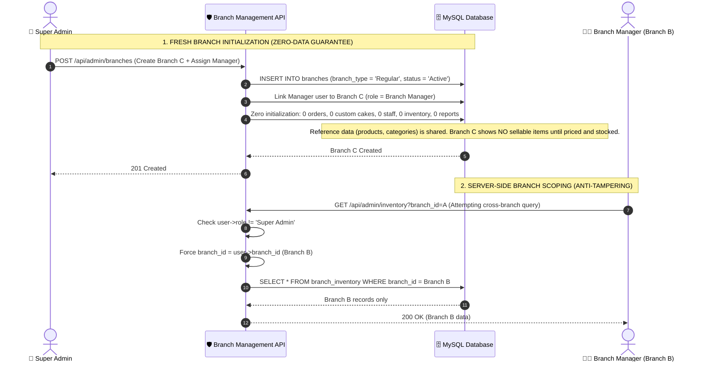
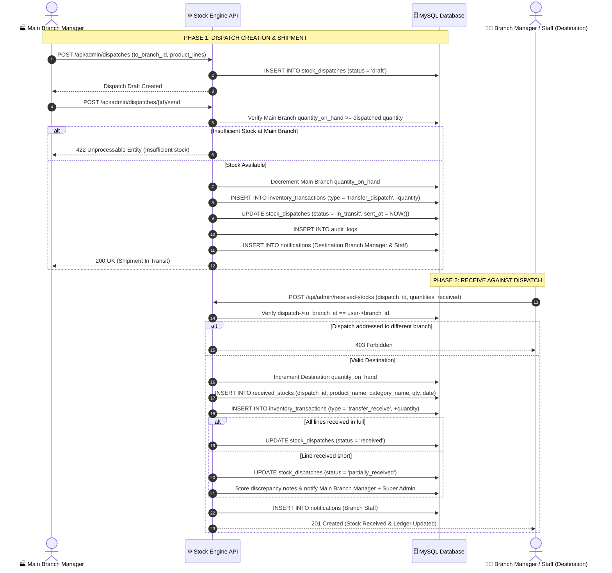
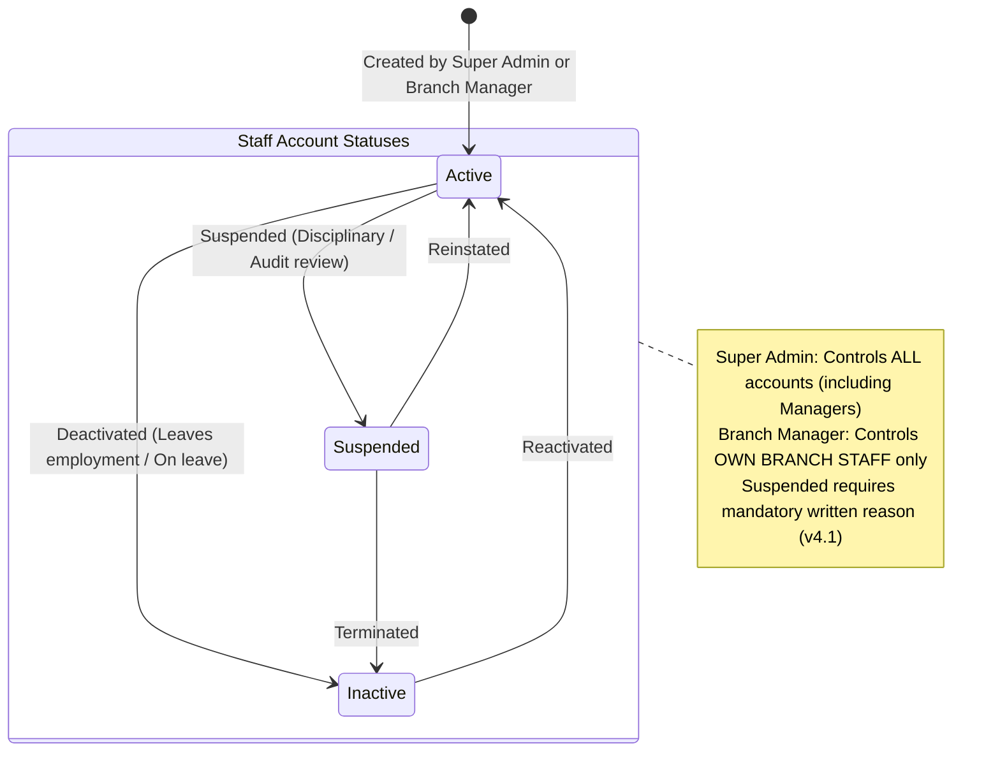
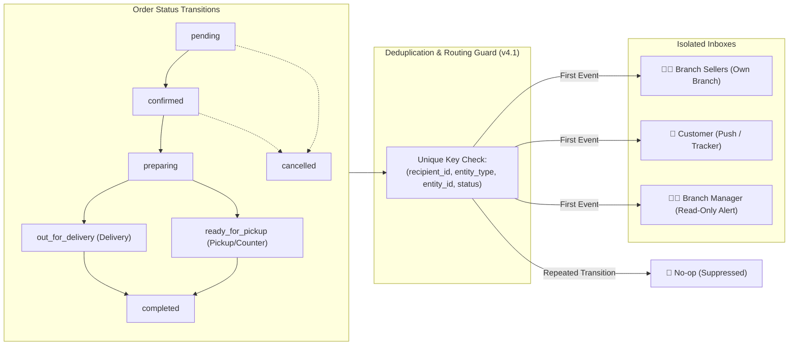
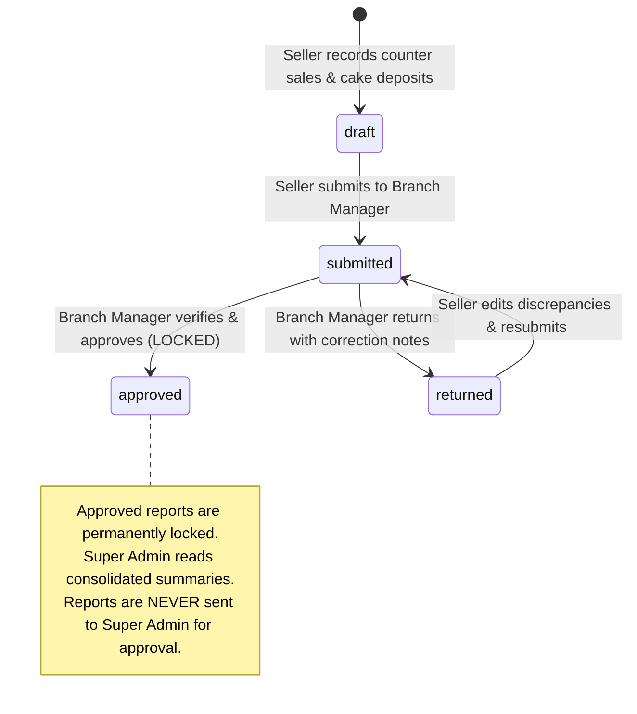
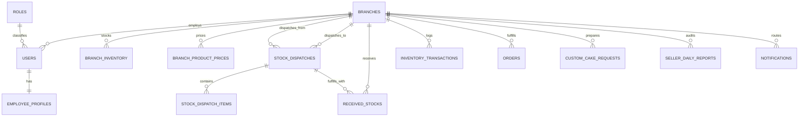

# 🧁 SweetBakes Bakery Management & E-Commerce Platform
## Comprehensive Technical, Architectural & Functional Documentation

> **Platform Version:** 4.1 Enterprise (Revision of 4.0, Release 2026.11.10)  
> **Backend Architecture:** Laravel 11 / PHP 8.2+ / REST API / Eloquent ORM  
> **Frontend Architecture:** Vue.js 3 (Composition API) / Vite / Tailwind CSS / Pinia  
> **Database:** MySQL / MariaDB (InnoDB, Strict Relational Constraints)  
> **Design Standard:** Warm Luxury Bakery Visual System (Dark Chocolate `#3D251E`, Warm Terracotta `#BA5420`, Forest Emerald `#047857`, Cream Canvas `#FAF7F2`, Soft Blush `#FFF5F2`)

---

## What Changed in v4.1

Version 4.1 fixes 14 critical defects and contradictions identified during the v4.0 review: conflicting role rules, a missing stock-dispatch workflow, schema precision errors, and unsafe defaults. Changed rules are marked **(v4.1)** throughout this document.

| # | Area | Defect in v4.0 | Resolution in v4.1 |
|---|---|---|---|
| **1** | **Role Matrix** | Contradicted between "omitted from manager dashboard" and "belongs to Branch Managers". | Single source of truth matrix: Branch Managers have **read-only order visibility** for supervisory oversight; Main Branch Manager explicitly covered across all domains. |
| **2** | **Stock Receive Roles** | Matrix said "view only" for staff, while API allowed staff. Super Admin had receive rights without a branch. | Harmonized: **Branch Manager and Branch Staff receive**; Super Admin and Sellers view only. Super Admin cannot receive stock. |
| **3** | **Dispatch & Receive Flow** | Receipts occurred without verifying stock was ever sent or available. | Linked two-step flow: Main Branch dispatches (`stock_dispatches`, `stock_dispatch_items`), and the destination branch receives against that dispatch. |
| **4** | **Main Branch Detection** | Code mixed `branch_type = 'Main'` and hardcoded `branch_id = 1`. | Main Branch is identified **exclusively by `branch_type = 'Main'`**. Hardcoded IDs such as `branch_id = 1` are strictly forbidden. |
| **5** | **HTTP Status Codes** | Mixed 403 and 422 for authorization and input failures. | Consistent standard: **HTTP 403 Forbidden** for permission/role violations; **HTTP 422 Unprocessable Entity** for validation/state errors. |
| **6** | **Staff Account Creation** | Managers could potentially create elevated roles. | Managers create **only staff roles** (`Branch Seller`, `Cashier`, `Servant`, `Branch Staff`) in their **own branch only**. Elevated requests return 403. |
| **7** | **Order Status Flow** | Tracker labels and notification statuses were misaligned. | Unified status machine shared across DB, notifications, and customer stepper: `pending`, `confirmed`, `preparing`, `out_for_delivery`, `ready_for_pickup`, `completed`, `cancelled`. |
| **8** | **Sales Reports Lifecycle** | Mixed terms ("reject" vs "return") and blurred cash vs sales. | Defined lifecycle: `draft` $\rightarrow$ `submitted` $\rightarrow$ `approved` (locked) or `returned` (with notes). Explicit separation of **Booked Sales** vs **Cash Collected**. |
| **9** | **Database Schema** | Longitude truncated values $> 99^\circ$; salary exposed in users; missing dispatch tables. | Fixed `longitude` to `DECIMAL(11,8)`; created `roles`, `employee_profiles` (salaries), `branch_product_prices`, and `stock_dispatches` tables; `users.status_reason` required when Suspended. |
| **10** | **Security & Auth** | Permissive 60/min login throttle; order tracking open to enumeration; hardcoded passwords. | Login throttle tightened to **5/min**; order tracking requires **2 factors** (`order_number` + phone/email); passwords loaded from `SEED_DEFAULT_PASSWORD`. |
| **11** | **API Completeness** | Missing dispatch, salary, quotation, and branch summary endpoints. | Added full endpoints for stock dispatches, custom-cake quotes, branch pricing, salaries, audit logs, and Super Admin consolidated read-only report summaries. |
| **12** | **Naming & Seed Data** | Legacy database name (`kenan_cake_db`) and real personal seed emails. | Standardized product name to **SweetBakes**, database `sweetbakes_db`, and development seed emails to `@sweetbakes.test`. |
| **13** | **Notifications** | Missing customer & manager notification mappings; duplicate alerts. | Complete recipient event mapping; duplicate notifications suppressed via unique composite constraint `(recipient, entity, event_or_status)`. |
| **14** | **Formatting & Math** | Broken LaTeX expressions and unescaped currency symbols. | Clean GFM KaTeX math formatting and strict currency notations. |

---

## 1. Executive Overview & System Purpose

The **SweetBakes Bakery Management & E-Commerce Platform** is an enterprise multi-branch bakery platform unifying digital customer sales, retail counter transactions, autonomous branch administration, central production distribution, and headquarters oversight:

1. **Customers (Storefront):** Choose their nearest branch, browse real-time localized stock and prices, order bakery items online, design bespoke cakes in an interactive 3D WebGL studio, and track orders with a two-factor milestone stepper.
2. **Branch Sellers and Cashiers:** Record counter orders, custom cake requests, and customer advance deposits with real-time balance calculations, and submit structured Daily Sales Reports.
3. **Branch Managers:** Supervise branch operations with read-only order queues, configure branch-specific product selling prices, manage staff account lifecycles (`Active`, `Inactive`, `Suspended`), adjust physical inventory with mandatory reason codes, receive stock dispatches, and approve or return seller reports.
4. **Main Branch Manager:** Manages the Main Branch with all manager authorities, plus creating and dispatching stock shipments to regular branches **(v4.1)**.
5. **Super Admin:** Global oversight across all branches, creates new branches with zero data guarantees, manages manager accounts and employee salaries, and reviews immutable business-wide audit and inventory ledgers.

> [!NOTE]
> **Storefront Clarification (v4.1):** The homepage features an elegant, fast-loading 2D luxury presentation with an interactive typewriter headline and smooth scroll reveals. The 3D WebGL studio is dedicated exclusively to the [`/custom-cake`](file:///c:/Kenan%20Cake/Client/src/views/customer/CustomCakeBuilderView.vue) studio page.

---

## 2. Architecture & Technology Stack

The platform operates as a stateless REST API (Laravel 11) consumed by a modern single-page client (Vue 3 / Vite), with all data isolation and authorization enforced on the server.

```mermaid
flowchart TD
    subgraph ClientLayer["🖥️ Frontend Client Layer (Vue.js 3 + Vite)"]
        CustomerUI["Customer Storefront\n(Animated Home, Shop, 3D Cake Studio, Cart, 2-Factor Tracker)"]
        SellerUI["Branch Seller Portal\n(Orders, Custom Cakes, Daily Sales Report, Local Notifications)"]
        ManagerUI["Branch Manager Portal\n(Read-Only Orders, Staff Status, Branch Pricing, Stock Receive, Report Review)"]
        MainManagerUI["Main Branch Manager Portal\n(Main Operations, Stock Dispatch Engine)"]
        AdminUI["Super Admin Portal\n(Central KPIs, Branch Management, Salaries, Audit Ledgers)"]
    end

    subgraph SecurityLayer["🛡️ Security, RBAC & Isolation Layer"]
        SanctumAuth["Sanctum Bearer Token Auth\n(Revoked immediately on Inactive/Suspended)"]
        RBACMiddleware["RoleAuthorizationMiddleware\n(Role & Scope Enforcement)"]
        BranchIsolation["Strict Server-Side Branch Isolation\n(Forces branch_id from authenticated session)"]
        RateLimiter["Security Rate Limiters\n(Login: 5/min, Tracking: 15/min)"]
    end

    subgraph BackendLayer["⚙️ Backend REST API Controllers (Laravel 11)"]
        OrderCtrl["OrderController & CustomCakeController"]
        DispatchCtrl["StockDispatchController (v4.1 Dispatch Engine)"]
        StockRcvCtrl["ReceivedStockController (v4.1 Linked Inflow Engine)"]
        ReportCtrl["OrderReportController (v4.1 Lifecycle: draft/submitted/approved/returned)"]
        CatalogCtrl["CatalogController & BranchPriceController (v4.1)"]
        InventoryCtrl["InventoryController (Ledger & Reconciliation)"]
        UserCtrl["UserController & SalaryController (v4.1)"]
        NotifyCtrl["NotificationController (v4.1 Unique Constraint Deduplication)"]
    end

    subgraph DatabaseLayer["🗄️ Relational Database (MySQL InnoDB)"]
        CoreDB[("sweetbakes_db\n(Strict Foreign Keys, Row-Level Locking,\nDecimal 11,8 GPS, Immutable Ledgers)")]
    end

    ClientLayer --> SecurityLayer
    SecurityLayer --> BackendLayer
    BackendLayer --> DatabaseLayer
```



### Core Technologies:
- **Backend:** Laravel 11 running on PHP 8.2+.
- **Authentication & Sessions:** Laravel Sanctum issuing stateless Bearer tokens. Existing tokens are **revoked immediately** when an account status changes to `Inactive` or `Suspended` **(v4.1)**.
- **Authorization:** `RoleAuthorizationMiddleware` applied to every administrative and branch route.
- **Database:** MySQL InnoDB with strict foreign key constraints, atomic transactions (`DB::transaction()`, `lockForUpdate()`), and soft deletes on critical entities. Primary keys strictly follow `<table_singular>_id`.
- **Frontend:** Vue 3 using `<script setup>` Composition API, Vue Router 4 with role navigation guards, Pinia reactive stores, and Vite bundling.
- **Design Tokens:**
  - **Dark Chocolate:** `#3D251E` (Headers, Primary Buttons, Sidebar Background)
  - **Warm Terracotta:** `#BA5420` (CTA buttons, highlight badges, interactive controls)
  - **Forest Emerald:** `#047857` / `#059669` (Stock Receive, approved badges)
  - **Cream Canvas:** `#FAF7F2` (Warm background canvas)
  - **Soft Blush Header:** Gradient `from-[#FFF5F2] via-[#FFF0EC] to-[#FCE7E1]` with border `#F7E1D7`
  - **Headings Font:** `font-serif` (Playfair Display)
  - **Body & Numeric Font:** `font-poppins` (Poppins)

---

## 3. Roles, Permissions & Scoping (RBAC)

Access is enforced across four defensive tiers: frontend navigation guards, API route middleware, controller authorization, and database query scopes. 

### Authoritative Role Permission Matrix (v4.1):
This matrix is the **single source of truth** across the entire platform:

| Role | Operational Scope | Orders & Custom Cakes | Stock Dispatch | Stock Receive | Staff Account Status | Daily Sales Reports |
|---|---|:---:|:---:|:---:|---|---|
| **Super Admin** | All branches | None *(Queues removed)* | **Full Authority (Create & Send)** *(v4.1)* | View only *(Audit)* | Any user, including managers | Read-only consolidated summary of approved reports |
| **Main Branch Manager** | Main Branch | **Read-only** *(v4.1)* | **Full Authority (Create & Send)** *(v4.1)* | Hidden *(Main never receives)* | Main Branch staff only; not own status | Reviews, approves, or returns Main Branch seller reports |
| **Branch Manager** | Own branch | **Read-only** *(v4.1)* | None *(403 Forbidden)* | **Receive & View** | Own-branch staff only; not own status | Reviews, approves, or returns own-branch seller reports |
| **Branch Seller / Cashier** | Own branch | **Full Daily Recording** | None *(403 Forbidden)* | View only | None | Records sales, books cakes, submits daily reports |
| **Branch Staff / Servant** | Own branch | Order prep only | None *(403 Forbidden)* | **Receive & View** *(v4.1)* | None | Kitchen preparation and shift logs |
| **Customer** | Public Storefront | Own orders only | None | None | Own profile only | None |

### Key Governance Rules:
1. **Manager Read-Only Order Supervision (v4.1):** Branch Managers have read-only visibility into branch orders and custom cakes. They supervise kitchen preparation and fulfillment milestones without recording retail orders.
2. **Stock Dispatch Authority (v4.1):** Full stock dispatch authority across the platform is granted exclusively to the **Main Branch Manager** and **Super Admin**. Both can create dispatch manifests, add products, validate available stock, confirm shipments, and view dispatch history. Regular Branch Managers and staff cannot create or send dispatches (HTTP 403 Forbidden). All dispatches must originate strictly from the Main Branch.
3. **Stock Receive Authority (v4.1):** Branch Managers and Branch Staff at destination branches can receive stock. Super Admin has no assigned branch and cannot receive stock.
4. **Manager Account Status Protection:** Only the Super Admin can alter a Branch Manager's or Main Branch Manager's account status. Managers attempting self-modification receive **HTTP 403 Forbidden**.
5. **Cross-Branch Isolation:** Managers attempting to alter staff, modify prices, or view transactions belonging to another branch receive **HTTP 403 Forbidden**.

---

## 4. Branch Management & Data Isolation

Every branch operates in strict isolation. The server determines the branch identity from the authenticated session, never from client input.



### Isolation & Branch Product Pricing Guarantees (v4.1):
1. **Fresh Start Guarantee:** A new branch created by the Super Admin starts with zero orders, custom cakes, staff members, reports, inventory records, branch prices, and ledger entries. Nothing is copied from existing branches.
2. **Branch Product Pricing Resolution Hierarchy:**
   - **Custom Override:** If a branch has a local active selling price configured in `branch_product_prices`, that price is authoritative.
   - **Base Price Fallback:** If no branch-specific price exists in `branch_product_prices`, the system automatically falls back to the company's base product price (`products.base_price`).
   - **Zero Available Stock Restriction:** Products remain **strictly unavailable for purchase** whenever the selected branch has zero available stock ($Q_{\text{on\_hand}} - Q_{\text{reserved}} \le 0$), regardless of whether a custom or base price is set.
   - **Authoritative Server Pricing:** Applied consistently across the storefront catalog, product details, cart sync, checkout, and backend order calculation. The backend always recalculates and validates the authoritative unit price, strictly rejecting client price tampering.
3. **Server-Side Override:** For every authenticated user except Super Admin, `branch_id` is locked to `$request->user()->branch_id`. Query parameters (`?branch_id=X`) and payload values are discarded.
4. **Customer Storefront Exception (v4.1):** Customers select a branch from active branches (`status = 'Active'`). Customer requests pass the selected `branch_id`, and customers access only their own order records.

---

## 5. Stock Dispatch & Receive Engine (v4.1)

Stock distribution operates as a linked, two-phase supply chain workflow: the Main Branch dispatches, and the regular destination branch receives against that dispatch. Full dispatch authority across the platform is granted exclusively to the **Main Branch Manager** and **Super Admin**. Regular Branch Managers and staff cannot create or send dispatches (HTTP 403 Forbidden). Dispatches must strictly originate from the Main Branch, and the system never permits dispatching more stock than the Main Branch actually has available on hand.



### Stock Dispatch Authority & Source Rules (v4.1):
1. **Full Dispatch Authority:** The **Main Branch Manager** and **Super Admin** possess full stock dispatch authority. Both roles can create dispatch manifests, add products, validate available stock, confirm shipments, and view dispatch history.
2. **Main Branch Source Enforcement:** Stock can only be dispatched from the Main Branch (`branch_type = 'Main'`). Any attempt to dispatch from a regular branch returns **HTTP 422 Unprocessable Entity**.
3. **Regular Branch Restriction:** Regular Branch Managers and staff cannot create or send dispatches (blocked by navigation UI and API middleware returning **HTTP 403 Forbidden**).
4. **Over-Dispatch Guard:** Manifest creation and shipment confirmation validate available stock ($Q_{\text{dispatch}} \le Q_{\text{main\_available}}$). Over-dispatch attempts are rejected with **HTTP 422 Unprocessable Entity**.

### Stock Receive Display Rules:
1. **Dynamic Button Visibility:** The **Stock Receive** button displays only when the active branch has `branch_type = 'Regular'` (not Main) and the logged-in role has receive authority (`Branch Manager`, `Branch Staff`).
2. **Main Branch Identification (v4.1):** Evaluated strictly by `branch_type = 'Main'`. Hardcoded IDs such as `branch_id = 1` are strictly prohibited.
3. **On-Button & Banner Information:** When stock is received, the button and top banner dynamically display:
   - **Product Name** (e.g. Strawberry Shortcake)
   - **Product Category** (e.g. Cakes)
   - **Received Quantity** (e.g. `+25 pcs`)
   - **Date Received** (e.g. `Nov 10, 2026`)
4. **Validation Standards:**
   - Destination branch is derived from the authenticated user.
   - Receiving stock for the Main Branch returns **HTTP 422**.
   - Receiving against a dispatch addressed to another branch returns **HTTP 403**.
   - Received quantity must be positive and cannot exceed dispatched quantity.

---

## 6. Staff Account Status & Governance Hierarchy

Employee account status is managed strictly from above, and self-modification is impossible:



### Status Lifecycle & Token Invalidation (v4.1):
| Status | Meaning | Login Allowed | Existing Bearer Tokens |
|---|---|:---:|---|
| `Active` | Full access according to role permissions | Yes | Valid |
| `Inactive` | Account disabled | No | **Revoked immediately** *(v4.1)* |
| `Suspended` | Restricted pending operational/audit review | No | **Revoked immediately** *(v4.1)* (Written reason mandatory) |

### Who May Change Whose Status (v4.1):
| Actor | May Change | May NOT Change |
|---|---|---|
| **Super Admin** | Any user, including Branch Managers and Main Branch Manager | Own status *(Prevents system lockout)* |
| **Main Branch Manager** | Staff of Main Branch only | Own status; other managers; staff of other branches |
| **Branch Manager** | Staff of own branch (`Branch Seller`, `Cashier`, `Servant`, `Branch Staff`) | Own status; other managers; staff of other branches |
| **Everyone Else** | None | Anything |

### Account Creation Restrictions (v4.1):
When a Branch Manager creates a user (`POST /api/admin/users`), the system forces the new account into the manager's own branch and permits only staff roles (`Branch Seller`, `Cashier`, `Servant`, `Branch Staff`). Attempts to create `Branch Manager`, `Main Branch Manager`, or `Super Admin` accounts return **HTTP 403 Forbidden**.

---

## 7. Unified Notification Engine

Notifications are dispatched once per event, routed to the correct role in the correct branch, and synchronized with the customer milestone tracker:



### Authoritative Order Status & Milestone Mapping (v4.1):
| Internal Status | Customer Tracker Label | Customer Notified | Delivery Orders | Pickup / Counter Orders |
|---|---|:---:|:---:|:---:|
| `pending` | Order Placed | Yes *(Receipt)* | Step 1 | Step 1 |
| `confirmed` | Confirmed | Yes | Step 2 | Step 2 |
| `preparing` | In Kitchen / Preparing | No *(Kitchen step)* | Step 3 | Step 3 |
| `out_for_delivery` | Out for Delivery | Yes | Step 4 | Skipped |
| `ready_for_pickup` | Ready for Pickup | Yes | Skipped | Step 4 |
| `completed` | Delivered / Collected | Yes | Step 5 | Step 5 |
| `cancelled` | Cancelled | Yes | Aborted | Aborted |

### Recipients by System Event:
| Event | Target Recipients |
|---|---|
| New Order / Custom Cake Request | Sellers of that specific branch |
| Order Status Change or Cancellation | Customer + Branch Manager (Read-only alert) |
| Stock Dispatched to Branch | Destination Branch Manager + Branch Staff |
| Stock Received | Main Branch Manager; Super Admin on discrepancy only |
| Seller Daily Report Submitted | Manager of that branch |
| Seller Daily Report Approved / Returned | The submitting seller |
| Inventory at or below Reorder Level | Branch Manager of that branch |
| Account Suspended | Super Admin (for managers); audit log otherwise |

### 7.1. Frontend Notification & Modal Dialog Architecture (v4.1)
All native browser dialogs (`window.alert`, `window.confirm`, `window.prompt`) have been replaced across 100% of the storefront, customer portal, seller counter, and branch manager interfaces with a reactive SweetBakes design system:

1. **Toast Notifications ([`ToastNotification.vue`](file:///c:/Kenan%20Cake/Client/src/components/ToastNotification.vue) / [`toast.js`](file:///c:/Kenan%20Cake/Client/src/stores/toast.js)):**
   - **Success (Green):** Crisp SVG checkmark, emerald border, auto-dismiss in 4.5s.
   - **Error (Red):** SVG alert circle, rose border, preserves authoritative backend message.
   - **Warning (Amber):** SVG alert triangle, amber border, alerts validation discrepancies.
   - **Information (Blue/Navy):** SVG information circle, sky border for operational status updates.
   - **Deduplication Guard:** Built-in suppression for rapid duplicate triggers within 2 seconds.

2. **Promise-Based Modal Dialogs ([`ModalDialog.vue`](file:///c:/Kenan%20Cake/Client/src/components/ModalDialog.vue) / [`dialog.js`](file:///c:/Kenan%20Cake/Client/src/stores/dialog.js)):**
   - **Confirmations (`await dialog.confirm(...)`):** Supports `danger` (red), `warning` (amber), `primary` (terracotta), and `success` (emerald) actions with custom action labels and backdrop blur.
   - **Prompts (`await dialog.prompt(...)`):** Supports input text and multiline textareas (e.g. cancellation reasons, price updates, return notes) with full keyboard accessibility (Escape to dismiss, Enter to submit).
   - **Keyboard & Accessibility:** Focus auto-trapping, ARIA dialog roles, and smooth enter/exit animations.

---

## 8. Customer Storefront & Homepage

### 8.1. Homepage Visual System
- Clean, fast-loading 2D luxury presentation with zero 3D canvas overhead on mobile.
- Typewriter animation headline cycling through curated slogans with natural typing speed, blinking cursor, and pause-before-backspace.
- Smooth scroll reveals (fade-in, slide-up) for product categories, feature highlights, and baker story.
- Users with `prefers-reduced-motion` enabled receive clean static typography without animation **(v4.1)**.

### 8.2. Interactive 3D Custom Cake Studio ([`/custom-cake`](file:///c:/Kenan%20Cake/Client/src/views/customer/CustomCakeBuilderView.vue))
- Dedicated 3D WebGL studio with 1 kg, 2 kg, 3 kg, and multi-tiered cylinder cake geometries.
- Full orbit rotation, touch pinch-zoom, and turntable auto-spin.
- 3D occasion toppers (birthday candle with flame, wedding rings, celebration crest, piped inscription ribbon).
- WebGL high-resolution snapshot generation attached to customer requests for seller quotation.

### 8.3. Two-Factor Order Tracker ([`/track-order`](file:///c:/Kenan%20Cake/Client/src/views/customer/OrderTrackingView.vue)) (v4.1)
- Requires **two factors** to view order status: `order_number` (`ORD-xxxx` or `CCR-xxxx`) PLUS customer phone number or email.
- Entering order number alone returns a generic not-found message, preventing order enumeration.
- Rate-limited to 15 lookups per minute per IP.
- Displays fulfillment milestone stepper matching Section 7.

### 8.4. Customer Order Receipt & Single-Page Printing Architecture (v4.1)
The receipt printing engine ([`OrderStatusView.vue`](file:///c:/Kenan%20Cake/Client/src/views/customer/OrderStatusView.vue)) provides single-click printing constrained to exactly **one A4 page**:

1. **Isolation & Element Suppression:**
   - Website header, top bar, navigation, mobile drawers, contact section, footer, wave SVGs, buttons ("Print Receipt", "Cancel Order", "Continue Shopping"), and interactive stepper timelines are marked `print:hidden` and suppressed via `@media print`.
   - Dark mode background colors are overridden to crisp `#FFFFFF` with high-contrast text (`#1A1412` and `#3D251E`) ensuring readability in both color and monochrome printing.
2. **Essential Information Hierarchy:**
   - **Bakery Identity & Branch Header:** SweetBakes logo, business name, fulfilling branch name, branch address, contact phone, and email.
   - **Document Headings & Identifiers:** `ORDER RECEIPT` heading, order number (`#ORD-XXXXX`), placement timestamp, and receipt print timestamp.
   - **Customer & Fulfillment Box:** Customer name, phone, optional email, fulfillment mode (`Doorstep Courier Delivery` vs `Bakery Counter Pickup`), and delivery address.
   - **Itemized Breakdown:** Tabular items grid with product name, quantity, unit price, and subtotal.
   - **Financials & Payment:** Payment method, payment status badge (`PAID ✓`), transaction reference, subtotal, delivery fee, and grand total.
   - **Appreciation & Support Note:** Warm customer appreciation note and branch support contact prompt.
3. **Print Layout Rules:**
   - `@page { size: A4 portrait; margin: 8mm 10mm; }`
   - `page-break-inside: avoid;` and `break-inside: avoid;` on `#order-receipt-container`.
   - Browser document title dynamically set to `SweetBakes-Receipt-[Order-Number]` during print for clean default PDF file naming.

---

## 9. Sales Reporting Architecture

Sellers record daily counter transactions and submit one Daily Sales Report per branch per day. The Branch Manager audits and approves the report or returns it for correction.



### Financial Definitions & Protected Formulas (v4.1):
- **Booked Sales:** Total agreed value of orders and custom cakes booked that day.
- **Cash Collected:** Actual currency collected that day (counter sales + advance deposits + balance payments).
- **Outstanding Balance:** Booked value awaiting payment upon collection or delivery.

$$\text{Line Total} = (\text{Quantity} \times \text{Unit Price}) - \text{Discount}$$
$$\text{Remaining Balance} = \text{Line Total} - \text{Advance Payment}$$
$$\text{Total Daily Booked Sales} = \text{Regular Orders Revenue} + \text{Custom Cake Revenue}$$

> [!IMPORTANT]
> The server recalculates every figure upon submission; client-submitted totals are ignored. Advance payments cannot exceed line totals, and remaining balances cannot be negative.

---

## 10. Database Schema & Migration Architecture

### Key Relational Tables (v4.1):



#### 1. `branches`
| Column | Type | Constraints / Description |
|---|---|---|
| `branch_id` | BIGINT UNSIGNED (PK) | Unique branch ID |
| `branch_name` | VARCHAR(255) | Name of bakery location |
| `branch_code` | VARCHAR(50) (Unique) | Unique identifier (e.g. `BR-BUA`) |
| `branch_type` | ENUM('Main', 'Regular') | Exactly one 'Main' branch; all others 'Regular' |
| `city` / `address` | VARCHAR(255) | Physical geographic location |
| `latitude` | DECIMAL(10,8) | Range $\pm 90^\circ$ |
| `longitude` | DECIMAL(11,8) | **Fixed in v4.1:** Range $\pm 180^\circ$ requires 3 integer digits |
| `manager_id` | BIGINT UNSIGNED (FK) | Assigned Branch Manager |
| `status` | ENUM('Active', 'Inactive') | Branch operating status |

#### 2. `users`, `roles` & `employee_profiles` (v4.1)
- `roles`: `role_id` (PK), `role_name`, `slug` (`super_admin`, `main_branch_manager`, `branch_manager`, `branch_seller`, `cashier`, `servant`, `branch_staff`, `customer`).
- `users`: `user_id` (PK), `role_id` (FK), `branch_id` (FK, nullable), `full_name`, `email` (Unique), `status` (`Active`, `Inactive`, `Suspended`), `status_reason` (TEXT, nullable, **required when Suspended**).
- `employee_profiles` **(v4.1)**: `user_id` (PK/FK), `salary` (`DECIMAL(10,2)`). Segregates compensation data away from the customer-facing user entity; managed exclusively by Super Admin.

#### 3. `stock_dispatches` & `stock_dispatch_items` (v4.1)
- `stock_dispatches`: `dispatch_id` (PK), `from_branch_id` (FK, Main Branch), `to_branch_id` (FK, Destination), `status` (`draft`, `in_transit`, `partially_received`, `received`, `cancelled`), `reference_number` (Unique), `created_by` (FK), `sent_at` (TIMESTAMP).
- `stock_dispatch_items`: `dispatch_id` (FK), `product_id` (FK), `quantity_dispatched` (INT UNSIGNED), `quantity_received` (INT UNSIGNED).

#### 4. `received_stocks` (v4.1)
- `received_stock_id` (PK), `branch_id` (FK), `product_id` (FK), `dispatch_id` (FK, nullable in v4.0, **mandatory in v4.1**), `product_name`, `category_name`, `receiver_name`, `quantity_received` (INT UNSIGNED), `date_received` (DATE), `received_by` (FK), `notes` (TEXT).

#### 5. `branch_product_prices` (v4.1)
- `branch_id` (FK), `product_id` (FK), `price` (`DECIMAL(10,2)`), `active` (`BOOLEAN`), `updated_by` (FK). Unique composite key `(branch_id, product_id)`.

#### 6. Guest Tracking & Email Verification Schema (v4.1)
- `orders.customer_email`: `VARCHAR(150)`, nullable, indexed for customer order history linking.
- `custom_cake_requests.customer_email`: `VARCHAR(150)`, nullable, indexed for bespoke cake request linking.
- `users.email_verified_at`: `TIMESTAMP`, nullable. Authoritative indicator of verified email ownership. Guest records link strictly when this timestamp is present.
- `email_verifications`: `id`, `email` (`VARCHAR(150)`), `code` (`VARCHAR(10)`), `expires_at` (`TIMESTAMP`), `created_at`. Stores 6-digit OTP codes with 15-minute expiration windows.

---

## 11. Complete RESTful API Route Reference

All `/api/admin/*` endpoints require a Sanctum Bearer token and pass through `RoleAuthorizationMiddleware`.

### Public Storefront & Authentication:
| Method | Endpoint | Rate Limit | Description |
|---|---|:---:|---|
| `POST` | `/api/auth/login` | **5 / min** *(v4.1)* | Bearer token authentication with IP/email throttling |
| `POST` | `/api/auth/register` | 10 / min | Customer account registration |
| `POST` | `/api/auth/send-verification-code` | 5 / min *(v4.1)* | Request 6-digit email ownership OTP code |
| `POST` | `/api/auth/verify-email` | 10 / min *(v4.1)* | Verify email OTP code and atomically link guest history |
| `GET` | `/api/branches` | 60 / min | Active branches with GPS coordinates |
| `GET` | `/api/products` | 60 / min | Catalog listing with localized branch pricing |
| `POST` | `/api/orders` | 15 / min | Place online retail order (stores `customer_email`) |
| `POST` | `/api/orders/track` | **15 / min** *(v4.1)* | **Two-factor tracking** (`order_number` + phone/email) |
| `POST` | `/api/custom-cakes` | 15 / min | Submit 3D cake design brief with WebGL snapshot & email |

### Orders & Custom Cakes:
| Method | Endpoint | Allowed Roles | Description |
|---|---|---|---|
| `GET` | `/api/admin/orders` | Sellers, Staff, **Managers (Read-only)** | List branch orders *(v4.1)* |
| `PATCH` | `/api/admin/orders/{id}/status` | Sellers, Staff (Preparation) | Update order milestone along Section 7 flow |
| `POST` | `/api/admin/orders` | Sellers, Cashiers | Record in-store counter order |
| `GET` | `/api/admin/custom-cakes` | Sellers, Staff, **Managers (Read-only)** | List branch custom-cake requests *(v4.1)* |
| `POST` | `/api/admin/custom-cakes/{id}/quote` | Sellers | Set final price quotation and deposit *(v4.1)* |

### Stock Dispatch & Inflow Engine:
| Method | Endpoint | Allowed Roles | Description |
|---|---|---|---|
| `POST` | `/api/admin/dispatches` | **Main Branch Manager, Super Admin** | Create draft dispatch manifest *(v4.1)* |
| `POST` | `/api/admin/dispatches/{id}/send` | **Main Branch Manager, Super Admin** | Confirm shipment; lowers Main stock *(v4.1)* |
| `POST` | `/api/admin/dispatches/{id}/cancel` | **Main Branch Manager, Super Admin** | Cancel draft or in-transit dispatch manifest *(v4.1)* |
| `GET` | `/api/admin/dispatches` | Super Admin, Managers, Staff | List dispatches *(v4.1)* |
| `GET` | `/api/admin/received-stocks` | Super Admin, Managers, Sellers, Staff | List received stocks scoped to branch |
| `POST` | `/api/admin/received-stocks` | **Branch Manager, Branch Staff** | Receive stock against dispatch *(v4.1)* |
| `GET` | `/api/admin/inventory` | Admin, Managers, Sellers, Staff | View on-hand inventory levels |
| `POST` | `/api/admin/inventory/adjust` | Managers | Physical count adjustments with mandatory reason |
| `GET` | `/api/admin/inventory/transactions` | Admin, Managers, Staff | View immutable transaction ledger |
| `GET` | `/api/admin/inventory/reconcile` | Admin, Managers | Verify stock balance against transaction history |

### Branch Governance & Personnel:
| Method | Endpoint | Allowed Roles | Description |
|---|---|---|---|
| `GET` | `/api/admin/branches` | Super Admin, Managers | List branches |
| `POST` | `/api/admin/branches` | Super Admin | Create branch with fresh zero-data initialization |
| `PATCH` | `/api/admin/branches/{id}` | Super Admin | Update branch name, manager, or GPS coordinates |
| `GET / PUT` | `/api/admin/branch-prices` | Managers | Read and set branch-specific selling prices *(v4.1)* |
| `GET` | `/api/admin/users` | Super Admin, Managers | Staff directory (Managers see own branch only) |
| `POST` | `/api/admin/users` | Super Admin, Managers | Recruit staff (Managers restricted to staff roles in own branch) |
| `PATCH` | `/api/admin/users/{id}/status` | Super Admin, Managers | Update account status (`Active`, `Inactive`, `Suspended`) |
| `PUT` | `/api/admin/users/{id}/salary` | Super Admin | Manage employee salary in `employee_profiles` *(v4.1)* |
| `GET` | `/api/admin/audit-logs` | Super Admin | Business-wide audit trail *(v4.1)* |

### Sales Reporting:
| Method | Endpoint | Allowed Roles | Description |
|---|---|---|---|
| `GET` | `/api/admin/reports/seller/today-orders` | Sellers, Cashiers | 1-click import of today's branch transactions |
| `GET` | `/api/admin/reports/seller/my-reports` | Sellers, Cashiers | Historical submitted daily reports |
| `POST` | `/api/admin/reports/seller/daily` | Sellers, Cashiers | Save draft or submit Daily Sales Report |
| `GET` | `/api/admin/reports/manager/seller-reports`| Managers | View seller reports for assigned branch |
| `POST` | `/api/admin/reports/manager/seller-reports/{id}/verify` | Managers | Approve or return seller report with notes |
| `GET` | `/api/admin/reports/admin/branch-summary` | Super Admin | Read-only summary of approved branch reports *(v4.1)* |

---

## 12. Guest Customer Order History & Verified Email Linking Engine (v4.1)

To protect customer privacy while providing seamless historical order tracking, the platform manages guest order histories using cryptographic email ownership verification:

```mermaid
sequenceDiagram
    autonumber
    actor Guest as 🛒 Guest Customer
    participant Storefront as 🖥️ Storefront (Vue 3)
    participant API as 🛡️ Auth & Order API
    participant DB as 🗄️ MySQL Database

    Note over Guest,DB: 1. GUEST PURCHASES & BESPOKE CAKE BRIEFS
    Guest->>Storefront: Places order / submits custom cake brief with email "guest@gmail.com"
    Storefront->>API: POST /api/orders (customer_email = "guest@gmail.com")
    API->>DB: INSERT INTO orders (user_id = shadow_id, customer_email = "guest@gmail.com")
    API-->>Guest: Order Confirmed (ORD-xxxx)

    Note over Guest,DB: 2. CUSTOMER REGISTRATION
    Guest->>Storefront: Registers new account with email "guest@gmail.com"
    Storefront->>API: POST /api/auth/register
    API->>DB: INSERT INTO users (email = "guest@gmail.com", email_verified_at = NULL)
    API-->>Guest: 201 Created (email unverified; guest records remain unlinked)

    Note over Guest,DB: 3. EMAIL OWNERSHIP VERIFICATION & ATOMIC LINKING
    Guest->>Storefront: Clicks "Send Verification Code" on Account Dashboard
    Storefront->>API: POST /api/auth/send-verification-code
    API->>DB: INSERT INTO email_verifications (code = "729481", expires_at = +15 min)
    API-->>Guest: OTP delivered to email

    Guest->>Storefront: Submits 6-digit OTP code "729481"
    Storefront->>API: POST /api/auth/verify-email (code = "729481")
    API->>DB: Verify code & mark users.email_verified_at = NOW()
    API->>DB: UPDATE orders SET user_id = new_user_id WHERE customer_email = "guest@gmail.com" AND shadow_user
    API->>DB: UPDATE custom_cake_requests SET user_id = new_user_id WHERE customer_email = "guest@gmail.com" AND shadow_user
    API->>DB: Log audit event "Linked historical orders and custom cakes"
    API-->>Storefront: 200 OK (Email Verified & History Linked)
    Storefront-->>Guest: Dashboard instantly populates with all past orders & bespoke cakes
```

### Guest History Security Invariants:
1. **Mandatory Email Ownership Verification:** Unverified user accounts are strictly forbidden from viewing, claiming, or linking historical guest records. Guest orders are linked **only after `email_verified_at` is confirmed**.
2. **Duplicate Linking Prevention:** The atomic linking procedure (`linkGuestHistory()`) targets exclusively unlinked records or shadow placeholder accounts (`@sweetbakes.local`). Repeated execution finds 0 newly linked records and produces no side effects.
3. **Cross-Customer Isolation:** A registered customer cannot link or access records belonging to another registered customer.
4. **Data Preservation Guarantee:** Linking updates only the relational owner (`user_id`). Order numbers, product lines, quantities, unit prices, applied promotions, delivery fees, payment logs, and fulfillment status histories remain 100% immutable.
5. **Dashboard Integration:** Authenticated customers see a verified status badge (`✓ Verified`) and direct tab navigation to past orders and custom cakes. Unverified accounts see a dedicated verification banner with 1-click OTP requesting and entry.

---

## 13. Verification & Quality Assurance Suite

Every rule in this specification is verified through an automated test suite ([`Backend/test_v41_comprehensive.php`](file:///c:/Kenan%20Cake/Backend/test_v41_comprehensive.php)):

```bash
php Backend/test_v41_comprehensive.php
# Verification Result: Total Passed: 82 | Total Failed: 0
```

| Area | Test Scenario | Expected Outcome |
|---|---|---|
| **Stock Receive** | Receive for Main Branch (`branch_type = 'Main'`) | HTTP 422 Unprocessable Entity |
| **Stock Receive** | Receive with no dispatch or dispatch for another branch | HTTP 422 (no dispatch) or HTTP 403 (wrong branch) |
| **Stock Receive** | Valid receive against dispatch at regular branch | `quantity_on_hand` increments; `transfer_receive` transaction; audit log; notification |
| **Stock Receive** | Receive quantity exceeding dispatched quantity | HTTP 422 Unprocessable Entity |
| **Stock Dispatch** | Dispatch quantity exceeding Main Branch on-hand | HTTP 422 Unprocessable Entity |
| **Stock Dispatch** | Valid dispatch confirmed | Main stock decrements; `transfer_dispatch` transaction; status `in_transit` |
| **Data Isolation** | Branch A queries received stocks, orders, or staff | Exactly 0 records belonging to Branch B, even with query tampering |
| **Data Isolation** | New branch initialized by Super Admin | All counters, sales, orders, and financial records start at 0 |
| **Status Governance** | Super Admin changes any user status | 200 OK |
| **Status Governance** | Any user attempts self-status modification | HTTP 403 Forbidden |
| **Status Governance** | Manager attempts altering staff of another branch | HTTP 403 Forbidden |
| **Status Governance** | Account set to `Suspended` without reason | HTTP 422 Unprocessable Entity |
| **Status Governance** | Manager attempts creating Branch Manager or Admin | HTTP 403 Forbidden |
| **Session Invalidation**| Account changed to `Inactive` or `Suspended` | Existing Sanctum tokens revoked immediately |
| **Notifications** | Order milestone updated | Only relevant branch sellers, branch manager, and customer notified |
| **Notifications** | Identical milestone triggered twice | Duplicate suppressed via unique composite constraint |
| **Security** | 6th login attempt within 1 minute from same IP/email | HTTP 429 Too Many Requests |
| **Security** | Order tracking queried with order number alone | Generic not-found response (Requires phone/email factor) |
| **Database** | High-cardinality composite indexes active | `idx_orders_branch_status_placed`, `idx_inv_tx_branch_prod_created`, `idx_reports_branch_date_status` verified |
| **Guest Linking**| Customer registers with phone used for guest orders | Historical orders & custom cakes automatically linked to user ID |
| **Financial** | Refund amount exceeding recorded payment | HTTP 422 Unprocessable Entity ($amount <= $payment->amount) |
| **Inventory** | Order cancelled / refunded | Reserved stock released cleanly (`quantity = 0`) with zero phantom drift |
| **Pricing** | Branch price update & read via `/api/admin/branch-prices` | HTTP 200 OK with scoped branch pricing |
| **Build & Assets** | Production frontend build (`npm run build`) | Zero errors and zero warnings |

---

## 13. System Maintenance & Quick Start

### Local Development Environment:
```bash
# 1. Start MySQL in XAMPP on port 3306 (database: kenean-cake-and-bread or sweetbakes_db)
# Ensure Backend/.env has DB_CONNECTION=mysql, DB_DATABASE=kenean-cake-and-bread (or sweetbakes_db), DB_USERNAME=root, DB_PASSWORD=

# 2. Run database migrations
php Backend/artisan migrate

# 3. Start Laravel REST API server
php Backend/artisan serve --port=8000

# 4. Start Vue 3 Vite Client
npm --prefix Client run dev
# Running at: http://localhost:5173
```

### Production Build:
```bash
npm --prefix Client run build
```

### Development Seed Accounts (v4.1):
| Role | Email |
|---|---|
| **Super Admin** | `admin@sweetbakes.test` |
| **Main Branch Manager** | `main.manager@sweetbakes.test` |
| **Branch Seller / Cashier** | `seller@sweetbakes.test` |

> [!CAUTION]
> Seed credentials are for local development and testing only. Passwords are set from the `SEED_DEFAULT_PASSWORD` environment variable and must be changed upon first login.

---

## 14. Complete Website Functionality & Feature Catalog

This section provides an exhaustive, screen-by-screen, and role-by-role functional catalog of the entire SweetBakes platform, detailing user workflows, interactive components, data inputs, automated validations, and state machines across both the customer-facing storefront and administrative operations portals.

### 14.1. Customer-Facing E-Commerce Storefront (`/`)

#### 1. Global Navigation & Header ([`CustomerLayout.vue`](file:///c:/Kenan%20Cake/Client/src/layouts/CustomerLayout.vue))
- **Brand Identity & Home Link:** SweetBakes gold & terracotta luxury logo routing to `/`.
- **Navigation Links:** Instant access to `Home`, `Shop`, `Custom Cake Studio`, `Branches`, `About`, `FAQ`, and `Contact`.
- **Active Branch Selector Dropdown:**
  - Displays currently selected bakery branch (e.g., "Bole Medhanialem Branch").
  - Dropdown modal reveals all active company branches with physical addresses, phone numbers, and live operational status (`Open Now` / `Closed`).
  - Switching branches automatically recalibrates catalog product availability, stock counters, delivery fees, and estimated fulfillment times without clearing selected cart items.
- **Header Actions & Utilities:**
  - **Live Search Bar:** Real-time debounced typeahead searching product titles, descriptions, and categories.
  - **Wishlist Trigger:** Quick-access modal displaying customer saved favorites with 1-click "Move to Cart".
  - **Slide-Out Cart Drawer Trigger:** Displays badge counter of total cart items. Clicking opens the high-speed slide-out cart drawer without navigating away from the current page.
  - **Authentication / Account Menu:** Dynamically toggles between "Sign In / Register" buttons and an authenticated customer profile dropdown ("My Account", "Order History", "Saved Addresses", "Logout").

#### 2. Homepage & Brand Showcase ([`CustomerHomeView.vue`](file:///c:/Kenan%20Cake/Client/src/views/customer/CustomerHomeView.vue))
- **Hero Presentation:**
  - High-impact luxury bakery banner utilizing deep chocolate (`#3D251E`) and warm cream tones.
  - Dynamic Typewriter Headline: Cycles through bespoke artisanal slogans ("Handcrafted with Passion", "Artisanal Breads Baked Fresh Daily", "Bespoke Celebration Cakes") with authentic humanized typing cadence, blinking cursor, and smooth pause intervals.
  - Motion Accessibility: Automatically honors `prefers-reduced-motion` OS settings by rendering clean static typography.
  - Dual Primary CTAs: "Explore Menu" (routes to `/shop`) and "Design 3D Cake" (routes to `/custom-cake`).
- **Signature Category Showcase:**
  - Visual category cards: *Artisan Cakes & Gateaux*, *Viennoiserie & Pastries*, *Sourdough & Artisan Breads*, *Savory Delights*, and *Bespoke Celebration Cakes*.
  - Hover micro-interactions with elevation lift and category badge counters.
- **Featured Best-Sellers Grid:**
  - Dynamic product cards featuring high-resolution photography, localized branch pricing, dietary indicators (e.g. Vegetarian, Nut-Free, Eggless), and instant "Add to Cart" actions.
- **Quality & Craftsmanship Pillars:**
  - Highlights bakery core values: 100% Pure Butter Pastries, 24-Hour Cold Fermentation Sourdoughs, Fresh Daily Baking, Master Pâtissiers, and Halal-Certified Ingredients.
- **Customer Testimonials & Social Proof:**
  - Authentic customer reviews with star ratings, occasion tags (e.g. "Wedding Cake", "Corporate Catering"), and reviewer location.
- **Interactive Branch Locator & Operating Hours:**
  - Quick-lookup directory of all branches with interactive map triggers, opening hours, direct phone dialing, and "Set as My Branch" buttons.
- **Comprehensive Footer:**
  - Brand mission statement, quick navigation links, newsletter subscription, payment partner badges, copyright, and social media channels.

#### 3. Menu & Product Catalog ([`ShopView.vue`](file:///c:/Kenan%20Cake/Client/src/views/customer/ShopView.vue))
- **Category Filter Pills:** Seamless filtering across `All Products`, `Cakes`, `Pastries`, `Breads`, `Savory`, and `Specialty Occasions`.
- **Search & Multi-Facet Sorting:**
  - Instant text filter by keyword.
  - Sorting options: *Featured / Best Sellers*, *Price: Low to High*, *Price: High to Low*, and *Newest Arrivals*.
- **Real-Time Stock Availability Indicators:**
  - `In Stock` (Forest Emerald badge): Product is plentiful at selected branch.
  - `Only X Left` (Warm Amber badge): Inventory count is below 5 units, indicating scarcity.
  - `Out of Stock` (Muted Gray badge): Add-to-cart button is disabled with an optional "Notify When Available" prompt.
- **Interactive Product Cards:**
  - Image preview with subtle zoom on hover.
  - Quick-add button with quantity selector.
  - Localized Branch Pricing: Displays branch-specific pricing if configured by the branch manager; falls back to company base price.

#### 4. Product Detail View ([`ProductDetailView.vue`](file:///c:/Kenan%20Cake/Client/src/views/customer/ProductDetailView.vue))
- **Product Media Gallery:** High-resolution main image with zoom and alternate thumbnails.
- **Product Overview & Metadata:** Full description, serving size recommendations, weight/dimensions, and storage instructions.
- **Nutritional Information & Allergen Disclosures:** Explicit allergen flags (Gluten, Dairy, Eggs, Tree Nuts, Soy).
- **Branch Stock & Quantity Selector:**
  - Dynamic quantity counter clamped strictly between 1 and the selected branch's on-hand inventory.
  - Real-time subtotal calculation.
- **Related Products Carousel:** Intelligent recommendations based on complementary categories (e.g. suggesting pastries when browsing cakes).

#### 5. Interactive 3D Custom Cake Studio ([`CustomCakeBuilderView.vue`](file:///c:/Kenan%20Cake/Client/src/views/customer/CustomCakeBuilderView.vue))
- **Interactive Three.js WebGL 3D Canvas:**
  - Real-time 3D rendering of custom cake geometry with physically based lighting and studio environment reflections.
  - Full 360-degree orbit rotation, vertical tilt control, touch pinch-to-zoom, and auto-turntable spin mode.
- **Customization Options & Layers:**
  - **Tier Configuration:** Single Tier (1 kg / 2 kg), Two Tiers (3 kg / 4 kg), or Three Tiers (5 kg+ grand celebration).
  - **Sponge Flavors:** Belgian Dark Chocolate, Bourbon Vanilla Bean, Red Velvet, Funfetti Confetti, Spiced Carrot Walnut, and Zesty Lemon.
  - **Frosting Textures & Finishes:** Satin Smooth Fondant, Rustic Buttercream Swirls, Naked / Semi-Naked Crumb Coat, Horizontal Ribbed Lines, and Cascading Chocolate/Caramel Drip.
  - **Frosting Color Palette:** Interactive hex color picker plus curated bakery swatches (Champagne Cream, Dusty Rose, Lavender Mist, Sage Green, Midnight Navy, White Pearl).
  - **Accents & 3D Toppers:** Animated 3D birthday candles with procedural flickering flame, Wedding Rings, Golden Celebration Crest, and Edible Pearl Sprinkles.
  - **Custom Piped Inscription:** Text box allowing customers to type personalized greeting (e.g. "Happy 30th Birthday Sarah!"); text is dynamically textured onto a sugar ribbon in the 3D scene.
- **Instant Dynamic Price Estimation:**
  - Mathematical live quotation calculating base tier cost + premium flavor modifiers + topper additions.
- **WebGL Snapshot Capture:**
  - 1-Click snapshot generator captures the current 3D canvas viewport as a high-resolution PNG data blob, automatically bundled with the order request for bakery decorators.
- **Booking & Request Submission Form:**
  - Fulfillment branch selector, event date and time picker, contact phone and email, and special dietary/allergen notes.
  - Submits to `/api/custom-cakes` where it routes directly to the designated branch seller queue.

#### 6. Cart Drawer & Dedicated Cart View ([`CartView.vue`](file:///c:/Kenan%20Cake/Client/src/views/customer/CartView.vue) & [`CartDrawer.vue`](file:///c:/Kenan%20Cake/Client/src/components/cart/CartDrawer.vue))
- **Slide-Out Drawer & Full Page:** Consistent cart experience whether quickly reviewing via slide-out drawer or visiting `/cart`.
- **Itemized Ledger:** Product thumbnail, title, selected options, unit price, quantity modifier (`+`/`-` with on-hand stock boundary check), line total, and remove item action.
- **Branch Change Protection:** Warns customer if changing branches causes any cart item to exceed the new branch's available inventory.
- **Order Financial Summary:** Itemized subtotal, estimated tax, estimated branch delivery fee, and grand total.

#### 7. Multi-Step Checkout ([`CheckoutView.vue`](file:///c:/Kenan%20Cake/Client/src/views/customer/CheckoutView.vue))
- **Step 1: Fulfillment Selection:**
  - *Branch Pickup:* Customer selects pickup date and time window; zero delivery fee applied.
  - *Doorstep Delivery:* Customer inputs delivery address, city/neighborhood, landmark instructions, recipient name, and active mobile number. Delivery fee dynamically calculated.
- **Step 2: Customer Contact Information:**
  - Supports both authenticated customer profiles and guest checkouts.
  - Phone number validated for SMS notifications and two-factor tracking lookups.
- **Step 3: Payment Method Selection:**
  - *Cash on Delivery / Pickup:* Pay cash upon collection or arrival.
  - *Direct Bank Transfer / Telebirr:* Displays bakery bank account numbers and QR code with receipt upload voucher.
  - *Online Debit/Credit Card:* Card payment gateway integration.
  - *Advance Deposit:* For large orders, pay a required minimum advance deposit with remainder due at collection.
- **Order Placement & Stock Reservation:**
  - Submits transaction to `/api/orders`.
  - Atomically reserves on-hand stock and generates an authoritative order number (`ORD-xxxx`).
  - Redirects customer to immediate Order Confirmation screen with order number and tracking links.

#### 8. Two-Factor Public Order Tracker ([`OrderTrackingView.vue`](file:///c:/Kenan%20Cake/Client/src/views/customer/OrderTrackingView.vue))
- **Two-Factor Authentication Security (v4.1):**
  - Requires both the **Order Reference Number** (`ORD-xxxx` or `CCR-xxxx`) AND matching **Customer Phone Number or Email**.
  - Prevents public enumeration and brute-force order scraping.
- **Fulfillment Milestone Stepper:**
  - Visual 5-step milestone tracking:
    1. *Order Placed:* Received by bakery system.
    2. *Confirmed:* Verified by branch seller.
    3. *In Kitchen / Preparing:* Baked and decorated by master baker.
    4. *Ready for Pickup / Out for Delivery:* Packaged in bakery box awaiting pickup or dispatched with courier.
    5. *Delivered / Collected:* Successfully handed to customer.
- **Itemized Order Receipt:** Displays items ordered, fulfillment branch address, contact phone, and payment status.
- **Privacy Protection:** Customer phone numbers and emails are masked in tracking API responses to safeguard customer PII.

#### 9. Customer Account & Authentication ([`LoginView.vue`](file:///c:/Kenan%20Cake/Client/src/views/customer/LoginView.vue), [`RegisterView.vue`](file:///c:/Kenan%20Cake/Client/src/views/customer/RegisterView.vue), [`AccountView.vue`](file:///c:/Kenan%20Cake/Client/src/views/customer/AccountView.vue))
- **Rate-Limited Authentication:** Login throttled to 5 attempts per minute per IP/account to prevent brute-force attacks.
- **Guest Order Auto-Linking (v4.1):** Registering an account with a mobile phone number automatically queries and links all historical guest retail orders and custom cake requests placed with that phone number.
- **Customer Dashboard:**
  - Recent orders directory with 1-click status check and printable PDF receipts.
  - Custom cake quotation tracker: Review quotes provided by branch sellers, approve quote, and view deposit status.
  - Saved delivery addresses management.
  - Saved Wishlist collection.

---

### 14.2. Branch Seller & Cashier Operations Portal (`/admin`)

#### 1. Seller POS & Walk-In Counter Sales ([`OrdersView.vue`](file:///c:/Kenan%20Cake/Client/src/views/admin/OrdersView.vue))
- **Counter Order Entry:** Fast, tactile point-of-sale interface designed for touchscreens and barcode/keyboard entry.
- **Localized Catalog Search:** Instant search scoped exclusively to the seller's assigned branch inventory and localized pricing.
- **Transaction Processing:** Add items, adjust quantities with real-time stock clamping, apply line-item or order-level discounts with seller note.
- **Payment Recording:** Accept cash, card, mobile money (Telebirr), or split payments; automatic change calculator.
- **Thermal Receipt Printing:** Instant browser print dialog formatted for 80mm thermal receipt printers with company logo, branch tax details, itemized breakdown, and pickup QR code.

#### 2. Online Order Management ([`OrdersView.vue`](file:///c:/Kenan%20Cake/Client/src/views/admin/OrdersView.vue))
- **Scoped Branch Order Queue:** Sellers see only orders assigned to their branch.
- **Order Milestone Transitions:**
  - Update status along the strict state machine: `pending` $\rightarrow$ `confirmed` $\rightarrow$ `preparing` $\rightarrow$ `ready_for_pickup` / `out_for_delivery` $\rightarrow$ `completed`.
  - Trigger automated role-filtered customer notifications and supervisory alerts on each transition.
- **Order Cancellation:** Allows authorized cancellation with mandatory reason logging; automatically releases reserved stock back into on-hand branch inventory.

#### 3. Custom Cake Inquiries & Quotations ([`CustomCakesView.vue`](file:///c:/Kenan%20Cake/Client/src/views/admin/CustomCakesView.vue))
- **Bespoke Request Inbox:** Lists all 3D cake requests submitted by customers for the seller's branch.
- **Design Review Modal:** Inspect customer 3D WebGL snapshot, selected tiers, sponge flavors, frosting colors, piped inscription text, reference photo uploads, and event due date.
- **Formal Price Quotation Engine:**
  - Enter total agreed price and required advance deposit (minimum percentage enforced).
  - Specify cake decorator notes and production prep time.
  - System notifies customer to review and accept the official quotation.
- **Deposit & Final Payment Recording:**
  - Record cash/transfer deposit upon receipt.
  - Automatic balance calculation: $\text{Remaining Balance} = \text{Agreed Price} - \text{Advance Deposit}$.
  - Record final balance payment when customer collects cake.

#### 4. Seller Daily Sales Report ([`SellerDailyReportView.vue`](file:///c:/Kenan%20Cake/Client/src/views/admin/SellerDailyReportView.vue))
- **1-Click Transaction Import:** Auto-populates all counter sales, online collections, and custom cake deposits completed at the branch today.
- **Financial Separation of Booked Sales vs Cash Collected (v4.1):**
  - **Booked Sales:** Total agreed revenue generated today.
  - **Cash Collected:** Actual currency physically collected (Cash in Till + Card Slips + Verified Bank Transfers + Cake Deposits).
- **Payment Method Reconciliation:** Separate input buckets for Cash, POS Card, and Bank/Mobile Transfers.
- **Discrepancy Audit:** Notes field for any cash over/short differences.
- **Lifecycle Actions:**
  - `Save Draft`: Save progress and return later.
  - `Submit to Manager`: Locks seller edits and submits report to the Branch Manager for formal verification.
  - `Returned Alert Banner`: If the Branch Manager returns the report, displays an amber warning banner with the manager's mandatory review notes, unlocking all fields for correction and resubmission.

#### 5. Localized Branch Notifications ([`NotificationsView.vue`](file:///c:/Kenan%20Cake/Client/src/views/admin/NotificationsView.vue))
- Scoped strictly to the seller's branch ID.
- Real-time alerts for incoming online orders, custom cake submissions, customer cancellations, and manager report decisions.
- Mark as read, mark all as read, and filter by unread status.

---

### 14.3. Branch Manager Supervisory Administration (`/admin`)

#### 1. Branch Executive Overview ([`OverviewView.vue`](file:///c:/Kenan%20Cake/Client/src/views/admin/OverviewView.vue))
- Real-time KPIs for assigned branch: Today's Total Sales, Month-to-Date Revenue, Pending Order Queue, Low Stock Alerts, and Active Staff Count.
- Hourly sales distribution and best-selling bakery categories charts.

#### 2. Supervisory Order Oversight ([`OrdersView.vue`](file:///c:/Kenan%20Cake/Client/src/views/admin/OrdersView.vue))
- Read-only supervisory visibility over all branch orders and custom cake requests (v4.1).
- Allows managers to monitor kitchen throughput and delivery pacing without interfering with seller cash drawer accountability.

#### 3. Branch Staff Governance & Security ([`UsersRolesView.vue`](file:///c:/Kenan%20Cake/Client/src/views/admin/UsersRolesView.vue))
- **Scoped Staff Directory:** Manager views only employees assigned to their own branch.
- **Recruit Branch Staff:** Create staff accounts restricted exclusively to operational roles (`Branch Seller`, `Cashier`, `Servant`, `Branch Staff`). Attempts to create elevated roles return HTTP 403 Forbidden.
- **Account Status Management:**
  - Toggle staff status: `Active`, `Inactive`, or `Suspended`.
  - Mandatory Reason Requirement: Suspending an employee requires entering a detailed `status_reason`.
  - Immediate Session Termination: Suspending or deactivating an account immediately revokes all active Sanctum API bearer tokens, terminating active sessions instantly.
  - Self-Modification Protection: Managers cannot alter their own account status or assign themselves to other branches (enforced by backend validation).

#### 4. Branch Product Pricing Customization ([`ProductsPricesView.vue`](file:///c:/Kenan%20Cake/Client/src/views/admin/ProductsPricesView.vue))
- View base company master catalog alongside branch-specific selling prices.
- Set or update custom selling prices for any product at their branch (e.g. premium airport branch vs neighborhood branch).
- Stored with unique composite key `(branch_id, product_id)` in `branch_product_prices`.

#### 5. Inventory Management & Stock Reconciliation ([`InventoryView.vue`](file:///c:/Kenan%20Cake/Client/src/views/admin/InventoryView.vue))
- Real-time inventory grid showing SKU, Product Name, Category, Minimum Safety Level, and On-Hand Balance.
- Color-coded safety alerts: Green (Healthy), Amber (Reorder Warning), Red (Depleted / Critical).
- **Physical Count Adjustment Modal:**
  - Perform manual stock adjustments following physical stocktakes.
  - Mandatory adjustment reason: *Damaged in Kitchen*, *Expired / Spoiled*, *Physical Count Discrepancy*, *Sample / Promotion*.
  - Every adjustment writes an immutable record to `inventory_transactions` with user ID and timestamp.

#### 6. Stock Receiving Workflow ([`InventoryView.vue`](file:///c:/Kenan%20Cake/Client/src/views/admin/InventoryView.vue)) *(Regular Branches Only)*
- **Dedicated "Stock Receive" Button:** Prominently displayed for all regular branches; automatically hidden on the Main Branch.
- **Incoming Dispatches Modal:**
  - Lists all pending shipments dispatched by Main Branch to this destination.
  - Displays Product Name, Category, Dispatched Quantity, Reference Number, and Dispatch Date.
- **Verified Receiving Input:**
  - Manager or authorized staff inputs actual received quantity.
  - Over-Receiving Guard: Blocks entering a quantity greater than dispatched ($Q_{\text{received}} \le Q_{\text{dispatched}}$).
  - Submission atomically increments branch `quantity_on_hand`, updates dispatch status to `received`, records an audit transaction, and notifies Main Branch.

#### 7. Seller Daily Report Verification ([`ManagerOrderReportsView.vue`](file:///c:/Kenan%20Cake/Client/src/views/admin/ManagerOrderReportsView.vue))
- Audit queue of daily reports submitted by branch sellers.
- Side-by-side verification: Recorded physical cash vs system-booked sales.
- **Manager Actions:**
  - `Approve Report`: Formally approves the report, permanently locking all numbers from further modification and archiving it for Super Admin review.
  - `Return for Correction`: Requires entering mandatory review notes explaining discrepancies; changes report status to `Returned` and alerts the seller to rectify errors.

---

### 14.4. Main Branch Distribution & Logistics Engine (`/admin`)

#### 1. Central Distribution Dispatch Hub ([`DistributionView.vue`](file:///c:/Kenan%20Cake/Client/src/views/admin/DistributionView.vue) & [`NewTransferView.vue`](file:///c:/Kenan%20Cake/Client/src/views/admin/NewTransferView.vue))
- Available exclusively to the Main Branch Manager and Super Admin.
- **Create Stock Dispatch Manifest:**
  - Select Destination Branch from active branches list.
  - Multi-Item Dispatch Builder: Add catalog products and specify quantities to transfer.
  - Stock Safeguard: Validates dispatch quantity against Main Branch available on-hand inventory ($Q_{\text{dispatch}} \le Q_{\text{main}}$). Prevents negative inventory dispatches.
- **Shipment Confirmation & Tracking:**
  - "Confirm & Send Dispatch" action immediately deducts inventory from Main Branch with a `transfer_dispatch` audit transaction.
  - Generates unique dispatch reference code (`DSP-xxxx`).
  - Sets shipment status to `in_transit`.
  - Dispatches automated notification to destination branch manager and staff alerting them of incoming stock.
- **Dispatch Manifest Archive:**
  - Historical archive of all dispatches, delivery statuses, receiver signatures, and reconciliation notes.

---

### 14.5. Super Admin Headquarters Governance (`/admin`)

#### 1. Master Executive Dashboard ([`OverviewView.vue`](file:///c:/Kenan%20Cake/Client/src/views/admin/OverviewView.vue))
- Cross-branch enterprise overview: Aggregated Gross Revenue, Total Daily Orders, Network-Wide Inventory Valuation, and Branch Revenue Ranking.
- Comparative analytics charting branch sales trends side-by-side.

#### 2. Multi-Branch Network Administration ([`BranchManagementView.vue`](file:///c:/Kenan%20Cake/Client/src/views/admin/BranchManagementView.vue))
- **Add New Branch Modal:**
  - Input Branch Name, Unique Branch Code, Branch Type (`Main` vs `Regular`), Physical Address, City, GPS Coordinates (Latitude $\pm 90^\circ$, Longitude $\pm 180^\circ$ with `DECIMAL(11,8)` precision), and Assign Initial Branch Manager.
  - **Zero-Data Guarantee:** Newly created branches automatically initialize with strictly 0 orders, 0 inventory, 0 custom cakes, and isolated tenant boundaries.
- **Branch Lifecycle Management:** Edit branch details, update assigned managers, or toggle branch operational status (`Active` / `Inactive`).

#### 3. Enterprise Staff Directory & Manager Governance ([`UsersRolesView.vue`](file:///c:/Kenan%20Cake/Client/src/views/admin/UsersRolesView.vue))
- Company-wide personnel directory with multi-branch and role filters.
- Create and assign Branch Managers.
- Manage Branch Manager account statuses (`Active`, `Inactive`, `Suspended`). Branch Managers can only have their status modified by the Super Admin.

#### 4. Employee Compensation & Payroll ([`SalariesView.vue`](file:///c:/Kenan%20Cake/Client/src/views/admin/SalariesView.vue))
- Compensation management stored in isolated `employee_profiles` table.
- View and update monthly salaries, pay grades, and compensation history.
- Salary data is strictly restricted from regular branch managers and staff.

#### 5. Consolidated Branch Daily Sales Summaries ([`/api/admin/reports/admin/branch-summary`](file:///c:/Kenan%20Cake/Backend/routes/api.php))
- Super Admin read-only view synthesizing all approved branch daily reports.
- Comprehensive financial rollup: Aggregates total booked sales, cash collected, card revenue, mobile payments, and advance cake deposits across the entire network.

#### 6. Immutable System Audit Trail ([`AuditLogView.vue`](file:///c:/Kenan%20Cake/Client/src/views/admin/AuditLogView.vue))
- Comprehensive tamper-evident audit log recording every critical administrative action:
  - User status changes and account suspensions with mandatory reason.
  - Inventory count adjustments with discrepancy reason.
  - Price overrides and branch-specific pricing updates.
  - Financial refunds and order cancellations.
  - Timestamp, actor user ID, client IP address, before/after state diff.

---

### 14.6. Cross-Cutting System Architectural Guarantees

1. **Strict Multi-Branch Tenant Isolation:**
   - Every database query for branch-scoped models (`Order`, `ReceivedStock`, `StockDispatch`, `SellerDailyReport`, `CustomCakeRequest`) automatically enforces `branch_id` from the authenticated user's session via `BranchIsolationScope`.
   - Tampered request payloads attempting to pass foreign `branch_id` values are rejected or forced to the authorized branch ID.
2. **Strict Financial Accounting Integrity:**
   - All monetary calculations are cast to `decimal:2` in PHP and stored as `DECIMAL(10,2)` in MySQL. Floating-point numbers are strictly prohibited.
   - Refund ceiling enforcement: Refund amounts are capped by the original payment ($A_{\text{refund}} \le A_{\text{payment}}$).
   - Order cancellation automatically releases reserved inventory without causing negative inventory phantom drift.
3. **Double-Hop Inventory Protection:**
   - On-hand stock is guarded using database row locks (`lockForUpdate()`) during checkout, counter sales, dispatches, and receiving.
   - Over-receiving and over-dispatching are blocked by backend request validators (`StockDispatchRequest`, `StockReceiveRequest`).
4. **Targeted Notification Routing & Deduplication:**
   - Super Admin is explicitly excluded from granular operational order notifications.
   - Branch sellers receive only order and custom cake alerts for their branch.
   - 24-hour composite unique constraint prevents duplicate alert spamming for repeated order milestone events.
