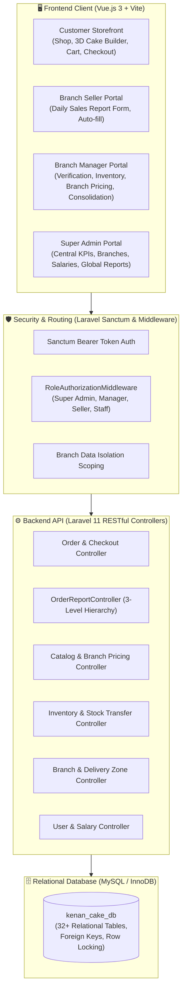
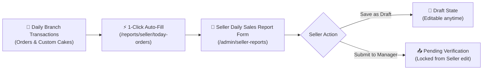
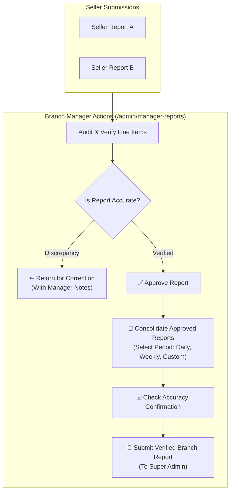
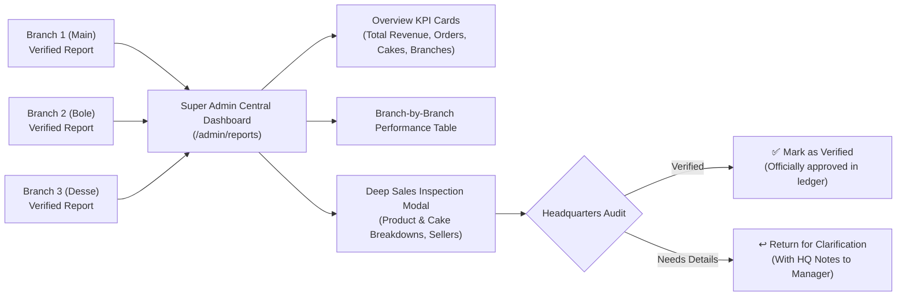
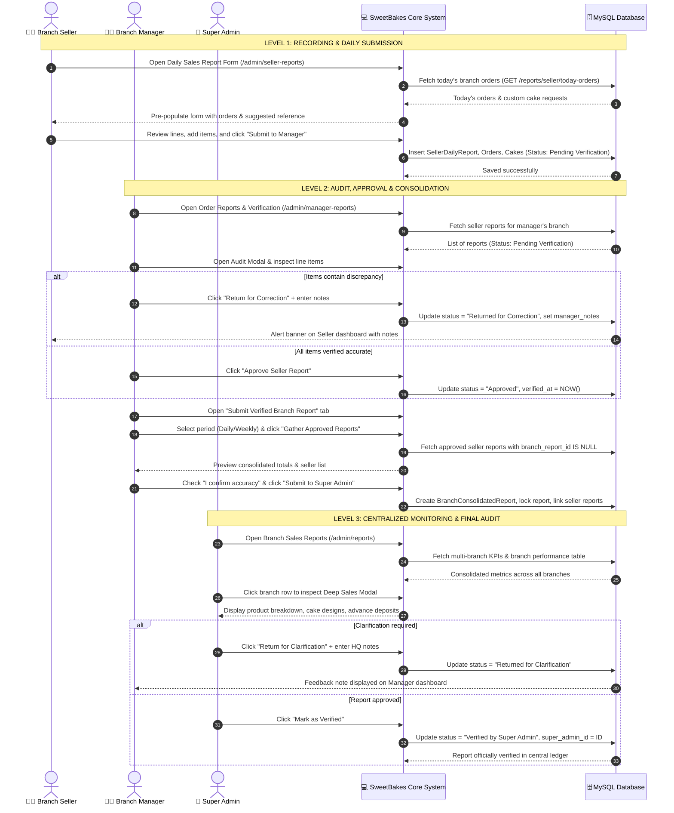
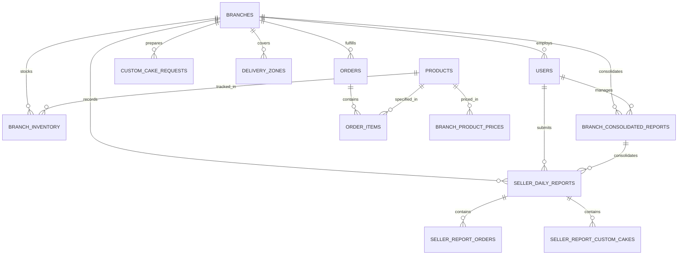

# 🧁 SweetBakes Bakery Management & E-Commerce Platform
## Comprehensive Technical, Architectural & Functional Documentation

> **Platform Version:** 3.5 Enterprise  
> **Backend Architecture:** Laravel 11 / PHP 8.2+ / REST API / Eloquent ORM  
> **Frontend Architecture:** Vue.js 3 (Composition API) / Vite / Tailwind CSS / Pinia  
> **Database:** MySQL / MariaDB (InnoDB, Strict Relational Constraints, 32+ Tables)  
> **Design Standard:** Warm Luxury Bakery Visual System (Chocolate `#3D251E`, Blush `#FAF7F2`, `#FFF5F2` gradients)

---

## 1. Executive Overview & System Purpose

The **SweetBakes Bakery Management & E-Commerce Platform** is a full-stack, enterprise-grade multi-branch bakery platform designed to integrate all aspects of bakery operations:
1. **Customer E-Commerce Storefront:** Enables customers to select their nearest branch, browse real-time inventory, place retail bakery orders, configure bespoke celebratory cakes in an interactive 3D builder, and track delivery progress in real time.
2. **Branch-Level Retail Operations:** Provides Branch Sellers and Cashiers with streamlined tools to record daily counter sales, custom cake orders, and customer advance deposits with automatic calculation safeguards.
3. **Branch Management & Quality Verification:** Equips Branch Managers with isolated branch-level oversight to manage local inventory, set branch product prices, verify seller daily sales reports, and consolidate branch sales for headquarters.
4. **Headquarters Centralized Governance:** Empowers the Super Admin to oversee multi-branch revenue, manage branch physical locations and Google Maps coordinates, enforce staff quotas, control employee salaries, dispatch central warehouse transfers, and verify consolidated branch reports.

---

## 2. System Architecture & Technology Stack



### Core Technologies:
- **Backend Framework:** Laravel 11 with PHP 8.2+.
- **Authentication:** Laravel Sanctum using stateless Bearer tokens and role-based middleware (`RoleAuthorizationMiddleware`).
- **Database Engine:** MySQL InnoDB with strict foreign key constraints, atomic transactions (`DB::beginTransaction()`, `lockForUpdate()`), and soft deletes on critical entities.
- **Frontend Framework:** Vue 3 using the Composition API (`<script setup>`), Vue Router 4 with navigation guards, Pinia for reactive store management, and Vite for lightning-fast bundling.
- **Styling & Design System:** Tailwind CSS with custom bakery color tokens:
  - **Dark Chocolate Primary:** `#3D251E` (Headers, Primary Buttons, Sidebar Background)
  - **Warm Terracotta Active:** `#57392C` (Active navigation states, badges)
  - **Cream Canvas:** `#FAF7F2` (Warm background canvas)
  - **Soft Blush Header:** Gradient `from-[#FFF5F2] via-[#FFF0EC] to-[#FCE7E1]` with border `#F7E1D7`
  - **Headings Font:** `font-serif` (Playfair Display)
  - **Body & Numeric Font:** `font-poppins` (Poppins)

---

## 3. User Roles, Permissions & Scoping Hierarchy (RBAC)

The system enforces strict Role-Based Access Control (RBAC) at both the backend controller/middleware level and the frontend UI navigation layer:

| Role | Operational Scope | Storefront / Admin | Key Responsibilities |
|---|---|---|---|
| **Super Admin** | Whole Business (All Branches) | Admin Portal | Branch management, system settings, salary controls, multi-branch revenue oversight, and final report verification. |
| **Main Branch Manager** | Main Branch & Distribution | Admin Portal | Main branch stock, transfer creation and dispatches, staff management, and local pricing. |
| **Branch Manager / Branch Admin** | Assigned Branch Only | Admin Portal | Branch staff management, local inventory & adjustments, branch pricing, seller report verification, and branch report consolidation. |
| **Branch Seller / Cashier** | Assigned Branch Only | Admin Portal | In-store order recording, custom cake booking, customer deposits, and submitting Daily Sales Reports. |
| **Branch Staff / Servant** | Assigned Branch Only | Admin Portal | Order preparation, kitchen fulfillment, inventory viewing, and staff shift reports. |
| **Customer** | Public Storefront | Storefront | Catalog browsing, custom cake builder, cart, checkout, delivery tracking, and order history. |

> [!IMPORTANT]
> **Strict Branch Data Isolation:** Users with branch-scoped roles (`Branch Manager`, `Branch Seller`, `Branch Staff`) are cryptographically bound to their `branch_id`. The backend automatically scopes all database queries to prevent unauthorized cross-branch data access.

### Role Persona Simulator (Super Admin Feature):
In [`AdminLayout.vue`](file:///c:/Kenan%20Cake/Client/src/layouts/AdminLayout.vue), the Super Admin can instantly simulate any role (e.g. simulate a Branch Manager in Desse or a Branch Seller in Bole) using the simulator dropdown in the top navigation bar to test UI and permissions without logging out.

---

## 4. Customer Storefront Functionality

### 4.1. Dynamic Branch Discovery & Header Binding
- Customers select their preferred bakery branch from the dynamic branch picker modal.
- The active branch is saved in the reactive Pinia store (`useBranchStore`) and persisted in `localStorage`.
- All catalog listings, prices, delivery zones, and stock statuses automatically adapt to the selected branch.

### 4.2. Catalog & Branch-Specific Pricing
- Each bakery product has a central **Base Price**.
- If a Branch Manager sets a customized branch selling price via [`branch_product_prices`](file:///c:/Kenan%20Cake/Backend/database/migrations/2026_11_07_120000_create_core_bakery_system_tables.php), the customer automatically sees the localized price for that branch.
- Stock availability indicators (`In Stock`, `Low Stock`, `Sold Out`) reflect the actual `quantity_on_hand` in the branch's inventory.

### 4.3. Shopping Cart & Inventory Reservation
- When a customer adds items to the cart, the system ensures items cannot exceed available stock.
- Multi-item checkout is processed within database transactions to ensure inventory consistency.

### 4.4. Delivery Address & Zone Verification (Coverage Enforcement)
- During checkout (Step 3: Delivery Address & Zone), the platform retrieves the delivery zones associated with the chosen branch.
- Customers outside active delivery coverage (e.g., outside the active Desse or Bole delivery zone) receive an alert prompt preventing unsupported dispatches.
- Delivery fees are computed dynamically based on the selected branch's delivery zones.

### 4.5. Interactive Custom Cake Studio
- Located at [`/custom-cake`](file:///c:/Kenan%20Cake/Client/src/views/customer/CustomCakeBuilderView.vue).
- Allows customers to design custom celebratory cakes:
  - **Category:** Birthday, Wedding, Anniversary, Graduation, Custom Celebration.
  - **Size & Tiers:** 1 kg, 2 kg, 3 kg, or Tiered arrangements.
  - **Flavors & Fillings:** Vanilla Sponge, Chocolate Fudge, Red Velvet, Caramel Crunch, Fruit Fusion.
  - **Design Notes & Message:** Written dedications and visual styling instructions.
  - **Reference Image Upload:** Upload design reference images.
  - **Event Date:** Scheduled delivery or collection date.
- Upon submission, a custom cake record is created with status `Pending` for Branch Manager quotation and seller recording.

### 4.6. Real-Time Order Tracking
- Located at [`/track-order`](file:///c:/Kenan%20Cake/Client/src/views/customer/OrderTrackingView.vue).
- Customers enter their unique order number (`ORD-xxxx` or `CCR-xxxx`) to view an interactive milestone stepper:
  $$\text{Placed} \longrightarrow \text{Confirmed} \longrightarrow \text{Preparing / In Kitchen} \longrightarrow \text{Out for Delivery / Ready for Pickup} \longrightarrow \text{Completed}$$

### 4.7. Contact Page with Google Maps Synchronization
- Located at [`/contact`](file:///c:/Kenan%20Cake/Client/src/views/customer/ContactView.vue).
- Synchronized directly with the `branches` database table. Outdated hardcoded addresses have been replaced with live GPS coordinates, branch opening hours, phone numbers, and clickable Google Maps directions links.

---

## 5. Branch Seller / Cashier: Daily Sales Reporting System

The Branch Seller portal establishes accountability for counter sales and cake bookings:



### Key Capabilities in [`SellerDailyReportView.vue`](file:///c:/Kenan%20Cake/Client/src/views/admin/SellerDailyReportView.vue):
1. **Auto-Assigned General Information:**
   - **Branch Name:** Auto-assigned from logged-in user's branch.
   - **Seller Name:** Auto-assigned from user profile.
   - **Report Date:** Defaults to today.
   - **Reference Number:** Automatically generated (`DSR-BR{id}-YYYYMMDD-{RAND}`).
2. **1-Click Auto-Fill Today's Orders:**
   - Endpoint: `GET /api/admin/reports/seller/today-orders`.
   - Imports all regular bakery orders and custom cake requests recorded in the system for that branch today into editable table rows.
3. **Regular Bakery Orders Section:**
   - Order number, product name, category, quantity, unit price, order status, payment status, customer information.
   - **Formula:** $\text{Total Amount} = \text{Quantity} \times \text{Unit Price}$ (Protected & read-only).
4. **Custom Cake Orders Section:**
   - Cake order number, customer name, cake category, design/flavor, size/weight, quantity, unit price, advance payment, delivery date, status.
   - **Formulas:**
     $$\text{Total Price} = \text{Quantity} \times \text{Unit Price}$$
     $$\text{Remaining Balance} = \text{Total Price} - \text{Advance Payment}$$
5. **Live Auto-Calculated Summary (Protected):**
   - Regular orders count & products sold.
   - Regular order revenue.
   - Custom cake count & cakes sold.
   - Total booked custom cake revenue.
   - Total advance payments collected (Cash in).
   - Total outstanding balances receivable.
   - **Combined Daily Sales Revenue** & **Total Payments Received Today**.
6. **Actions & History:**
   - *Save as Draft*: Keeps status as `Draft`.
   - *Submit to Branch Manager*: Changes status to `Pending Verification` and sets `submitted_at`.
   - *Correction Alert Banner*: If returned by manager, displays exact correction notes with guidance to adjust and resubmit.

---

## 6. Branch Manager: Verification, Pricing, Inventory & Consolidation

The Branch Manager portal acts as the quality and financial checkpoint between branch sellers and corporate headquarters:



### Key Capabilities in [`ManagerOrderReportsView.vue`](file:///c:/Kenan%20Cake/Client/src/views/admin/ManagerOrderReportsView.vue):
1. **Verify Seller Reports Tab:**
   - Displays all seller reports exclusively for the manager's assigned branch.
   - Filter pills: `All`, `Pending Verification`, `Approved`, `Returned for Correction`.
   - **Verification Audit Modal:** Cross-checks regular item quantities, prices, custom cake designs, deposits, and balances.
   - **Actions:**
     - `✅ Approve Report`: Marks report as `Approved`, records `manager_id` and timestamp.
     - `↩️ Return for Correction`: Requires a correction explanation note and sends report back to seller.
2. **Submit Verified Branch Sales Report Tab:**
   - **Automated Period Consolidation:** Select period (`Daily`, `Weekly`, `Monthly`, `Custom`) and date range.
   - **1-Click Gathering:** Pulls all approved seller reports that have not yet been attached to a consolidated report.
   - **No Duplicate Data Entry:** Summarizes all regular orders, custom cakes, revenues, advance deposits, and balances automatically.
   - **Mandatory Accuracy Checkbox:** Requires the manager to certify that all line items and receipts were cross-checked.
   - **Submission:** Submits locked report (`BCR-BR{id}-YYYYMMDD-{RAND}`) to Super Admin with status `Submitted to Super Admin`.
3. **Branch Submissions History Tab:**
   - Tracks all submissions to Super Admin and displays any HQ feedback or clarification requests.

---

## 7. Super Admin: Centralized Monitoring & Governance

The Super Admin portal provides centralized business intelligence across all branches:



### Key Capabilities in [`ReportsView.vue`](file:///c:/Kenan%20Cake/Client/src/views/admin/ReportsView.vue):
1. **Overview KPI Cards:**
   - **Total Branches:** Active operating branches.
   - **Total Submitted Branch Reports:** Submissions from managers.
   - **Awaiting Review:** Reports pending HQ audit (`Submitted to Super Admin`).
   - **Verified Reports:** Reports officially approved by HQ (`Verified by Super Admin`).
   - **Total Regular Orders Across Branches.**
   - **Total Custom Cakes Across Branches.**
   - **Total Multi-Branch Revenue:** Summed strictly from verified/submitted branch reports.
   - **Advance Payments Collected & Outstanding Balances Receivable.**
2. **Branch-by-Branch Performance Table:**
   - Format:
     | Branch | Regular Orders | Custom Cakes | Total Revenue | Manager | Report Status | Actions |
     |---|---:|---:|---:|---|---|:---:|
   - Clickable branch rows to inspect detailed branch reports.
3. **Deep Sales Inspection Modal:**
   - Full breakdown of regular bakery items sold with quantities and totals.
   - Custom cake orders breakdown (categories, designs, sizes, deposits, balances).
   - Reporting sellers list.
   - Verifying manager and timeline.
4. **Headquarters Actions:**
   - `✅ Mark as Verified`: Marks consolidated report as officially verified by headquarters.
   - `↩️ Return for Clarification`: Returns report to the Branch Manager with feedback notes for reconciliation.
5. **Data Export & Reporting:**
   - 1-Click CSV export and Print/PDF formatted layouts.

---

## 8. Complete Three-Level Reporting Workflow (Sequence Diagram)



---

## 9. Core Database Schema & Entity Relationships



### Table Definitions for Key Entities:
1. **`branches`**: Primary branch entity (`branch_id`, `branch_name`, `branch_code`, `city`, `address`, `latitude`, `longitude`, `phone`, `manager_id`, `status`, `is_shopping_enabled`).
2. **`seller_daily_reports`**: Level 1 seller report (`id`, `report_reference`, `branch_id`, `seller_id`, `report_date`, `status`, `manager_id`, `manager_notes`, `regular_order_revenue`, `custom_cake_revenue`, `total_advance_payments`, `total_outstanding_balances`, `combined_daily_revenue`, `total_payments_received`).
3. **`seller_report_orders`**: Regular bakery item lines (`id`, `report_id`, `order_number`, `product_name`, `category`, `quantity`, `unit_price`, `total_amount`, `order_status`, `payment_status`, `customer_info`).
4. **`seller_report_custom_cakes`**: Custom cake order lines (`id`, `report_id`, `cake_order_number`, `customer_name`, `cake_category`, `cake_type_design`, `size_weight`, `quantity`, `unit_price`, `total_price`, `advance_payment`, `remaining_balance`, `delivery_date`, `order_status`, `payment_status`).
5. **`branch_consolidated_reports`**: Level 2 consolidated branch report (`id`, `report_reference`, `branch_id`, `manager_id`, `period_type`, `period_start`, `period_end`, `sellers_included_count`, `status`, `confirmed_accuracy`, `manager_notes`, `super_admin_notes`, `super_admin_id`, `is_locked`, `total_regular_orders`, `total_custom_cake_orders`, `total_branch_revenue`, `breakdown_json`).

---

## 10. Deployment, Operational Verification & Maintenance

### 10.1. Running the System Locally
1. **MySQL Database Engine:**
   - Port: `3306`
   - Database Name: `kenan_cake_db`
2. **Laravel Backend API:**
   ```bash
   php Backend/artisan serve --port=8000
   ```
3. **Vue.js Frontend (Vite Dev Server):**
   ```bash
   npm --prefix Client run dev
   ```
   - Running at: `http://localhost:5173`

### 10.2. Compiling for Production
```bash
npm --prefix Client run build
```
Outputs optimized, tree-shaken static assets directly to `Client/dist`.

### 10.3. Running Database Migrations
```bash
php Backend/artisan migrate
```

### 10.4. Default System Accounts
- **Super Admin:** `admin@goldencrust.com`
- **Main Branch Manager:** `amirhassen2027@gmail.com`
- **Branch Seller / Cashier:** `amirhassen2026@gmail.com`
- **Password:** `Password123!`

---

## 11. Summary of System Principles

| Core Principle | Implementation Safeguard |
|---|---|
| **Branch Sellers RECORD** | Dedicated Daily Sales Report form with 1-click today's order import. Cannot approve own reports. |
| **Branch Managers VERIFY & REPORT** | Cross-checks item quantities, selling prices, deposits, and balances. Consolidates approved reports with required accuracy certification. |
| **Super Admin MONITORS & OVERSEES** | Centralized dashboard receiving only manager-consolidated reports. Inspects product and custom cake breakdowns across all branches. |
| **Data Privacy & Scoping** | Enforced at database and middleware level. Sellers only access own reports; Managers only access own branch. |
| **Financial Integrity** | Automatic calculations for amounts, advance payments, and balances. Unapproved reports are excluded from HQ revenue totals. |

---

## 13. Upgrades: Financial Integrity Safeguards & 3D Interactive Cake Studio

### 13.1 Step 1: Core Financial & Relational Safeguards
- **Sequential Reference Numbering with Collision Protection:**
  - Branch Seller Reports: `DSR-BR{branch_id}-YYYYMMDD-{SEQ}` (e.g. `DSR-BR1-20261109-001`).
  - Branch Consolidated Reports: `BCR-BR{branch_id}-YYYYMMDD-{SEQ}` (e.g. `BCR-BR1-20261109-001`).
  - Generated via sequential lookup per branch per day with database collision incrementing.
- **Duplicate Order Guard:**
  - `sellerTodayOrders` automatically excludes any order or custom cake request already recorded in an active daily sales report.
  - Submissions validate uniqueness of `order_id` and `custom_cake_id`, strictly preventing double counting of revenue.
- **Strict Branch Binding:**
  - Branch Sellers, Cashiers, and Managers are hard-bound to `$request->user()->branch_id`; client-side branch overrides are strictly ignored.
- **Super Admin Official Verified Revenue Rule:**
  - HQ Official Revenue (`total_revenue`) strictly sums reports with status `Verified by Super Admin`.
  - Pending verification revenue (`Submitted to Super Admin`) is segregated and displayed in audit inspection indicators.
- **Financial Record Immutability:**
  - Daily reports can only be deleted while in `Draft` status. Once submitted or approved, records are permanent for audit compliance.

### 13.2 Step 2: Interactive 3D Cake Studio
- **Three.js WebGL 3D Visualizer:**
  - Real-time 3D rendering in [`CustomCakeBuilderView.vue`](file:///c:/Kenan%20Cake/Client/src/views/customer/CustomCakeBuilderView.vue) with cylinder tier geometries, silver pedestal stand, creamy frosting shaders, and decorative pearl border rings.
  - Interactive orbit controls: mouse drag and touch gestures rotate 360° horizontally and tilt vertically; scroll wheel and pinch zoom smoothly.
  - Auto-spin turntable mode with one-click toggle.
  - Dynamic 3D occasion toppers (Birthday Candle with glowing flame, Wedding Interlocking Rings, Celebration Crest).
  - Dynamic Piped Inscription Ribbon generated via canvas texture and mounted on the cake tier.
  - High-resolution 3D preview snapshot capture (`toDataURL('image/jpeg')`) automatically attached to customer design briefs and displayed in admin inspection galleries.
  - Structured `design_config` JSON column and `snapshot_url` column stored in `custom_cake_requests`.
  - Graceful fallback to 2D layered visualizer for devices or browsers without WebGL.

### 13.3 Step 3: Branch Manager Level 2: 3D Design Auditing, Pricing Autonomy & Clarification Resubmission
- **Custom Cake 3D Design & Specification Verification Modal:**
  - Integrated full 3D snapshot inspection in [`ManagerOrderReportsView.vue`](file:///c:/Kenan%20Cake/Client/src/views/admin/ManagerOrderReportsView.vue) with customer reference photos, tiers/size, flavors, buttercream finish, dedication message/plaque inscription, total agreed price, advance deposit, and balance due.
- **Super Admin Clarification & Re-Submission Workflow:**
  - Backend endpoint `POST /api/admin/reports/manager/consolidated-reports/{id}/resubmit` in [`OrderReportController.php`](file:///c:/Kenan%20Cake/Backend/app/Http/Controllers/OrderReportController.php).
  - Interactive clarification resolution UI for reports with status `Returned for Clarification` in [`ManagerOrderReportsView.vue`](file:///c:/Kenan%20Cake/Client/src/views/admin/ManagerOrderReportsView.vue), requiring manager clarification remarks and accuracy confirmation checkbox before re-submitting to Super Admin.
- **Branch Pricing & Product Autonomy:**
  - Implemented in [`ProductsPricesView.vue`](file:///c:/Kenan%20Cake/Client/src/views/admin/ProductsPricesView.vue) with independent branch price setting, daily & weekly sales monitoring by product, and price update notifications sent to Super Admin.
- **Branch Inventory & Stock Control:**
  - Implemented in [`InventoryView.vue`](file:///c:/Kenan%20Cake/Client/src/views/admin/InventoryView.vue) with manager-restricted stock adjustments, reason presets, inventory audit transactions, and real-time reconciliation.
- **Role Separation & Staff Reports:**
  - Verified in [`AdminLayout.vue`](file:///c:/Kenan%20Cake/Client/src/layouts/AdminLayout.vue) and [`StaffReportController.php`](file:///c:/Kenan%20Cake/Backend/app/Http/Controllers/StaffReportController.php): Super Admin is restricted to consolidated branch reports, while Branch Managers manage local staff reports.

### 13.4 Step 4: Super Admin Multi-Branch Monitoring & Consolidated Ledger Verification
- **Central Multi-Branch Monitoring & KPI Governance:**
  - Verified in [`ReportsView.vue`](file:///c:/Kenan%20Cake/Client/src/views/admin/ReportsView.vue) & [`OrderReportController.php`](file:///c:/Kenan%20Cake/Backend/app/Http/Controllers/OrderReportController.php):
  - Official Revenue sums strictly from reports with status `Verified by Super Admin`.
  - Transparent pipeline tracking for revenue pending verification (`Submitted to Super Admin`), advance deposits, and balances receivable.
- **Consolidated Submissions Filter Tabs:**
  - Interactive filter pills: `All Submissions`, `Awaiting Review` (with pending counter badge), `Verified`, `Clarification Needed`.
- **Deep Sales Inspection Modal with 3D Cake Auditing:**
  - Status alert banners for official verified state, returned clarification, and awaiting review.
  - **Individual Custom Cake Orders & 3D Design Audits** table with `🎂 View 3D Snapshot` button launching the 3D Cake Studio Preview modal.
- **Headquarters Verification Actions:**
  - `Mark as Verified`: Permanently locks report into official corporate ledger.
  - `Return for Clarification`: Requires feedback notes, unlocks report for Branch Manager adjustment, and notifies the manager.

### 13.5 Step 5: End-to-End System Verification & Delivery Coverage
- **Delivery Zone Enforcement & Branch Coverage:**
  - Strict branch location bounding in [`CheckoutView.vue`](file:///c:/Kenan%20Cake/Client/src/views/customer/CheckoutView.vue): Delivery zones are locked to the branch city (e.g. Dessie).
  - Selecting an address outside active zones displays explicit warning and restricts submission, offering Free Shop Pickup or branch switching.
- **Dynamic Contact Page & Google Maps Synchronization:**
  - [`ContactSection.vue`](file:///c:/Kenan%20Cake/Client/src/components/ContactSection.vue) dynamically pulls branches from `/api/branches` with real GPS coordinates, distance calculator (Haversine formula), and direct Google Maps directions links.
- **Continuous Integration & Clean Build Status:**
  - Full Vite build completed with 0 errors (`dist/` production assets generated).
  - All 22 database migrations active and consistent.
  - End-to-end API pipeline verified with collision-free sequential references and draft deletion safeguards.

